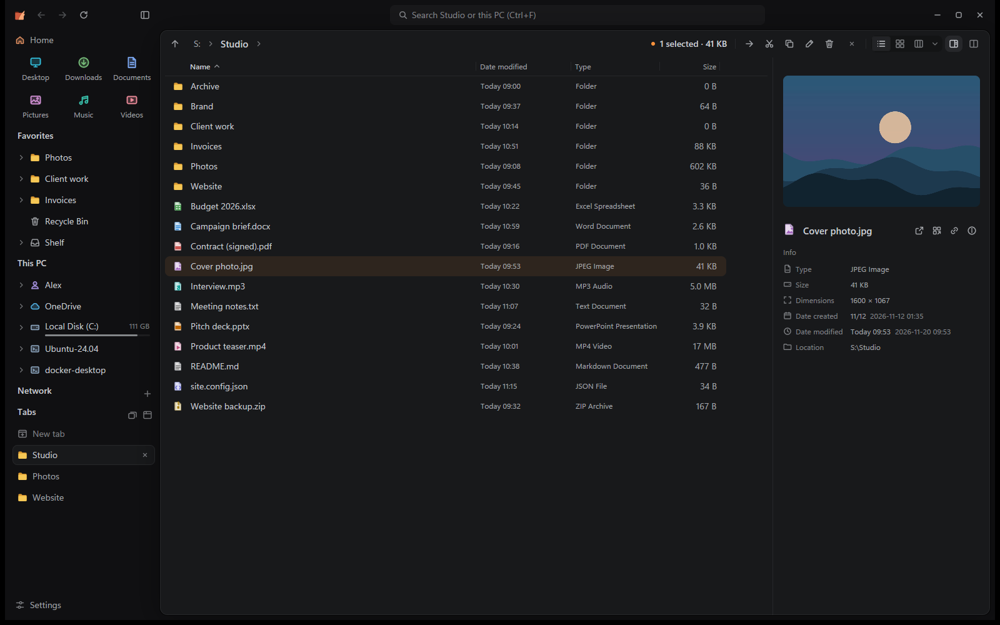
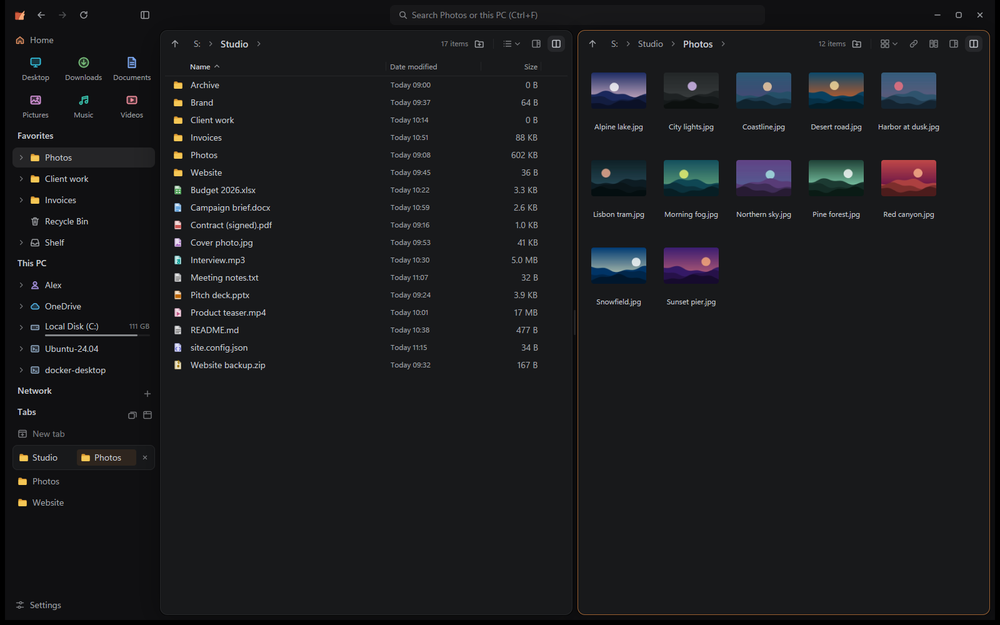
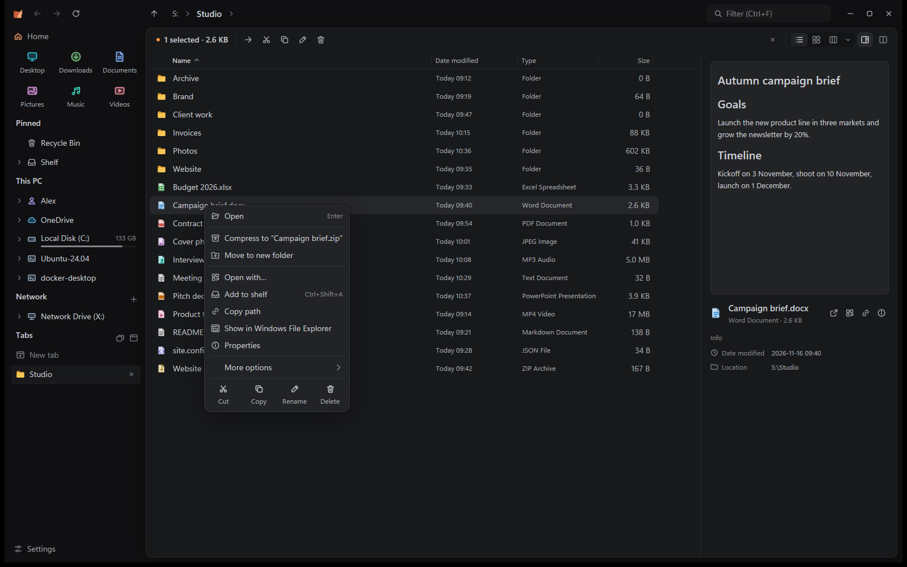
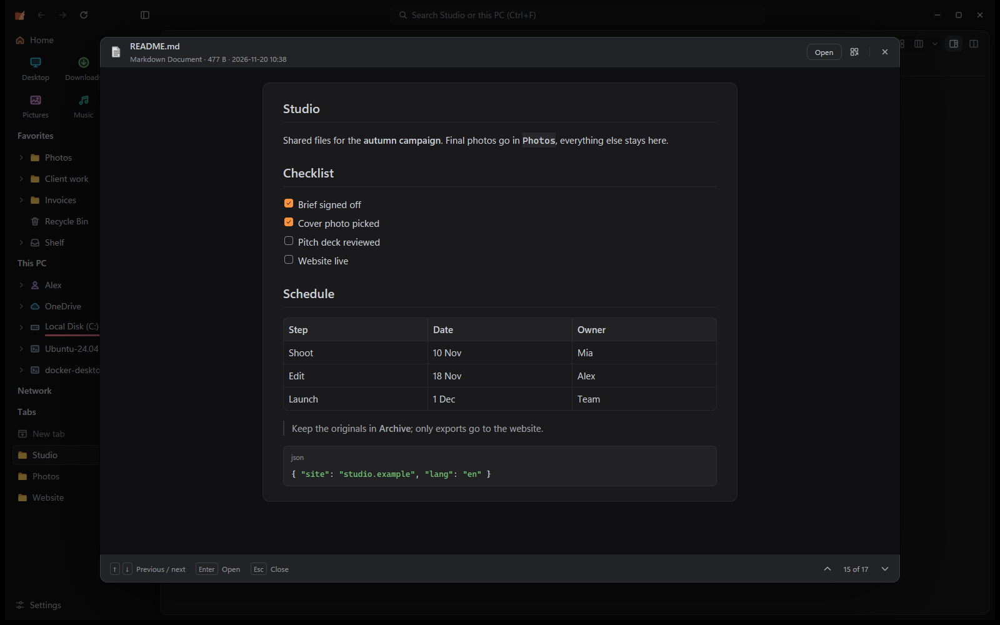
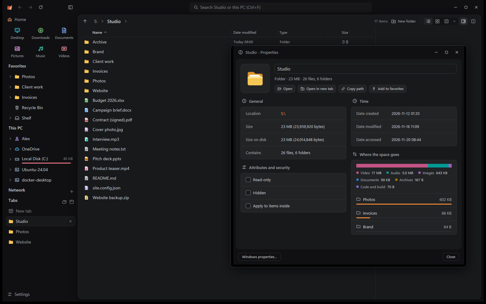
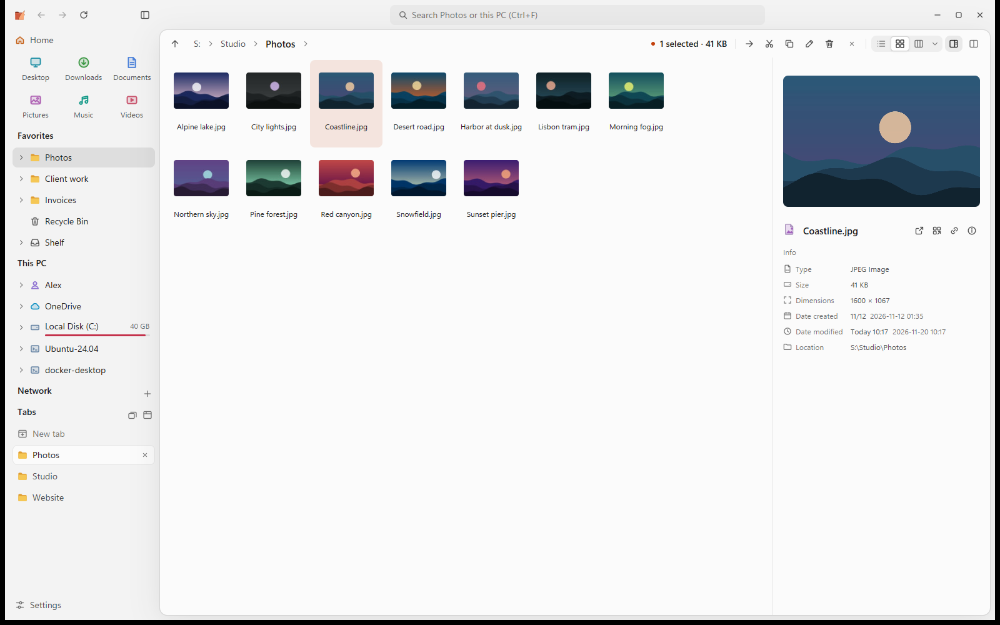
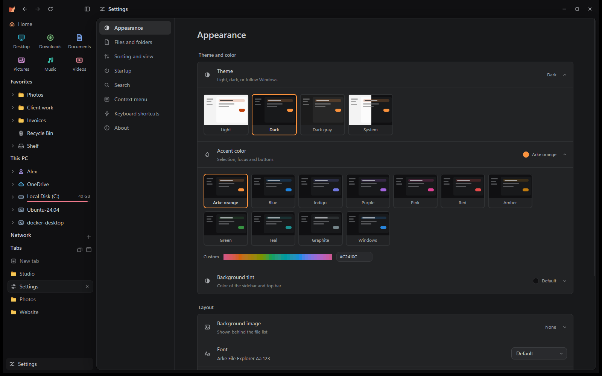
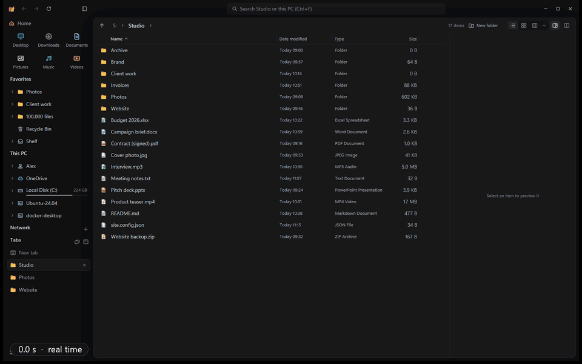
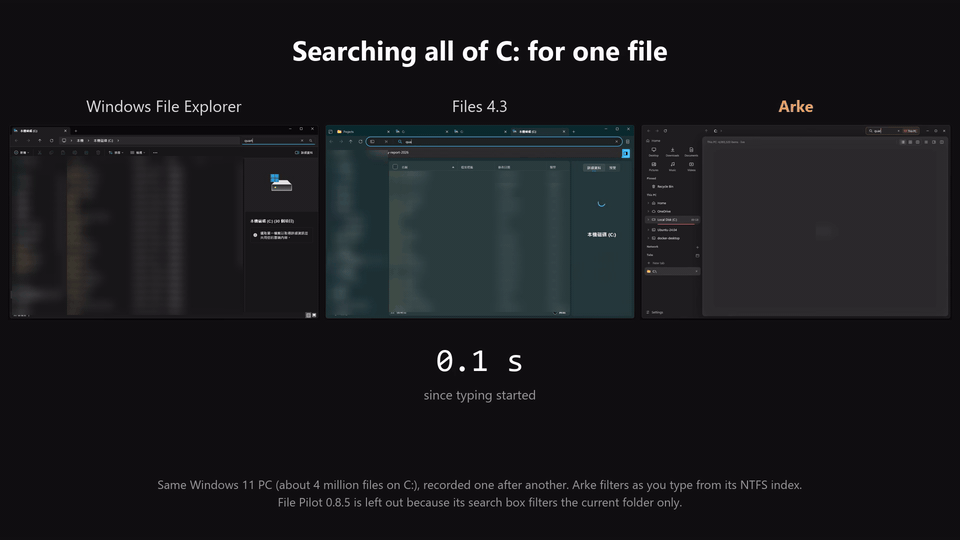
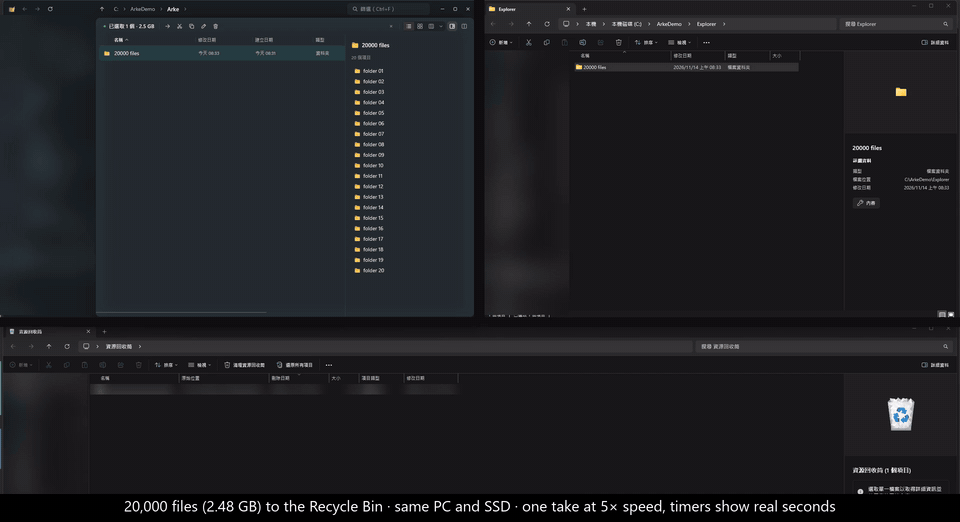

<p align="center"></p>

<h1 align="center">Arke</h1>

<p align="center"><b>Ein Dateimanager für Windows, der nie hängt.</b><br>
GPU-gerendert, in Rust geschrieben, eine kleine exe.</p>

<p align="center">
  <a href="https://github.com/Koimsurai/Arke/releases"></a>
  <a href="https://github.com/Koimsurai/Arke/actions/workflows/ci.yml"></a>
  
  <a href="LICENSE"></a>
</p>

<p align="center"><a href="README.md">English</a> · <a href="README.zh-CN.md">简体中文</a> · <a href="README.zh-TW.md">繁體中文</a> · <a href="README.ja.md">日本語</a> · <b>Deutsch</b> · <a href="README.es.md">Español</a> · <a href="README.pt-BR.md">Português (Brasil)</a></p>

<p align="center"></p>

## Warum Arke

**Es bleibt reaktionsfähig.** Auflisten, Sortieren, Miniaturansichten, Ordnergrößen, Suche und
Dateivorgänge laufen alle außerhalb des UI-Threads. Eine nicht erreichbare Netzwerkfreigabe oder ein
Ordner mit 100.000 Dateien hindert Sie nicht daran, zu scrollen, zu tippen oder zwischen
Registerkarten zu wechseln.

**Es findet alles, sofort.** Arke führt einen Dateinamen-Index Ihrer lokalen Laufwerke. Mit dem
optionalen Hintergrunddienst liest es die NTFS-Masterdateitabelle direkt, indiziert Millionen von
Dateien in Sekunden und folgt dem Änderungsjournal, sodass der Index beim Öffnen schon aktuell ist.

**Dateivorgänge lassen Sie nicht warten.** Ein Ordner mit 20.000 Dateien landet in 0,2 s im
Papierkorb statt in 47 s im Datei-Explorer und lässt sich wie gewohnt wiederherstellen. Kopier- und
Verschiebevorgänge zeigen ihren Fortschritt, reihen sich auf demselben Laufwerk in eine Warteschlange
ein, lassen sich anhalten und rückgängig machen.

**Es ist für die Arbeit in vielen Ordnern gleichzeitig gebaut.** Registerkarten liegen in einer
vertikalen Seitenleiste, lassen sich anheften und als benannte Arbeitsbereiche speichern. Jede
Registerkarte lässt sich in zwei Bereiche teilen, die synchron navigieren oder ihren Inhalt
vergleichen, und eine Datei, die Sie auf eine Registerkarte, einen Favoriten oder ein Pfadsegment
ziehen, wird direkt dort abgelegt.

**Es geht sorgsam mit Ihrem System um.** Arke hat keine Telemetrie. Abgesehen vom optionalen
Suchdienst, den Windows bei der Installation registriert, schreibt Arke nur dann in die Registrierung,
wenn Sie „Ordner in Arke öffnen“ einschalten: Dann registriert es sich als Ordner-Handler für Ihr
Windows-Konto (ausschließlich unter `HKEY_CURRENT_USER\Software\Classes`), und beim Ausschalten wird
alles zurückgesetzt. Shell-Erweiterungen anderer Programme laufen in einem separaten Prozess, sodass
eine fehlerhafte Erweiterung Arke nicht zum Absturz bringen kann.

Wenn Arke Ihnen nützt, hilft ein ⭐ auf GitHub anderen, es zu finden.

Arke wurde in [Ruan Yifengs Tech-Wochenrückblick #420](https://www.ruanyifeng.com/blog/2026/11/weekly-issue-420.html) vorgestellt und ist in [awesome-rust](https://github.com/rust-unofficial/awesome-rust), [awesome-gpui](https://github.com/zed-industries/awesome-gpui) und bei AlternativeTo gelistet.

<p><a href="https://alternativeto.net/software/arke/about/?utm_source=badge&utm_medium=referral"></a></p>

## Funktionen

<table>
  <tr>
    <td width="50%"></td>
    <td width="50%"></td>
  </tr>
  <tr>
    <td>Teilen Sie jede Registerkarte in zwei Bereiche, die synchron navigieren oder ihren Inhalt vergleichen.</td>
    <td>Ein schnelles eigenes Kontextmenü, das vollständige Windows-Menü ist einen Klick entfernt.</td>
  </tr>
  <tr>
    <td width="50%"></td>
    <td width="50%"></td>
  </tr>
  <tr>
    <td>Die Schnellansicht (Leertaste) zeigt Markdown so wie GitHub sowie Bilder, PDF, Office-Dateien und Code.</td>
    <td>Ein eigenes Eigenschaften-Fenster (Alt+Eingabe), das zeigt, wohin der Speicherplatz eines Ordners geht.</td>
  </tr>
  <tr>
    <td width="50%"></td>
    <td width="50%"></td>
  </tr>
  <tr>
    <td>Detail-, Symbol- und Spaltenansicht, mit einem Vorschaubereich für die meisten Dateitypen.</td>
    <td>Helles, dunkles und dunkelgraues Design, Akzentfarben sowie eine Hintergrundtönung oder ein Hintergrundbild.</td>
  </tr>
</table>

**Navigieren**
- Detail-, Symbol- (jede Größe bis 256 px, Strg+Mausrad) und Spaltenansicht. In der Detailansicht
  lassen sich Ordner direkt in der Liste aufklappen, Sie können nach mehreren Spalten sortieren,
  Spalten umordnen und Verknüpfungsziele anzeigen.
- Jeder Ordner merkt sich seine Ansicht und Sortierung.
- Registerkarten, die Sie anheften oder als Arbeitsbereiche speichern können. Teilen Sie eine
  Registerkarte mit einer gemeinsamen Vorschau in zwei Bereiche, mit synchronem Navigieren und
  Ordnervergleich. Mit Mittelklick oder Strg+Klick auf einen Ordner in der Seitenleiste, auf Start
  oder in der Adressleiste öffnen Sie ihn in einer neuen Registerkarte (Strg+Doppelklick in der
  Dateiliste).
- Das Suchfeld sitzt in der Mitte der Titelleiste und durchsucht den aktiven Bereich. Jeder Bereich
  hat eine eigene Zeile mit „Nach oben“, seinem Pfad und seinen Ansichtsschaltflächen, sodass in der
  geteilten Ansicht jede Seite ihren eigenen Filter behält.
- Ziehen Sie eine Registerkarte heraus, um ihr ein eigenes Fenster zu geben, oder legen Sie Dateien
  auf einer Registerkarte ab, um sie in deren Ordner zu kopieren oder zu verschieben.
- Favoriten oben in der Seitenleiste und auf Start, als Kacheln und als Liste: Fügen Sie einen
  Ordner oder eine Registerkarte über deren Menü hinzu oder ziehen Sie sie dorthin. Ziehen Sie sie,
  um sie neu anzuordnen (die anderen machen Platz, wie App-Symbole auf einem Smartphone), oder
  heraus, um sie zu entfernen, und benennen Sie sie um, ohne den Ordner umzubenennen. Ordner, die im
  Datei-Explorer an den Schnellzugriff angeheftet sind, erscheinen ebenfalls.
- Standardmäßig ein einziges Fenster (seit 0.7): Ordner aus anderen Apps, Win+E und ein erneuter
  Start von Arke fügen dem zuletzt verwendeten Fenster eine Registerkarte hinzu. Schalten Sie
  „Einzelnes Fenster“ in den Einstellungen aus, um jeweils ein eigenes Fenster zu erhalten.
- Mit „Neue Fenster öffnen: Zuletzt geöffnete Registerkarten“ kommen die Fenster, die beim Beenden
  von Arke (oder beim Herunterfahren von Windows) offen sind, mit ihren Registerkarten zurück. Ein
  Fenster, das Sie schließen, während andere geöffnet bleiben, wird nicht gespeichert.
- Ordner, die sich beim Darüberziehen öffnen, eine Ablage zum Sammeln von Dateien aus
  verschiedenen Ordnern und eine Startseite mit Ihren Favoriten, zuletzt verwendeten Dateien,
  Laufwerken und Netzwerkorten, jeweils mit eigenem Rechtsklickmenü (Laufwerke bieten Auswerfen,
  Formatieren, Datenträgerbereinigung und Eigenschaften).
- Wischen Sie mit zwei Fingern auf dem Touchpad, um wie in einem Browser vor und zurück zu gehen.
- Die Seitenleiste lässt sich durch Ziehen am Rand verbreitern und auf eine Spalte mit Symbolen
  einklappen (Strg+B); auf Wunsch öffnet sie sich über dem Inhalt, wenn Sie den Zeiger darauf
  ruhen lassen (standardmäßig aus). Favoriten, Dieser PC und Netzwerk lassen sich mit einem Klick
  auf ihre Überschrift einzeln einklappen, und der Ordnerbaum folgt dem
  Ordner, in dem Sie sich befinden. Die Spalten der Spaltenansicht lassen sich in der Größe ändern.
- Oberflächenskalierung von 80 % bis 150 %, zusätzlich zur Skalierung von Windows.
- Befehlspalette (Strg+Umschalt+P) für jeden Befehl und Tastenkombinationen, die Sie ändern können.

**Vorschau**
- Ein in der Größe veränderbarer Vorschaubereich und die Schnellansicht (Leertaste) für Bilder (auch
  SVG), PDF, Word, Excel und PowerPoint, Text und Code mit Syntaxhervorhebung, Markdown, Archive,
  `.gz`-Dateien und Ordner.
- Videos zeigen ein Bild und PDFs ihre erste Seite als Miniaturansicht. Die Schnellansicht zoomt
  Text, Dokumente und PDF-Seiten (Strg+Mausrad), und wenn QuickLook installiert ist, kann die
  Leertaste stattdessen dieses öffnen.

**Suche**
- Schon während der Eingabe, in diesem Ordner, seinen Unterordnern oder auf dem ganzen Computer, mit
  unscharfem Abgleich und Filtern für Typ, Größe und Datum ([Suchsyntax](#suchsyntax)).
- Suche in Dateien, auch in PDF- und Office-Dokumenten, in einem Ordner und seinen Unterordnern.
- Dateien und Ordner, die Sie oft öffnen, stehen bei Ergebnissen auf dem ganzen Computer vorn.

**Dateien**
- Kopieren und Verschieben über die Windows-Shell-Engine mit Fortschritt, Rückgängig und
  Wiederholen. Aufträge auf demselben Laufwerk reihen sich in eine Warteschlange ein und lassen sich
  anhalten, optional mit Überprüfung nach dem Kopieren oder Übergabe an TeraCopy (experimentell).
- Stapelweises Umbenennen, „In neuen Ordner verschieben“ und ein Menü zum Verschieben/Kopieren/
  Erstellen einer Verknüpfung, wenn Sie mit der rechten Maustaste ziehen oder bei gedrückter Alt-Taste
  ablegen.
- Ein eigenes Eigenschaften-Fenster (Alt+Eingabe): Größen, wohin der Speicherplatz eines Ordners
  geht, Attribute, die App, mit der eine Datei geöffnet wird, SHA-256 und das Aufheben der Blockierung
  heruntergeladener Dateien. Das Fenster von Windows ist einen Klick entfernt. Ein ganzes Laufwerk
  wird in Sekunden gezählt, aus dem Suchindex oder, mit dem Suchdienst, wie bei WizTree aus der
  Dateitabelle des Laufwerks.

**Orte**
- Netzwerkfreigaben, die schnell fehlschlagen, wenn ein Server offline ist, und den zuletzt bekannten
  Inhalt zeigen; `\\server` listet seine Freigaben auf. SFTP- und WebDAV-Orte (experimentell; reines
  http erst, nachdem Sie es für den jeweiligen Ort erlaubt haben). Zugeordnete Laufwerke und
  Netzwerkorte können eigene Namen erhalten, die nur in Arke gespeichert werden.
- OneDrive und andere Cloud-Ordner mit Synchronisierungsstatus. Vorschauen laden nie Dateien herunter,
  die nur online verfügbar sind.
- Archive: zip und 7z (auch kennwortgeschützte), tar (.gz, .xz, .bz2, .zst) und RAR in der Vorschau anzeigen und extrahieren, als
  zip komprimieren. RAR und die tar-Varianten xz / bzip2 / zstd nutzen die in Windows enthaltene
  libarchive (am besten ab Windows 11 23H2).

**Windows**
- Große Ordner landen auf lokalen Laufwerken sofort im Papierkorb: 20.000 Dateien in etwa einer
  Viertelsekunde statt in 40 s, da Windows nicht zuerst jede Datei prüft. Das Wiederherstellen
  funktioniert wie gewohnt, und alles, wofür Arke nicht einstehen kann (Netzlaufwerke, OneDrive,
  Dateien in Verwendung, Richtlinien), überlässt es Windows. In den Einstellungen lässt sich das
  ausschalten. Einzelne Dateien brauchen wenige Millisekunden, immer noch zwei- bis sechsmal schneller
  als Windows.
- Updates werden leise im Hintergrund heruntergeladen und beim nächsten Neustart von Arke installiert,
  nie während Dateien kopiert werden und nie über eine getaktete Verbindung.
- Menüs öffnen sich wie die Menüs von Windows in eigenen Fenstern und ragen daher am Rand über das
  Arke-Fenster hinaus, statt gequetscht zu werden. Windows-Befehle, die Sie über „Weitere Optionen“
  anheften (Git Bash, Windows Terminal, VS Code, 7-Zip, NanaZip ...), erscheinen sofort, wenn sich das
  Menü öffnet, und Umschalt+Rechtsklick fügt wie im Datei-Explorer die erweiterten hinzu.
- Launcher und Skripte (Listary, ALTRun, AutoHotkey, PowerShell) können die Fenster, Registerkarten
  und Auswahl von Arke lesen und über eine einzige JSON-Schnittstelle Ordner öffnen
  ([docs/integration.md](docs/integration.md)).
- Ruhig im Leerlauf: Ändert sich auf dem Bildschirm nichts, wird nichts neu gezeichnet, auch im
  minimierten Zustand. Ordnergrößen, Indizierung und der Suchdienst laufen mit niedriger Priorität im
  Effizienzmodus von Windows, und wenn nur noch das Symbol im Infobereich übrig ist, gibt Arke seine
  Caches frei.
- Optional (experimentell) Ordner in Arke statt im Datei-Explorer öffnen (auch Ordner, die aus
  anderen Apps geöffnet werden), ebenso „Im Ordner anzeigen“ aus Browsern und „Dateispeicherort
  öffnen“ aus anderen Apps. Dabei wird Arke als Ordner-Handler für Ihr Konto registriert, und beim
  Ausschalten wird das rückgängig gemacht. Ein Datei-Explorer, den Sie selbst starten (Win+E, die
  Taskleiste, Start), bleibt der Datei-Explorer, solange Sie nicht auch „Win+E und das
  Datei-Explorer-Symbol öffnen ebenfalls Arke“ einschalten.
- Unterstützung für Sprachausgaben, Builds für x64 und ARM64 (beide auf echter Hardware getestet),
  Sprungliste der Taskleiste, sicheres Auswerfen von USB-Geräten, Infobereich, Sicherung der
  Einstellungen. Englisch, Vereinfachtes und Traditionelles Chinesisch, Japanisch, Deutsch, Spanisch
  und brasilianisches Portugiesisch (die letzten vier sind neu in 0.8; Korrekturen am Wortlaut sind
  in Issues willkommen).

*Experimentelle* Funktionen werden von automatisierten Tests und lokalen Testservern abgedeckt, sind
aber noch nicht weit verbreitet im Einsatz; siehe das [Änderungsprotokoll](CHANGELOG.md).
Rückmeldungen in Issues sind willkommen.

## Leistung

<p align="center"></p>

<p align="center"></p>

<p align="center"></p>

| | Arke | Zum Vergleich |
| --- | --- | --- |
| Den Index des gesamten Datenträgers von Grund auf aufbauen (etwa 4 Millionen Dateien) | etwa 10 s, danach etwa 130 MB Arbeitsspeicher | Everything 1.4.1: 21 s, etwa 400 MB |
| Eine Datei irgendwo auf C: finden | Ergebnisse erscheinen während der Eingabe | Files 4.3: etwa 26 s · Datei-Explorer: kein Ergebnis nach 30 s* |
| Einen Ordner mit 100.000 Dateien öffnen | etwa 0,7 s, 128 MB | File Pilot 0.8.5: 1,0–1,4 s, 563 MB · Datei-Explorer: 2–3 s |
| 20.000 Dateien (2,48 GB) in den Papierkorb verschieben | 0,2 s | Datei-Explorer: 47,3 s |

\* Die Datei lag außerhalb der Ordner, die die Windows-Suche indiziert. Innerhalb davon findet der
Datei-Explorer Dateien deutlich schneller.

<details>
<summary>So wurde gemessen</summary>

Ein PC: Intel i9-13900, 64 GB RAM, Samsung 990 PRO NVMe, Windows 11 (Build 26200), mit
eingeschaltetem Echtzeit-Virenscan, der jedes Programm ausbremst. Die Dateisystem-Caches waren warm.

- **Index**: Der Suchdienst von Arke liest die NTFS-Masterdateitabelle, in einem frischen Profil;
  Everything 1.4.1 Lite mit seinem Dienst, mit indizierter Dateigröße und Änderungsdatum (den
  Standardwerten), nachdem seine Datenbank gelöscht wurde. Die Zahlen von Arke stammen aus
  `arke --bench index`, die von Everything aus seinem Debug-Protokoll; der Arbeitsspeicher ist der
  Arbeitssatz nach Abschluss der Indizierung.
- **Suche**: Jedes Programm wurde in `C:\` gestartet und suchte nach demselben Dateinamen; der Timer
  startet mit dem Tippen. Der Datei-Explorer und Files verlassen sich bei indizierten Ordnern auf die
  Windows-Suche und durchsuchen sonst den Datenträger.
- **Ordner**: Ein Ordner mit 100.000 generierten Dateien (`cargo run -p genfiles -- 100000`), geöffnet
  nach einem Kaltstart jedes Programms; Median von drei Durchläufen nach einem Aufwärmlauf, gemessen
  bis sich das Fenster nicht mehr veränderte. File Pilot (kostenlose Beta) kommt nur in diesem Test
  vor: Es hat noch keine Suche über den gesamten Datenträger.
- **Papierkorb**: Derselbe Ordner (20.000 Dateien in 20 Ordnern, 2,48 GB) wurde aus jedem Programm in
  einem Zug in den Papierkorb verschoben, gemessen von Entf bis zum Verschwinden des Ordners aus der
  Liste. Arke nutzt seinen schnellen Papierkorb (für lokale Laufwerke standardmäßig an); beide lassen
  sich wie gewohnt aus dem Windows-Papierkorb wiederherstellen.

Ihre Werte werden abweichen. Arke protokolliert seine eigenen Zeiten in `%LOCALAPPDATA%\Arke\arke.log`.

Führen Sie `arke --bench index` aus, um den Index auf Ihrem Rechner zu messen.

</details>

## Installation

Laden Sie Arke von den [Releases](https://github.com/Koimsurai/Arke/releases) herunter. Beide
Downloads sind dasselbe Arke, mit denselben Funktionen und Updates, und beide speichern ihre
Einstellungen in `%APPDATA%\Arke`:

- **Portable**, `arke-<version>.exe`: eine einzelne exe ohne Laufzeitumgebung, die aus jedem Ordner
  läuft. Es wird nichts installiert, daher erscheint es weder im Startmenü noch unter
  Einstellungen › Apps; Einstellungen › Info › **Arke von diesem PC entfernen** entfernt es.
- **Installer**, `arke-<version>-setup.exe`: installiert Arke für Ihr Konto ohne
  Administratorgenehmigung oder für alle Benutzer unter Programme, und fügt es dem Startmenü und
  Einstellungen › Apps hinzu, wo Sie es deinstallieren können.

Auf ARM64-PCs verwenden Sie die Dateien mit `-arm64` (`arke-<version>-arm64.exe`,
`arke-<version>-arm64-setup.exe`).

Mit [Scoop](https://scoop.sh):

```bash
scoop bucket add arke https://github.com/Koimsurai/scoop-bucket
scoop install arke/arke
```

Scoop hält es danach aktuell (`scoop update arke`), und Arke überlässt ihm das Aktualisieren.

Die Builds sind noch nicht codesigniert, daher fragt SmartScreen beim ersten Mal möglicherweise nach
einer Bestätigung.

Arke prüft höchstens einmal am Tag auf GitHub auf eine neue Version und installiert eine nur, wenn
Sie es sagen (Einstellungen › Info).

<details>
<summary><b>Optionaler Hintergrunddienst</b></summary>

Einstellungen › Suche › Live-Updates installiert einen kleinen Windows-Dienst, mit
Administratorgenehmigung. Er liest nur das Änderungsjournal und die Masterdateitabelle des
Dateisystems, nie Dateiinhalte, und meldet nie Namen in den Profilordnern anderer Benutzer. Sie
können ihn an derselben Stelle wieder entfernen.

</details>

## Suchsyntax

Geben Sie im Suchfeld etwas ein (Strg+F). Das Feld darunter legt den Bereich (dieser Ordner,
Unterordner oder der ganze Computer) und die Filter fest; mit Tab gelangen Sie dorthin. Wörter werden
unscharf abgeglichen, sodass `rprt` den Treffer `report` findet. Filter lassen sich auch eintippen und
kombinieren:

| Filter | Beispiel | Bedeutung |
| --- | --- | --- |
| `type:` | `type:image;video`, `type:folder` | Dateityp: folder, document, image, audio, video, archive, code, app |
| `ext:` oder `*.` | `ext:pdf;docx`, `*.png` | Dateierweiterung |
| `size:` | `size:>10mb`, `size:1mb..10mb`, `size:large` | Dateigröße (`empty`, `tiny`, `small`, `medium`, `large`, `huge`, `gigantic` wie bei Everything) |
| `dm:` | `dm:today`, `dm:7d`, `dm:2026-11`, `dm:>2026-01-01` | Änderungsdatum: ein Schlüsselwort, die letzten N Stunden/Tage/Wochen oder ein Datumsbereich |
| `file:` / `folder:` | `folder: photos` | Nur Dateien oder nur Ordner |
| `folder\name` | `docs\report` | Name in einem Ordner, dessen Name zu `docs` passt |
| `content:` | `content:"due date"` | Text in Dateien, auch in PDF- und Office-Dokumenten (dieser Ordner und Unterordner) |

Bei Filtern ohne Namen (`ext:pdf dm:7d`) werden die Ergebnisse nach Datum absteigend aufgelistet.
Datumsschlüsselwörter funktionieren auch in der Sprache der Oberfläche (今天, 本周, 本週 ...). Auf dem
ganzen Computer stehen oft geöffnete Elemente weiter oben; unter Einstellungen › Suche können Sie das
ausschalten oder zurücksetzen.

## Tastatur

<details>
<summary>Tastenkombinationen</summary>

| Tasten | Aktion |
| --- | --- |
| Strg+T | Zu einem Ordner gehen (zuletzt besuchte Orte, geöffnete Registerkarten und Pfade) |
| Strg+Umschalt+P | Befehlspalette: einen beliebigen Befehl suchen und ausführen; jede Tastenkombination lässt sich unter Einstellungen › Tastenkombinationen ändern |
| Strg+W · Strg+Umschalt+T | Registerkarte schließen (in der geteilten Ansicht die aktive Seite) · geschlossene Registerkarte wieder öffnen |
| Strg+Tab · Strg+Umschalt+Tab · Strg+1…9 | Registerkarten wechseln |
| Strg+Umschalt+S · Strg+Umschalt+D | Zwei Bereiche: synchrones Navigieren · Ordner vergleichen |
| Tab · Alt+C · Alt+M | Geteilte Ansicht: Bereiche wechseln · Auswahl in den anderen Bereich kopieren · verschieben |
| Strg+F · Strg+Umschalt+F · Strg+K | Diesen Ordner durchsuchen · diesen Ordner und Unterordner · den ganzen Computer; mit Tab gelangen Sie zu Bereich und Filtern |
| Strg+L · Alt+D | Pfad bearbeiten |
| Alt+← · Alt+→ · Alt+↑ | Zurück · vor · nach oben |
| F5 · Strg+R | Aktualisieren |
| Leertaste | Schnellansicht |
| F2 | Umbenennen (bei mehreren ausgewählten Elementen: alle umbenennen) |
| Umschalt+F10 | Kontextmenü |
| Strg+Umschalt+N | Neuer Ordner |
| Strg+C · Strg+X · Strg+V | Kopieren · ausschneiden · einfügen, gemeinsam mit dem Datei-Explorer |
| Strg+Umschalt+C | Pfad kopieren |
| Strg+Z · Strg+Y oder Strg+Umschalt+Z | Den letzten Dateivorgang rückgängig machen · wiederholen |
| Strg+Umschalt+A | Zur Ablage hinzufügen |
| Entf · Umschalt+Entf | In den Papierkorb · endgültig löschen |
| Strg+H | Ausgeblendete Elemente anzeigen |
| Strg+Umschalt+1…4 · Strg+Umschalt+6 | Symbole, von extragroß bis klein · Detailansicht |
| Strg+, | Einstellungen |

</details>

## Barrierefreiheit

Arke arbeitet über UI Automation mit Windows-Screenreadern zusammen, der Schnittstelle von Narrator
und NVDA; JAWS sollte ebenfalls funktionieren. Bisher wurde es mit UI-Automation-Werkzeugen geprüft,
noch nicht von Menschen, die täglich einen Screenreader nutzen. Hilfe beim Testen ist willkommen.

Das funktioniert: Dateiliste, Seitenleiste, Tabs, Pfadleiste, Suche, Einstellungen, Menüs und das
Eigenschaften-Fenster. Noch unvollständig: Die Schaltflächen der Symbolleiste sind noch nicht mit der
Tab-Taste erreichbar (nutzen Sie stattdessen F6 und die Tastenkombinationen), und einige Dialoge
wurden noch nicht geprüft.

Die [Tastaturanleitung](docs/keyboard.md) (auf Englisch) listet alle Tastenkombinationen nach Bereich.
Wenn etwas nicht erreichbar ist oder nicht vorgelesen wird, [eröffnen Sie bitte ein
Issue](https://github.com/Koimsurai/Arke/issues) und nennen Sie Ihren Screenreader samt Version.

## FAQ

<details>
<summary><b>Betrifft mich die AGPL, wenn ich es nur verwende, privat oder bei der Arbeit?</b></summary>

Nein. Die Lizenz begründet nur dann Pflichten, wenn Sie ein verändertes Arke weitergeben (oder über
ein Netzwerk anbieten); die Nutzung, auch in einem Unternehmen, bringt keine mit sich.

</details>

<details>
<summary><b>Was ändert es an meinem System?</b></summary>

Nichts, solange Sie es nicht verlangen. Die Installation des optionalen Suchdienstes (mit Ihrer
Genehmigung) registriert ihn bei Windows, das Dienste unter
`HKEY_LOCAL_MACHINE\SYSTEM\CurrentControlSet\Services\ArkeIndex` ablegt. Darüber hinaus ist die einzige
Änderung an der Registrierung die optionale Einstellung „Ordner in Arke öffnen“, die Arke als
Ordner-Handler für Ihr Windows-Konto registriert, ausschließlich unter
`HKEY_CURRENT_USER\Software\Classes`: die Verben `open` und `explore` von `Folder` (sodass jeder
Ordner, den die Shell öffnet, auch „Im Ordner anzeigen“ von Browsern und Editoren, Arke statt den
Datei-Explorer startet; was Arke nicht anzeigen kann, etwa die Systemsteuerung, wird direkt an den
Explorer weitergereicht) und, nur mit „Win+E und das Datei-Explorer-Symbol öffnen ebenfalls Arke“,
der Handler für Win+E. Was zuvor dort stand, wird in `%APPDATA%\Arke\folder-handler-backup.json`
gesichert und genau so wiederhergestellt, wenn Sie die Einstellung ausschalten oder
`arke --restore-explorer` ausführen. Arke beobachtet außerdem neue Explorer-Fenster für die Fälle,
die die Registrierung nicht erreicht, etwa `explorer.exe /select,...`. Auf PCs, auf denen Windows
Win+E direkt an den Datei-Explorer schickt, ohne die Registrierung zu befragen (eine Änderung, die
Windows seit Ende 2026 ausrollt), übernimmt Arke Win+E mit einem Tastatur-Hook, solange es im
Hintergrund läuft: Er reagiert nur auf E, während eine Windows-Taste gehalten wird, und zeichnet
nichts auf. Einstellungen liegen in `%APPDATA%\Arke`, der Suchindex, das Protokoll und heruntergeladene
Updates in `%LOCALAPPDATA%\Arke`. „Beim Anmelden an Windows starten“ ist eine Verknüpfung in Ihrem
Autostart-Ordner und „Arke im Startmenü anzeigen“ eine in Ihrem Startmenüordner. Kennwörter für
SFTP- und WebDAV-Orte gehen an die Windows-Anmeldeinformationsverwaltung, und nur, wenn Sie
„Merken“ ankreuzen. Der optionale Suchdienst ist der einzige Teil, der eine Administratorgenehmigung
braucht. Der Installer fügt, falls Sie ihn verwenden, den Deinstallationseintrag hinzu, den Windows
unter Einstellungen › Apps auflistet (für Ihr Konto oder für alle Benutzer, wenn Sie dort
installieren), und fragt nur bei einer Installation für alle Benutzer nach einer Genehmigung.

</details>

<details>
<summary><b>Wie entferne ich es vollständig?</b></summary>

Einstellungen › Info › **Arke von diesem PC entfernen**. Das entfernt den Suchdienst, falls Sie ihn
installiert haben (Windows verlangt dafür eine Administratorgenehmigung), die Verknüpfungen im
Startmenü und für „Beim Anmelden an Windows starten“, gespeicherte SFTP- und WebDAV-Kennwörter, die
Sprungliste, `%LOCALAPPDATA%\Arke`, `%APPDATA%\Arke` (außer Sie kreuzen „Meine Einstellungen
behalten“ an) und schließlich die exe selbst, und zeigt dann, was es entfernt hat.

Über ein Terminal oder ein Skript: `arke --uninstall`, mit `--keep-settings`, `--quiet` (keine
Dialoge, nur die Administratorabfrage für den Dienst) oder `--dry-run` (listet nur auf, was es
entfernen würde). Mit Scoop oder winget installiert (sobald Arke auf winget verfügbar ist)?
`arke --uninstall` überlässt die exe dem Paketmanager; entfernen Sie sie mit `scoop uninstall arke`
oder `winget uninstall Koimsurai.Arke`.

Es schaltet auch „Ordner in Arke öffnen“ aus und stellt den vorherigen Ordner-Handler wieder her.
Entfernen Sie Arke stattdessen von Hand? Schalten Sie diese Einstellung aus (oder führen Sie
`arke --restore-explorer` aus), **bevor** Sie die exe löschen, damit Ordner weiterhin im
Datei-Explorer geöffnet werden.

</details>

<details>
<summary><b>Warum warnen SmartScreen oder mein Virenscanner davor?</b></summary>

Die Builds sind noch nicht codesigniert, und eine neue unsignierte exe hat bei SmartScreen keinen
Ruf. Jede Version bringt in ihren Hinweisen eine SHA-256-Prüfsumme und einen VirusTotal-Scan der exe-
Dateien mit, und Sie können es jederzeit selbst aus dem Quellcode bauen. Für Versionen nach 0.1.0
bestätigt `gh attestation verify arke-<version>.exe -R Koimsurai/Arke`, dass eine exe vom
Release-Workflow dieses Repositorys gebaut wurde.

Manche Virenscanner blockieren jede neue Version, bis Sie sie erlauben. Wenn einer die neue Version
stoppt, während Arke nach einem Update neu startet, stellt Arke die zuvor genutzte Version wieder her
und sagt es Ihnen; erlauben Sie `arke.exe` in Ihrem Virenscanner und aktualisieren Sie erneut.

</details>

<details>
<summary><b>Wird es eine Linux- oder macOS-Version geben?</b></summary>

Noch nicht. `crates/core` ist größtenteils plattformunabhängig, aber die Teile, die Arke unter
Windows schnell machen (der MFT-Index, die Shell-Integration), sind Windows-spezifisch. Sagen Sie uns
in einem Issue, was Sie bräuchten.

</details>

## Ein Problem melden

Am einfachsten geht es aus Arke heraus: **Einstellungen › Info › Problem melden › Issue auf GitHub
öffnen**. Es trägt Ihre Arke- und Windows-Version, die wichtigsten Einstellungen und die letzten
Protokollzeilen ein, wobei Ihr Konto sowie Computer-, Server- und Dateinamen entfernt werden. Sie
können den Bericht auch kopieren oder als Datei speichern und auf anderem Weg senden, und
**Protokolldatei anzeigen** öffnet das Protokoll selbst.

Wenn Arke nicht startet, finden Sie das Protokoll unter `%LOCALAPPDATA%\Arke\arke.log`.

## Aus dem Quellcode bauen

Sie brauchen Windows 10 oder 11, die MSVC-Buildtools und rustup; die Version der Toolchain ist in
`rust-toolchain.toml` festgelegt und wird automatisch installiert.

```bash
cargo arke                     # run
cargo arke -- "C:\Windows"     # open a folder
cargo nextest run --workspace  # tests
cargo lint                     # clippy, as strict as CI
```

| Pfad | |
| --- | --- |
| `crates/core` | Plattformunabhängiges Modell: Auflisten, Sortieren, Filtern, Suche, Index |
| `crates/app` | Die GPUI-App und die Windows-Integration |
| `crates/indexd` | Der optionale Hintergrunddienst (MFT und USN-Journal) |
| `tools/xtask` | Release-Werkzeuge: Changesets, Versionierung, Paketierung, Veröffentlichung |

Arke nimmt vorerst keine Pull Requests an, aber Fehlerberichte und Ideen sind als
[Issues](https://github.com/Koimsurai/Arke/issues) sehr willkommen. Konventionen und den
Release-Prozess finden Sie in [CONTRIBUTING.md](CONTRIBUTING.md).

## Danksagung

Arke baut auf [GPUI](https://github.com/zed-industries/zed/tree/main/crates/gpui) auf, dem
UI-Framework des Zed-Editors, und auf den Open-Source-Crates, die in
[THIRD_PARTY_LICENSES.md](THIRD_PARTY_LICENSES.md) aufgeführt sind. Die Suchsyntax folgt
[Everything](https://www.voidtools.com/), das Aussehen verdankt der App
[Files](https://files.community/) sehr viel, und die Registerkarten-Seitenleiste ist eine Verbeugung
vor dem Arc-Browser.

Der Name stammt aus der griechischen Mythologie: Arke ist die Zwillingsschwester der Iris, beide sind
geflügelte Götterboten.

## Datenschutz

Arke erhebt oder sendet keine Daten über Sie oder Ihre Dateien. Es geht nur online, um auf GitHub
nach einer neuen Version zu suchen (höchstens einmal am Tag, unter Einstellungen › Info abschaltbar),
um eine herunterzuladen, wenn Sie sich für die Installation entscheiden, und um die
Netzwerkfreigaben sowie SFTP- und WebDAV-Orte zu erreichen, die Sie selbst öffnen.

Ist GitHub bei Ihnen langsam oder gesperrt, leitet Einstellungen › Info › Updates › Download-Weg
die Suche nach Updates und ihre Downloads über einen Mirror (eine `https://`-Adresse vor der von
GitHub) oder einen HTTP-Proxy (`Host:Port`) Ihrer Wahl. Arke bringt keinen eigenen mit und nutzt
einen nur, wenn Sie ihn eintragen. Wer ihn betreibt, sieht Ihre IP-Adresse und welche Arke-Version
Sie suchen oder herunterladen; sonst geht nichts darüber. Schlägt er fehl, fragt Arke GitHub direkt
und zeigt das unter der Einstellung an. Arke installiert nur Downloads, die mit seinem eigenen
Schlüssel signiert sind, sodass ein Mirror oder Proxy keine veränderte oder ältere Version
unterschieben kann.

## Lizenz

[AGPL-3.0](LICENSE). Hinweise zu Drittanbietern stehen in
[THIRD_PARTY_NOTICES.md](THIRD_PARTY_NOTICES.md), die vollständigen Lizenztexte der in der exe
enthaltenen Abhängigkeiten in [THIRD_PARTY_LICENSES.md](THIRD_PARTY_LICENSES.md) (auch unter
Einstellungen › Info › Lizenzen).
