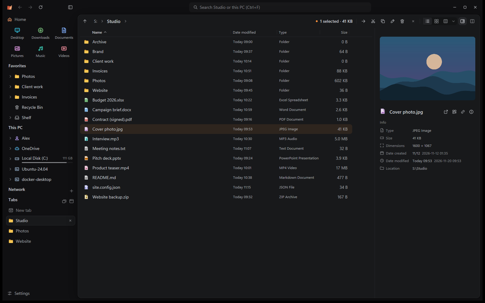
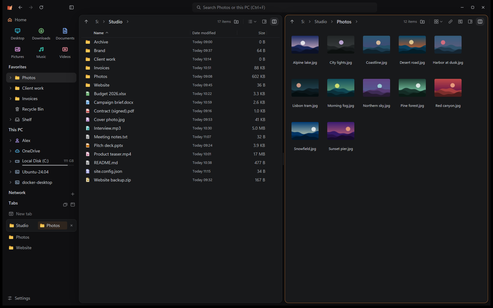
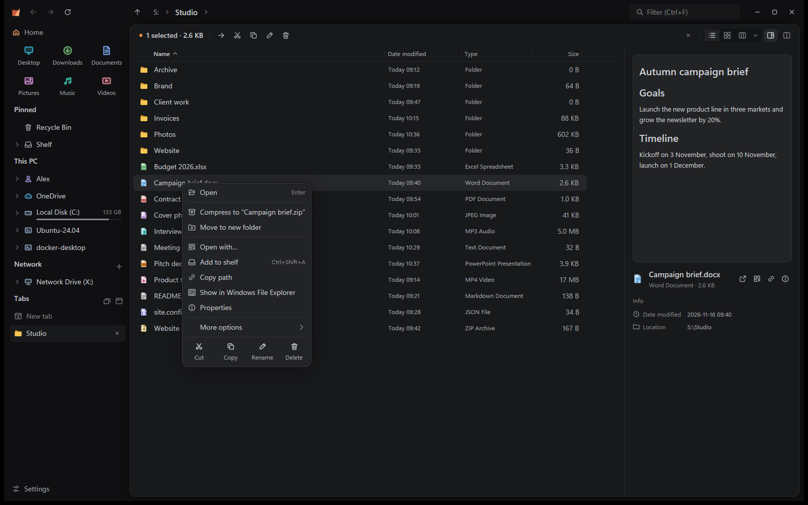
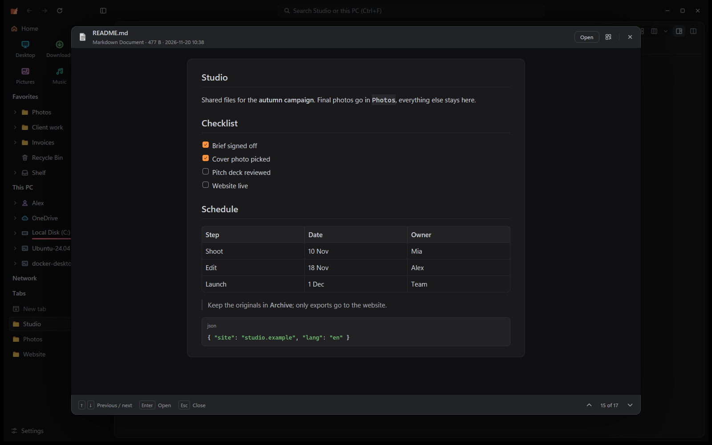
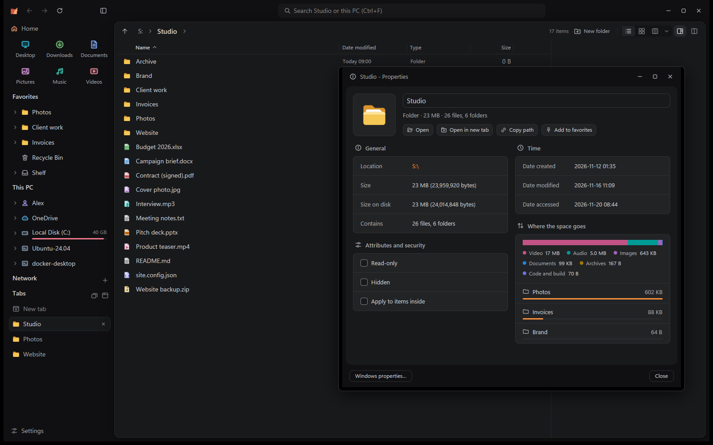
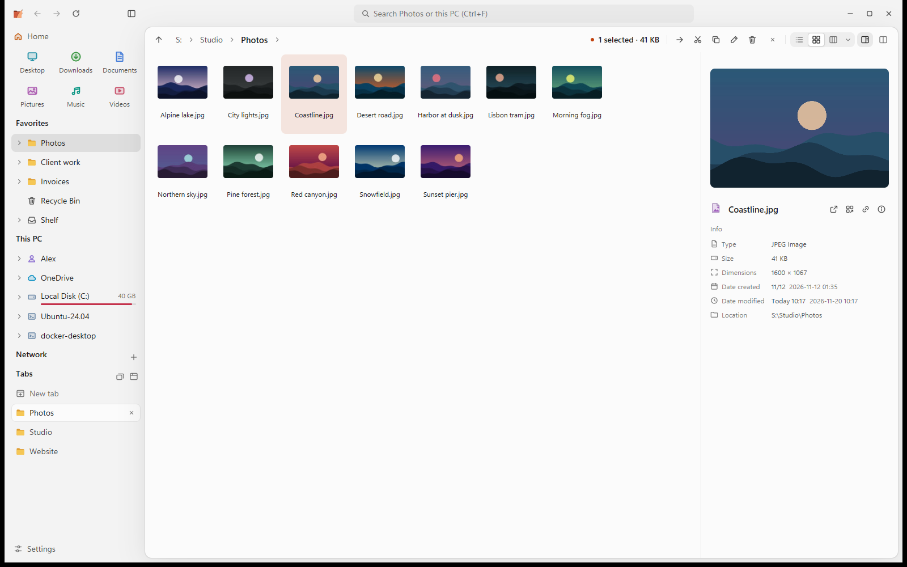
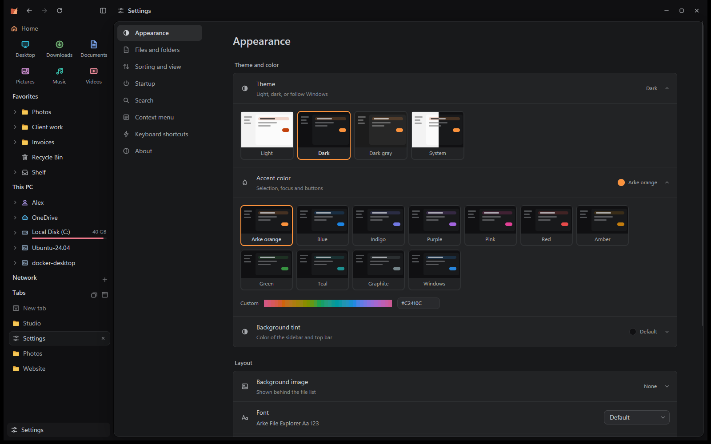
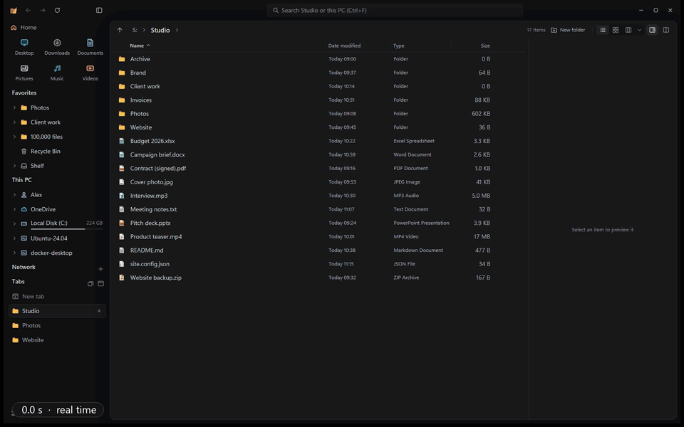
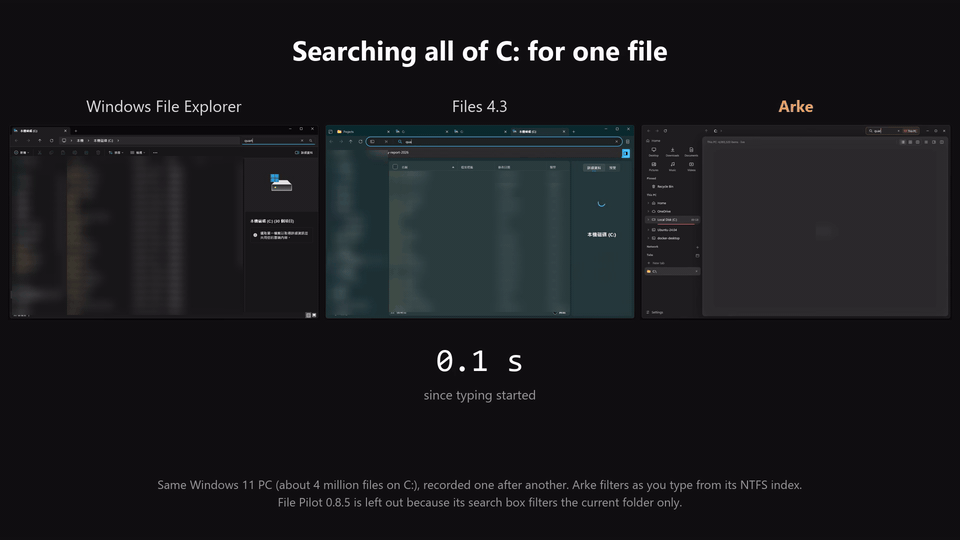
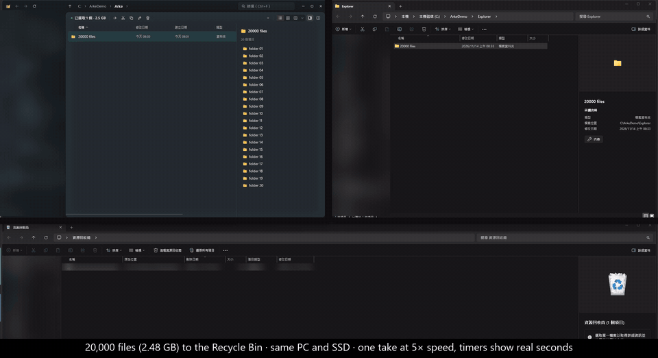

<p align="center"></p>

<h1 align="center">Arke</h1>

<p align="center"><b>Un explorador de archivos para Windows que nunca se congela.</b><br>
Renderizado por GPU, escrito en Rust, un único exe pequeño.</p>

<p align="center">
  <a href="https://github.com/Koimsurai/Arke/releases"></a>
  <a href="https://github.com/Koimsurai/Arke/actions/workflows/ci.yml"></a>
  
  <a href="LICENSE"></a>
</p>

<p align="center"><a href="README.md">English</a> · <a href="README.zh-CN.md">简体中文</a> · <a href="README.zh-TW.md">繁體中文</a> · <a href="README.ja.md">日本語</a> · <a href="README.de.md">Deutsch</a> · <b>Español</b> · <a href="README.pt-BR.md">Português (Brasil)</a></p>

<p align="center"></p>

## Por qué Arke

**Sigue respondiendo.** El listado, la ordenación, las miniaturas, los tamaños de carpeta, la búsqueda
y las operaciones con archivos se ejecutan fuera del hilo de la interfaz. Un recurso de red
inaccesible o una carpeta con 100 000 archivos no le impiden desplazarse, escribir ni cambiar de pestaña.

**Lo encuentra todo, al instante.** Arke mantiene un índice de nombres de archivo de sus unidades locales. Con el
servicio opcional en segundo plano lee directamente la tabla maestra de archivos (MFT) de NTFS, indexa millones de
archivos en segundos y sigue el diario de cambios, de modo que el índice está al día en cuanto lo abre.

**Las operaciones con archivos no le hacen esperar.** Una carpeta de 20 000 archivos va a la Papelera de reciclaje en
0,2 s en lugar de 47 s en el Explorador de archivos, y se restaura como de costumbre. Las copias y los movimientos muestran su progreso,
se ponen en cola en la misma unidad, se pueden pausar y se pueden deshacer.

**Está pensado para trabajar en muchas carpetas a la vez.** Las pestañas viven en una barra lateral vertical, se pueden
anclar y guardar como espacios de trabajo con nombre. Cualquier pestaña se divide en dos paneles que navegan sincronizados o comparan
su contenido, y al arrastrar un archivo sobre una pestaña, un favorito o un segmento de la ruta, se suelta justo
ahí.

**Es seguro para su sistema.** Arke no tiene telemetría. Aparte del servicio de búsqueda opcional, que
Windows registra al instalarlo, Arke solo escribe en el registro si activa
«Abrir carpetas en Arke»: entonces se registra como controlador de carpetas de su cuenta de Windows
(solo bajo `HKEY_CURRENT_USER\Software\Classes`), y al desactivar la opción todo vuelve a su estado anterior.
Las extensiones de shell de otros programas se ejecutan en un proceso aparte, así que una con errores no puede derribar a Arke.

Si Arke le resulta útil, una ⭐ en GitHub ayuda a que otras personas lo encuentren.

Arke apareció en el [boletín tecnológico n.º 420 de Ruan Yifeng](https://www.ruanyifeng.com/blog/2026/11/weekly-issue-420.html) y figura en [awesome-rust](https://github.com/rust-unofficial/awesome-rust), [awesome-gpui](https://github.com/zed-industries/awesome-gpui) y en AlternativeTo.

<p><a href="https://alternativeto.net/software/arke/about/?utm_source=badge&utm_medium=referral"></a></p>

## Características

<table>
  <tr>
    <td width="50%"></td>
    <td width="50%"></td>
  </tr>
  <tr>
    <td>Divida cualquier pestaña en dos paneles que navegan sincronizados o comparan su contenido.</td>
    <td>Un menú contextual rápido propio, con el menú completo de Windows a un clic.</td>
  </tr>
  <tr>
    <td width="50%"></td>
    <td width="50%"></td>
  </tr>
  <tr>
    <td>La vista rápida (Space) muestra Markdown como lo hace GitHub, además de imágenes, PDF, archivos de Office y código.</td>
    <td>Una ventana Propiedades propia (Alt+Enter) que muestra adónde va el espacio de una carpeta.</td>
  </tr>
  <tr>
    <td width="50%"></td>
    <td width="50%"></td>
  </tr>
  <tr>
    <td>Vistas de detalles, iconos y columnas, con un panel de vista previa para la mayoría de los tipos de archivo.</td>
    <td>Temas claro, oscuro y gris oscuro, colores de énfasis y un tinte o una imagen de fondo.</td>
  </tr>
</table>

**Navegar**
- Vistas de detalles, iconos (cualquier tamaño hasta 256 px, Ctrl+rueda del mouse) y columnas. En Detalles, las carpetas
  se pueden expandir en su sitio, y se puede ordenar por varias columnas, reordenar columnas y mostrar los destinos de los vínculos.
- Cada carpeta recuerda su vista y su ordenación.
- Pestañas que se pueden anclar o guardar como espacios de trabajo. Divida una pestaña en dos paneles con una única vista previa compartida,
  navegación sincronizada y comparación de carpetas. Clic central o Ctrl+clic en una carpeta de la barra lateral, en
  Inicio o en la barra de direcciones para abrirla en una pestaña nueva (Ctrl+doble clic en la lista de archivos).
- El cuadro de búsqueda está en el centro de la barra de título y busca en el panel activo. Cada panel tiene
  su propia fila con Subir, su ruta y sus botones de vista, de modo que en la vista dividida cada lado conserva su propio
  filtro.
- Arrastre una pestaña fuera para darle una ventana propia, o suelte archivos sobre una pestaña para copiarlos o moverlos a
  su carpeta.
- Favoritos en la parte superior de la barra lateral y en Inicio, como mosaicos y como lista: agregue una carpeta o una pestaña desde
  su menú, o arrástrela hasta allí. Arrástrelos para reordenarlos (los demás hacen sitio, como los iconos de aplicaciones en un
  teléfono) o fuera para quitarlos, y cámbieles el nombre sin renombrar la carpeta. Las carpetas ancladas a
  Acceso rápido en el Explorador de archivos también aparecen.
- Una sola ventana de forma predeterminada (desde la 0.7): las carpetas de otras aplicaciones, Win+E y volver a iniciar Arke agregan una
  pestaña a la ventana que usó por última vez. Desactive «Ventana única» en la configuración para tener una ventana por cada una.
- Con «Las ventanas nuevas abren en: Última ubicación», las ventanas abiertas al cerrar Arke (o al apagarse
  Windows) vuelven con sus pestañas. Una ventana que cierra mientras otras siguen abiertas no se conserva.
- Carpetas que se abren al arrastrar sobre ellas, una bandeja para reunir archivos de distintas carpetas y una página de Inicio
  con sus favoritos, archivos recientes, unidades y ubicaciones de red, cada una con su propio menú
  de clic derecho (las unidades tienen expulsar, Formatear, Liberador de espacio en disco y Propiedades).
- Deslice dos dedos en un panel táctil para ir atrás y adelante, como en un navegador.
- La barra lateral se puede ensanchar arrastrando su borde y se contrae en una columna de iconos (Ctrl+B),
  que se puede configurar para abrirse sobre el contenido al dejar el puntero encima (desactivado
  de forma predeterminada). Favoritos, Este equipo y Red se contraen por separado haciendo clic en
  su encabezado, y el árbol de carpetas sigue a la carpeta en la que está. Las columnas de la vista de
  columnas se pueden redimensionar.
- Escala de la interfaz del 80 % al 150 %, además de la propia escala de Windows.
- Paleta de comandos (Ctrl+Shift+P) para todos los comandos, y atajos de teclado que se pueden cambiar.

**Vista previa**
- Un panel de vista previa redimensionable y la vista rápida (Space) para imágenes (también SVG), PDF, Word, Excel y
  PowerPoint, texto y código con resaltado de sintaxis, Markdown, archivos comprimidos, archivos `.gz` y carpetas.
- Los vídeos muestran un fotograma y los PDF su primera página como miniatura. La vista rápida amplía texto, documentos y páginas PDF
  (Ctrl+rueda), y con QuickLook instalado, Space puede abrir ese en su lugar.

**Búsqueda**
- Mientras escribe, en esta carpeta, sus subcarpetas o todo el equipo, con coincidencia aproximada y
  filtros por tipo, tamaño y fecha ([sintaxis de búsqueda](#sintaxis-de-búsqueda)).
- Busque dentro de los archivos, incluidos PDF y documentos de Office, en una carpeta y sus subcarpetas.
- Los archivos y carpetas que abre con frecuencia aparecen primero en los resultados de todo el equipo.

**Archivos**
- Copie y mueva con el motor del shell de Windows, con progreso, deshacer y rehacer. Las tareas en la misma
  unidad se ponen en cola y se pueden pausar, con verificación opcional tras copiar o traspaso a TeraCopy
  (experimental).
- Cambio de nombre por lotes, «Mover a una carpeta nueva» y un menú de mover/copiar/acceso directo al arrastrar con el botón derecho
  del mouse o al soltar con Alt pulsada.
- Una ventana Propiedades propia (Alt+Enter): tamaños, adónde va el espacio de una carpeta, atributos, la
  aplicación con la que se abre un archivo, SHA-256 y desbloqueo de archivos descargados. La de Windows está a un clic.
  Una unidad entera se cuenta en segundos, a partir del índice de búsqueda o, con el servicio de búsqueda, de
  la tabla de archivos de la unidad, como hace WizTree.

**Lugares**
- Recursos de red que fallan rápido cuando un servidor está desconectado y muestran el último contenido conocido;
  `\\server` lista sus recursos compartidos. Ubicaciones SFTP y WebDAV (experimental; http sin cifrar solo después de que
  lo permita para esa ubicación). Las unidades asignadas y los lugares de red pueden tener nombres propios, guardados
  solo en Arke.
- OneDrive y otras carpetas en la nube con estado de sincronización. Las vistas previas nunca descargan archivos solo en línea.
- Archivos comprimidos: vista previa y extracción de zip y 7z (también con contraseña), tar (.gz, .xz, .bz2, .zst) y RAR, compresión a zip.
  RAR y los tar xz / bzip2 / zstd usan la libarchive integrada en Windows (mejor en Windows 11
  23H2 y posteriores).

**Windows**
- Las carpetas grandes van a la Papelera de reciclaje de una vez en las unidades locales: 20 000 archivos en aproximadamente un cuarto de
  segundo en lugar de 40 s, ya que Windows no comprueba antes cada archivo. Restaurar funciona como siempre, y
  todo lo que no puede garantizar (unidades de red, OneDrive, archivos en uso, directivas) se deja a Windows.
  Se puede desactivar en la configuración. Los archivos sueltos tardan unos pocos milisegundos cada uno, todavía de dos a seis veces
  más rápido que Windows.
- Las actualizaciones se descargan discretamente en segundo plano y se instalan la próxima vez que se reinicie Arke, nunca mientras
  se copian archivos y nunca en una conexión de uso medido.
- Los menús se abren en ventanas propias, como los menús de Windows, de modo que cerca del borde sobresalen de la ventana de Arke
  en lugar de quedar comprimidos. Los comandos de Windows que ancle desde «Mostrar más opciones» (Git Bash,
  Terminal de Windows, VS Code, 7-Zip, NanaZip...) aparecen en cuanto se abre el menú, y Mayús+clic derecho
  agrega los extendidos, como en el Explorador de archivos.
- Lanzadores y scripts (Listary, ALTRun, AutoHotkey, PowerShell) pueden leer las ventanas, pestañas y la
  selección de Arke y abrir carpetas mediante una interfaz JSON ([docs/integration.md](docs/integration.md)).
- Silencioso en reposo: si nada cambia en pantalla, no se redibuja nada, tampoco al minimizar. Los tamaños de
  carpeta, la indexación y el servicio de búsqueda se ejecutan con prioridad baja en el modo de eficiencia de Windows, y con
  solo el icono de la bandeja del sistema Arke libera sus cachés.
- Opcionalmente (experimental), abra carpetas en Arke en lugar del Explorador de archivos (incluidas las carpetas abiertas desde otras
  aplicaciones), también «Mostrar en carpeta» desde navegadores y «Abrir ubicación del archivo» desde otras aplicaciones.
  Registra a Arke como controlador de carpetas de su cuenta y se deshace al desactivarlo.
  El Explorador de archivos que inicie usted mismo (Win+E, la barra de tareas, Inicio) sigue siendo el Explorador de archivos a menos que también
  active «Win+E y el icono del Explorador de archivos también abren Arke».
- Compatibilidad con lectores de pantalla, compilaciones x64 y ARM64 (ambas probadas en hardware real),
  lista de salto de la barra de tareas, expulsión segura de USB, bandeja del sistema, copia de seguridad de la configuración. Inglés, chino simplificado y
  tradicional, japonés, alemán, español y portugués de Brasil (los cuatro últimos son nuevos
  en la 0.8; las correcciones de redacción son bienvenidas en las incidencias).

Las funciones *experimentales* están cubiertas por pruebas automatizadas y servidores de prueba locales, pero todavía no se
usan ampliamente; consulte el [registro de cambios](CHANGELOG.md). Los comentarios en las incidencias son bienvenidos.

## Rendimiento

<p align="center"></p>

<p align="center"></p>

<p align="center"></p>

| | Arke | Para comparar |
| --- | --- | --- |
| Crear desde cero el índice de todo el disco (unos 4 millones de archivos) | unos 10 s, unos 130 MB de memoria después | Everything 1.4.1: 21 s, unos 400 MB |
| Encontrar un archivo en cualquier parte de C: | los resultados aparecen al escribir | Files 4.3: unos 26 s · Explorador de archivos: sin resultado tras 30 s* |
| Abrir una carpeta con 100 000 archivos | unos 0,7 s, 128 MB | File Pilot 0.8.5: 1,0–1,4 s, 563 MB · Explorador de archivos: 2–3 s |
| Enviar 20 000 archivos (2,48 GB) a la Papelera de reciclaje | 0,2 s | Explorador de archivos: 47,3 s |

\* El archivo estaba fuera de las carpetas que indexa la Búsqueda de Windows. Dentro de ellas, el Explorador de archivos encuentra los archivos
mucho más rápido.

<details>
<summary>Cómo se midió</summary>

Un PC: Intel i9-13900, 64 GB de RAM, Samsung 990 PRO NVMe, Windows 11 (compilación 26200), con
análisis antivirus en tiempo real activado, lo que ralentiza todos los programas. Las cachés del sistema de archivos estaban calientes.

- **Índice**: el servicio de búsqueda de Arke leyendo la tabla maestra de archivos de NTFS, en un perfil nuevo;
  Everything 1.4.1 Lite con su servicio, con el tamaño de archivo y la fecha de modificación indexados (los valores predeterminados), tras
  borrar su base de datos. Las cifras de Arke proceden de `arke --bench index`, las de Everything de su registro
  de depuración; la memoria es el conjunto de trabajo una vez terminada la indexación.
- **Búsqueda**: cada programa se inició en `C:\` y buscó el mismo nombre de archivo; el cronómetro arranca
  al empezar a escribir. El Explorador de archivos y Files dependen de la Búsqueda de Windows para las carpetas indexadas y examinan
  el disco en el resto.
- **Carpeta**: una carpeta de 100 000 archivos generados (`cargo run -p genfiles -- 100000`), abierta desde un
  inicio en frío de cada programa; mediana de tres ejecuciones tras un calentamiento, cronometrada hasta que la ventana dejó de
  cambiar. File Pilot (beta gratuita) solo está en esta prueba: todavía no tiene búsqueda en todo el disco.
- **Papelera de reciclaje**: la misma carpeta (20 000 archivos en 20 carpetas, 2,48 GB) enviada a la Papelera de reciclaje
  desde cada programa en una sola toma, cronometrada desde Eliminar hasta que la carpeta salió de la lista. Arke usa su
  Papelera de reciclaje rápida (activada de forma predeterminada en las unidades locales); ambos restauran desde la Papelera de reciclaje de Windows
  como de costumbre.

Sus cifras serán distintas. Arke registra sus propios tiempos en `%LOCALAPPDATA%\Arke\arke.log`.

Ejecute `arke --bench index` para medir el índice en su equipo.

</details>

## Instalación

Descargue desde [Releases](https://github.com/Koimsurai/Arke/releases). Ambas descargas son el mismo
Arke, con las mismas funciones y actualizaciones, y ambas guardan la configuración en `%APPDATA%\Arke`:

- **Portátil**, `arke-<version>.exe`: un único exe sin entorno de ejecución que funciona desde cualquier carpeta. No se
  instala nada, por lo que no aparece en el menú Inicio ni en Configuración › Aplicaciones; Configuración › Acerca de › **Quitar Arke
  de este equipo** lo elimina.
- **Instalador**, `arke-<version>-setup.exe`: instala Arke para su cuenta sin aprobación de administrador,
  o para todos los usuarios en Archivos de programa, y lo agrega al menú Inicio y a Configuración › Aplicaciones,
  desde donde puede desinstalarlo.

En PC con ARM64, use los archivos `-arm64` (`arke-<version>-arm64.exe`,
`arke-<version>-arm64-setup.exe`).

Con [Scoop](https://scoop.sh):

```bash
scoop bucket add arke https://github.com/Koimsurai/scoop-bucket
scoop install arke/arke
```

Scoop lo mantiene actualizado (`scoop update arke`), y Arke le deja ese trabajo.

Las compilaciones aún no están firmadas, por lo que SmartScreen puede pedir confirmación la primera vez.

Arke consulta GitHub en busca de una versión nueva como máximo una vez al día y solo instala una cuando usted lo indica
(Configuración › Acerca de).

<details>
<summary><b>Servicio opcional en segundo plano</b></summary>

Configuración › Búsqueda › Actualizaciones en vivo instala un pequeño servicio de Windows, con aprobación de administrador.
Solo lee el diario de cambios y la tabla maestra de archivos del sistema de archivos, nunca el contenido de los archivos, y
nunca informa de nombres dentro de las carpetas de perfil de otros usuarios. Puede quitarlo desde el mismo lugar.

</details>

## Sintaxis de búsqueda

Escriba en el cuadro de búsqueda (Ctrl+F). El panel situado debajo elige el ámbito (esta carpeta, subcarpetas o
todo el equipo) y los filtros; Tab pasa a él. Las palabras se comparan de forma aproximada, así que `rprt` encuentra
`report`. Los filtros también se pueden escribir y combinar:

| Filtro | Ejemplo | Significado |
| --- | --- | --- |
| `type:` | `type:image;video`, `type:folder` | Tipo de archivo: folder, document, image, audio, video, archive, code, app |
| `ext:` o `*.` | `ext:pdf;docx`, `*.png` | Extensión de archivo |
| `size:` | `size:>10mb`, `size:1mb..10mb`, `size:large` | Tamaño del archivo (`empty`, `tiny`, `small`, `medium`, `large`, `huge`, `gigantic` como en Everything) |
| `dm:` | `dm:today`, `dm:7d`, `dm:2026-11`, `dm:>2026-01-01` | Fecha de modificación: una palabra clave, las últimas N horas/días/semanas, o un intervalo de fechas |
| `file:` / `folder:` | `folder: photos` | Solo archivos o solo carpetas |
| `folder\name` | `docs\report` | Nombre dentro de una carpeta cuyo nombre coincide con `docs` |
| `content:` | `content:"due date"` | Texto dentro de los archivos, incluidos PDF y documentos de Office (esta carpeta y subcarpetas) |

Con filtros pero sin nombre (`ext:pdf dm:7d`), los resultados se listan del más reciente al más antiguo. Las palabras clave de fecha también
funcionan en el idioma de la interfaz (今天, 本周, 本週…). En todo el equipo, lo que abre con frecuencia
aparece más arriba; puede desactivarlo o borrarlo en Configuración › Búsqueda.

## Teclado

<details>
<summary>Atajos</summary>

| Teclas | Acción |
| --- | --- |
| Ctrl+T | Ir a una carpeta (lugares recientes, pestañas abiertas y rutas) |
| Ctrl+Shift+P | Paleta de comandos: busque cualquier comando y ejecútelo; todos los atajos se pueden cambiar en Configuración › Atajos de teclado |
| Ctrl+W · Ctrl+Shift+T | Cerrar pestaña (en la vista dividida, el lado activo) · reabrir la pestaña cerrada |
| Ctrl+Tab · Ctrl+Shift+Tab · Ctrl+1…9 | Cambiar de pestaña |
| Ctrl+Shift+S · Ctrl+Shift+D | Panel doble: navegación sincronizada · comparar carpetas |
| Tab · Alt+C · Alt+M | Vista dividida: cambiar de panel · copiar · mover la selección al otro panel |
| Ctrl+F · Ctrl+Shift+F · Ctrl+K | Buscar en esta carpeta · en esta carpeta y subcarpetas · en todo el equipo; Tab pasa al ámbito y los filtros |
| Ctrl+L · Alt+D | Editar la ruta |
| Alt+← · Alt+→ · Alt+↑ | Atrás · adelante · subir |
| F5 · Ctrl+R | Actualizar |
| Space | Vista rápida |
| F2 | Cambiar nombre (con varios seleccionados: cambia el nombre de todos) |
| Shift+F10 | Menú contextual |
| Ctrl+Shift+N | Nueva carpeta |
| Ctrl+C · Ctrl+X · Ctrl+V | Copiar · cortar · pegar, compartido con el Explorador de archivos |
| Ctrl+Shift+C | Copiar ruta |
| Ctrl+Z · Ctrl+Y o Ctrl+Shift+Z | Deshacer · rehacer la última operación con archivos |
| Ctrl+Shift+A | Agregar a la bandeja |
| Delete · Shift+Delete | Enviar a la Papelera de reciclaje · eliminar permanentemente |
| Ctrl+H | Mostrar elementos ocultos |
| Ctrl+Shift+1…4 · Ctrl+Shift+6 | Iconos, de extragrandes a pequeños · vista de detalles |
| Ctrl+, | Configuración |

</details>

## Accesibilidad

Arke funciona con los lectores de pantalla de Windows a través de UI Automation, la interfaz que usan
Narrator y NVDA; JAWS también debería funcionar. Hasta ahora se ha comprobado con herramientas de UI
Automation, todavía no con personas que usen un lector de pantalla a diario, así que se agradece la
ayuda para probarlo.

Lo que funciona: la lista de archivos, la barra lateral, las pestañas, la barra de ruta, la búsqueda,
Configuración, los menús y la ventana de Propiedades. Lo que sigue incompleto: a los botones de la
barra de herramientas aún no se llega con Tab (usa F6 y los atajos) y algunos cuadros de diálogo no se
han revisado.

La [guía de teclado](docs/keyboard.md) (en inglés) enumera todos los atajos por zona. Si algo no se
puede alcanzar o no se anuncia, [abre un issue](https://github.com/Koimsurai/Arke/issues) e indica tu
lector de pantalla y su versión.

## Preguntas frecuentes

<details>
<summary><b>¿Me afecta la AGPL si solo lo uso, en casa o en el trabajo?</b></summary>

No. La licencia solo añade obligaciones cuando distribuye un Arke modificado (o lo ofrece a través de una
red); usarlo, incluso dentro de una empresa, no conlleva ninguna.

</details>

<details>
<summary><b>¿Qué cambia en mi sistema?</b></summary>

Nada, a menos que usted lo pida. Instalar el servicio de búsqueda opcional (con su aprobación) lo registra
en Windows, que mantiene los servicios en
`HKEY_LOCAL_MACHINE\SYSTEM\CurrentControlSet\Services\ArkeIndex`. Aparte de eso, el único cambio en el registro
es la opción opcional «Abrir carpetas en Arke», que registra a Arke como controlador de carpetas de su cuenta de Windows, solo bajo
`HKEY_CURRENT_USER\Software\Classes`: los verbos `open` y `explore` de `Folder` (de modo que cada carpeta
que abre el shell, incluidos «Mostrar en carpeta» de navegadores y editores, inicia Arke en lugar del Explorador de
archivos; lo que Arke no puede mostrar, como el Panel de control, se entrega directamente al Explorador) y, solo
con «Win+E y el icono del Explorador de archivos también abren Arke», el controlador de Win+E. Lo que hubiera antes
se guarda en `%APPDATA%\Arke\folder-handler-backup.json` y se restituye exactamente cuando desactiva la
opción o ejecuta `arke --restore-explorer`. Arke también vigila las ventanas nuevas del Explorador para
los casos que el registro no alcanza, como `explorer.exe /select,...`. En los PC donde Windows
envía Win+E directamente al Explorador de archivos sin consultar el registro (un cambio que Windows viene
desplegando desde finales de 2026), Arke toma Win+E con un hook de teclado mientras se ejecuta en segundo plano:
solo reacciona a E mientras se mantiene pulsada una tecla Windows y no registra nada. La configuración reside en `%APPDATA%\Arke`, el índice de búsqueda, el registro y las
actualizaciones descargadas en `%LOCALAPPDATA%\Arke`. «Iniciar al iniciar sesión en Windows» es un acceso directo en su carpeta de
Inicio, y «Mostrar Arke en el menú Inicio» uno en la carpeta de su menú Inicio. Las contraseñas de las ubicaciones SFTP y WebDAV van al Administrador de credenciales de Windows, y solo cuando
marca «Recordar». El servicio de búsqueda opcional es la única parte que necesita aprobación
de administrador. El instalador, si lo usa, agrega la entrada de desinstalación que Windows muestra en Configuración › Aplicaciones
(para su cuenta, o para todos los usuarios si lo instala así) y pide aprobación solo para una
instalación para todos los usuarios.

</details>

<details>
<summary><b>¿Cómo lo elimino por completo?</b></summary>

Configuración › Acerca de › **Quitar Arke de este equipo**. Elimina el servicio de búsqueda si lo instaló
(Windows pide aprobación de administrador para esa parte), los accesos directos del menú Inicio y de «Iniciar al iniciar sesión en
Windows», las contraseñas SFTP y WebDAV guardadas, la lista de salto, `%LOCALAPPDATA%\Arke`, `%APPDATA%\Arke`
(a menos que marque «Conservar mi configuración») y por último el propio exe, y luego muestra lo que eliminó.

Desde un terminal o un script: `arke --uninstall`, con `--keep-settings`, `--quiet` (sin cuadros de diálogo,
solo el aviso de administrador para el servicio) o `--dry-run` (solo lista lo que eliminaría).
¿Instalado con Scoop o winget (cuando Arke esté disponible en winget)? `arke --uninstall` deja el exe al gestor de paquetes; elimínelo
con `scoop uninstall arke` o `winget uninstall Koimsurai.Arke`.

También desactiva «Abrir carpetas en Arke» y restituye el controlador de carpetas anterior. ¿Prefiere quitar Arke a mano? Desactive esa opción (o ejecute `arke --restore-explorer`) **antes** de borrar el exe, para que las carpetas sigan abriéndose en el Explorador de archivos.

</details>

<details>
<summary><b>¿Por qué me avisa SmartScreen o mi antivirus?</b></summary>

Las compilaciones aún no están firmadas, y un exe nuevo sin firmar no tiene reputación en SmartScreen.
Cada versión incluye en sus notas una suma de comprobación SHA-256 y un análisis de VirusTotal de los exe, y
siempre puede compilarlo usted mismo desde el código fuente. Para las versiones posteriores a la 0.1.0,
`gh attestation verify arke-<version>.exe -R Koimsurai/Arke` confirma que un exe fue compilado por el flujo de trabajo de publicación de este repositorio.

Algunos antivirus bloquean cada versión nueva hasta que la permite. Si detiene la versión nueva
cuando Arke se reinicia tras una actualización, Arke restituye la versión que tenía y se lo indica; permita
`arke.exe` en su antivirus y actualice de nuevo.

</details>

<details>
<summary><b>¿Habrá una versión para Linux o macOS?</b></summary>

Todavía no. `crates/core` es en su mayor parte independiente de la plataforma, pero las partes que hacen rápido a Arke en
Windows (el índice MFT, la integración con el shell) son específicas de Windows. Cuéntenos en una incidencia qué
necesitaría.

</details>

## Cómo informar de un problema

La forma más fácil es desde Arke: **Configuración › Acerca de › Informar de un problema › Abrir una incidencia en GitHub**.
Rellena sus versiones de Arke y de Windows, la configuración principal y las últimas líneas del registro, sin los nombres de su
cuenta, equipo, servidor ni archivos. También puede copiar el informe o guardarlo como
archivo y enviarlo de otra forma, y **Mostrar archivo de registro** abre el propio registro.

Si Arke no inicia, el registro está en `%LOCALAPPDATA%\Arke\arke.log`.

## Compilar desde el código fuente

Necesita Windows 10 u 11, las herramientas de compilación de MSVC y rustup; la versión de la cadena de herramientas está fijada en
`rust-toolchain.toml` y se instala automáticamente.

```bash
cargo arke                     # run
cargo arke -- "C:\Windows"     # open a folder
cargo nextest run --workspace  # tests
cargo lint                     # clippy, as strict as CI
```

| Ruta | |
| --- | --- |
| `crates/core` | Modelo independiente de la plataforma: listado, ordenación, filtrado, búsqueda, índice |
| `crates/app` | La aplicación GPUI y la integración con Windows |
| `crates/indexd` | El servicio opcional en segundo plano (MFT y diario USN) |
| `tools/xtask` | Herramientas de publicación: changesets, versionado, empaquetado, publicación |

Por ahora Arke no acepta pull requests, pero los informes de errores y las ideas son muy bienvenidos como
[incidencias](https://github.com/Koimsurai/Arke/issues). Consulte [CONTRIBUTING.md](CONTRIBUTING.md) para
las convenciones y el proceso de publicación.

## Agradecimientos

Arke está construido sobre [GPUI](https://github.com/zed-industries/zed/tree/main/crates/gpui), el framework
de interfaz del editor Zed, y sobre los crates de código abierto enumerados en
[THIRD_PARTY_LICENSES.md](THIRD_PARTY_LICENSES.md). La sintaxis de búsqueda sigue a
[Everything](https://www.voidtools.com/), el aspecto debe mucho a la aplicación
[Files](https://files.community/), y la barra lateral de pestañas es un guiño al navegador Arc.

El nombre viene de la mitología griega: Arke es la hermana gemela de Iris, ambas mensajeras con alas.

## Privacidad

Arke no recopila ni envía ningún dato sobre usted ni sobre sus archivos. Solo se conecta a internet para
consultar GitHub en busca de una versión nueva (como máximo una vez al día, se puede desactivar en Configuración › Acerca de), para
descargar una cuando usted decide instalarla, y para acceder a los recursos de red y las ubicaciones SFTP y WebDAV
que usted mismo abre.

Si GitHub es lento o está bloqueado donde usted está, Configuración › Acerca de › Actualizaciones ›
Ruta de descarga envía la búsqueda y la descarga de actualizaciones a través de un espejo (una dirección
`https://` antepuesta a la de GitHub) o un proxy HTTP (`host:puerto`) que usted elija. Arke no incluye
ninguno propio y solo usa uno si usted lo escribe. Quien lo gestiona ve su dirección IP y qué versión de
Arke consulta o descarga; nada más pasa por él. Si falla, Arke consulta GitHub directamente y lo indica
bajo el ajuste. Arke solo instala descargas firmadas con su propia clave, así que un espejo o proxy no
puede colar una versión modificada o anterior.

## Licencia

[AGPL-3.0](LICENSE). Los avisos de terceros están en [THIRD_PARTY_NOTICES.md](THIRD_PARTY_NOTICES.md), y
los textos completos de las licencias de las dependencias incluidas en el exe en
[THIRD_PARTY_LICENSES.md](THIRD_PARTY_LICENSES.md) (también en Configuración › Acerca de › Licencias).
