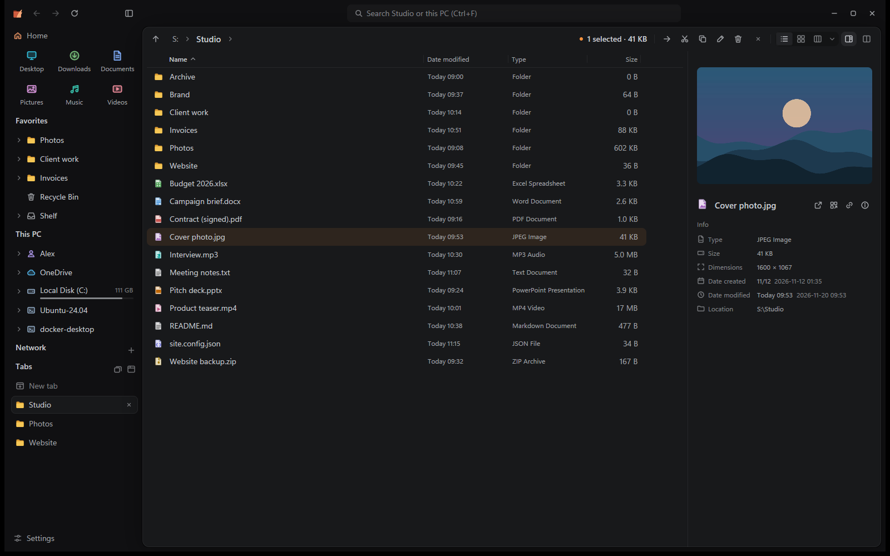
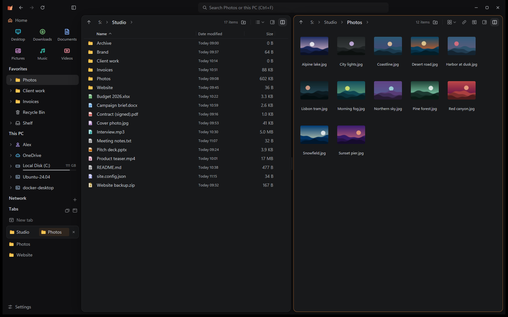
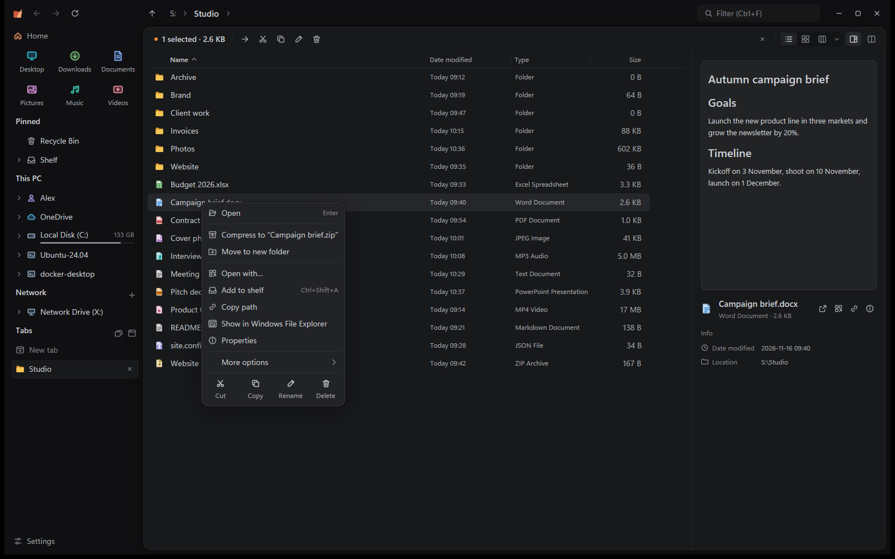
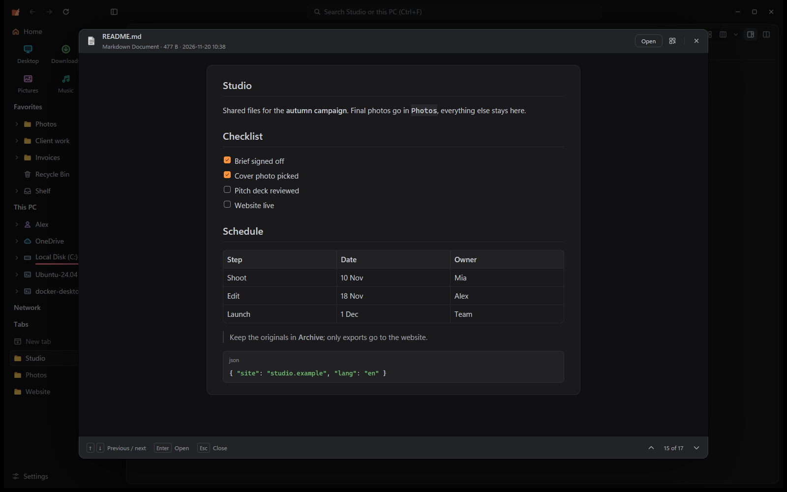
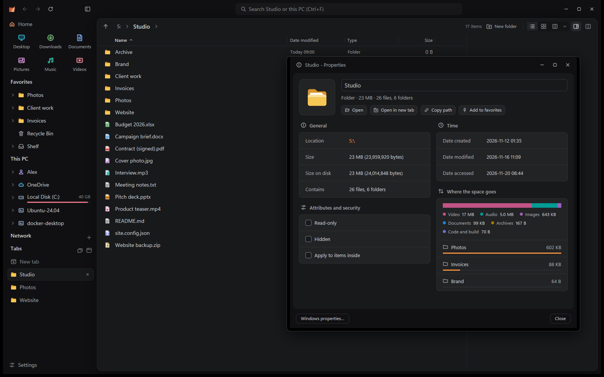
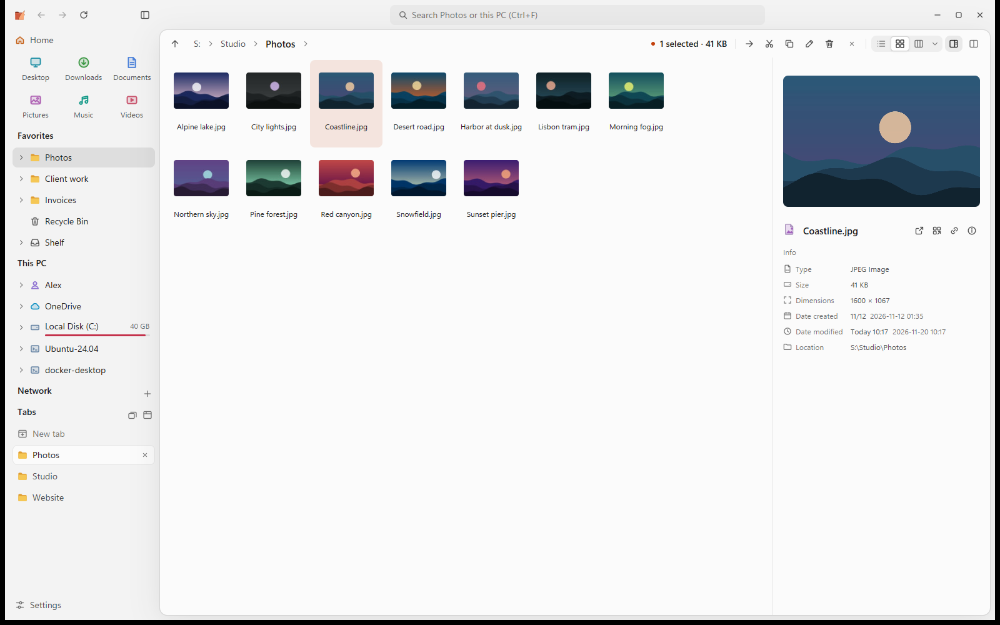
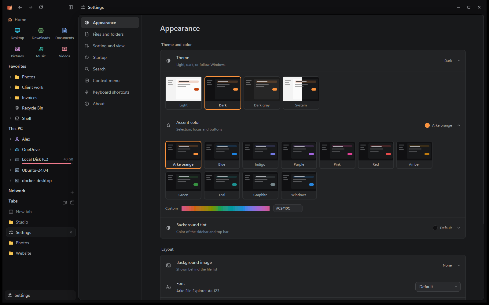
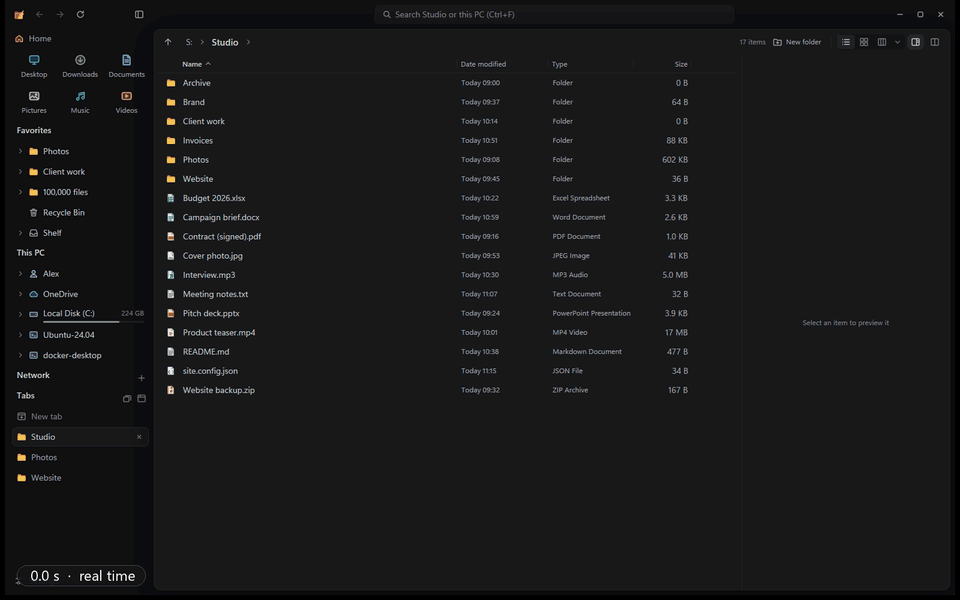
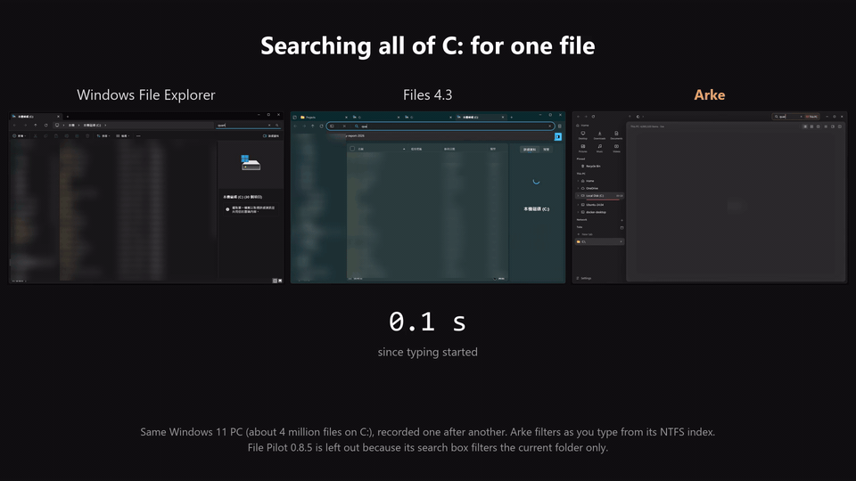
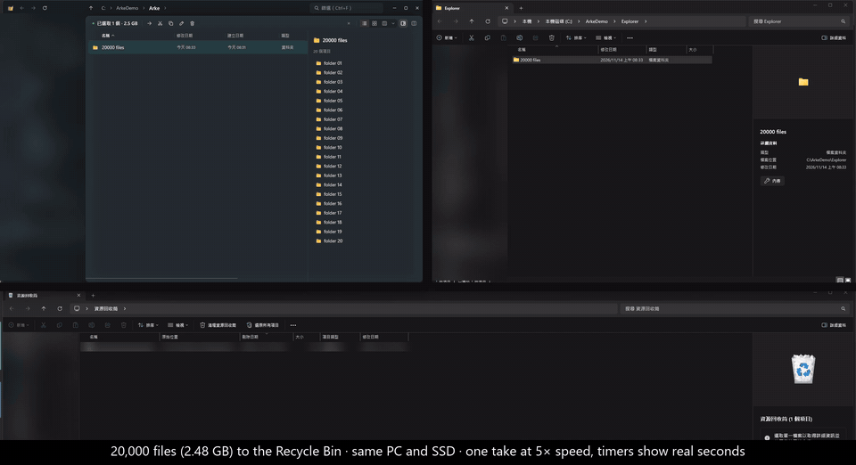

<p align="center"></p>

<h1 align="center">Arke</h1>

<p align="center"><b>フリーズしない Windows 用ファイル マネージャー。</b><br>
GPU レンダリング、Rust 製、小さな exe 1 つ。</p>

<p align="center">
  <a href="https://github.com/Koimsurai/Arke/releases"></a>
  <a href="https://github.com/Koimsurai/Arke/actions/workflows/ci.yml"></a>
  
  <a href="LICENSE"></a>
</p>

<p align="center"><a href="README.md">English</a> · <a href="README.zh-CN.md">简体中文</a> · <a href="README.zh-TW.md">繁體中文</a> · <b>日本語</b> · <a href="README.de.md">Deutsch</a> · <a href="README.es.md">Español</a> · <a href="README.pt-BR.md">Português (Brasil)</a></p>

<p align="center"></p>

## Arke を選ぶ理由

**常に軽快に動きます。** 一覧表示、並べ替え、サムネイル、フォルダー サイズ、検索、ファイル操作は
すべて UI スレッドの外で実行されます。応答のないネットワーク共有や 100,000 個のファイルがある
フォルダーがあっても、スクロールも入力もタブの切り替えも止まりません。

**何でも一瞬で見つかります。** Arke はローカル ドライブのファイル名インデックスを保持します。
オプションのバックグラウンド サービスを使うと NTFS のマスター ファイル テーブルを直接読み取り、
数百万個のファイルを数秒でインデックス化し、変更ジャーナルを追跡するので、開いた時点で
インデックスは最新です。

**ファイル操作で待たされません。** 20,000 個のファイルが入ったフォルダーを、エクスプローラーでは
47 秒かかるところ 0.2 秒でごみ箱に移動でき、復元も通常どおりです。コピーと移動は進行状況を表示し、
同じドライブ上では順番待ちになり、一時停止や元に戻す操作もできます。

**たくさんのフォルダーを同時に扱う作業向けです。** タブは縦型のサイドバーに並び、ピン留めしたり、
名前を付けたワークスペースとして保存したりできます。どのタブも 2 つのペインに分割でき、同期して
閲覧したり内容を比較したりできます。ファイルをタブ、お気に入り、パスの区切りにドラッグすると、
その場所にそのまま移動やコピーができます。

**システムに対して安全です。** Arke にテレメトリはありません。インストール時に Windows に登録される
オプションの検索サービスを除くと、Arke がレジストリに書き込むのは「Arke でフォルダーを開く」を
オンにしたときだけです。このとき Arke は Windows アカウントのフォルダー ハンドラーとして自身を
登録し（`HKEY_CURRENT_USER\Software\Classes` 配下のみ）、設定をオフにすればすべて元に戻ります。
他のプログラムのシェル拡張は別プロセスで実行されるため、不具合のある拡張で Arke が落ちることはありません。

Arke が役に立ったら、GitHub で ⭐ を付けていただけると、ほかの人が見つけやすくなります。

Arke は [阮一峰のテック週刊 #420](https://www.ruanyifeng.com/blog/2026/11/weekly-issue-420.html) で紹介され、[awesome-rust](https://github.com/rust-unofficial/awesome-rust)、[awesome-gpui](https://github.com/zed-industries/awesome-gpui)、AlternativeTo に掲載されています。

<p><a href="https://alternativeto.net/software/arke/about/?utm_source=badge&utm_medium=referral"></a></p>

## 機能

<table>
  <tr>
    <td width="50%"></td>
    <td width="50%"></td>
  </tr>
  <tr>
    <td>どのタブも 2 つのペインに分割して、同期して閲覧したり内容を比較したりできます。</td>
    <td>独自の高速なコンテキスト メニュー。Windows の完全なメニューもワンクリックで開けます。</td>
  </tr>
  <tr>
    <td width="50%"></td>
    <td width="50%"></td>
  </tr>
  <tr>
    <td>クイック表示 (スペース キー) は、Markdown を GitHub と同じ見た目で表示するほか、画像、PDF、Office ファイル、コードも表示します。</td>
    <td>独自のプロパティ ウィンドウ (Alt+Enter) で、フォルダーの容量が何に使われているかがわかります。</td>
  </tr>
  <tr>
    <td width="50%"></td>
    <td width="50%"></td>
  </tr>
  <tr>
    <td>詳細、アイコン、列の各表示と、ほとんどの種類のファイルに対応したプレビュー ウィンドウ。</td>
    <td>ライト、ダーク、ダーク グレーのテーマ、アクセント カラー、背景の色合いや画像。</td>
  </tr>
</table>

**閲覧**
- 詳細、アイコン（256 px までの任意のサイズ、Ctrl+マウス ホイール）、列の各表示。詳細表示では、
  フォルダーをその場で展開でき、複数の列での並べ替え、列の並べ替え、リンク先の表示ができます。
  項目はグループ化でき、グループの見出しをクリックすると折りたためます。
- フォルダーごとに表示方法と並べ替えを記憶します。
- ピン留めやワークスペースとしての保存ができるタブ。タブを 2 つのペインに分割でき、プレビューは
  共有され、同期閲覧とフォルダー比較にも対応します。サイドバー、ホーム、アドレス バーでフォルダーを
  中クリックまたは Ctrl+クリックすると新しいタブで開きます（ファイル一覧では Ctrl+ダブルクリック）。
- 検索ボックスはタイトル バーの中央にあり、アクティブなペインを検索します。各ペインには、上へ、パス、
  表示ボタンを並べた独自の行があるので、分割表示では左右それぞれが自分のフィルターを保持します。
- タブをドラッグして外に出すと独立したウィンドウになり、ファイルをタブにドロップするとそのフォルダーに
  コピーまたは移動できます。
- お気に入りはサイドバーの先頭とホームにタイルと一覧で表示されます。フォルダーやタブをメニューから
  追加するか、ドラッグして追加します。ドラッグして並べ替えたり（ほかの項目が場所をあけます。スマート
  フォンのアプリ アイコンのように）、外にドラッグして削除したり、フォルダー名を変えずに名前を付け
  替えたりできます。エクスプローラーでクイック アクセスにピン留めしたフォルダーも表示されます。
- 既定では 1 つのウィンドウ（0.7 以降）：他のアプリから開いたフォルダー、Win+E、Arke の再起動は、
  最後に使ったウィンドウに新しいタブとして追加されます。設定の「単一ウィンドウ」をオフにすると、
  それぞれ別のウィンドウになります。
- 「新しいウィンドウの表示: 前回のタブ」にしておくと、Arke を終了したとき（または Windows をシャット
  ダウンしたとき）に開いていたウィンドウがタブごと復元されます。ほかのウィンドウが残っている状態で
  閉じたウィンドウは保存されません。
- スプリング ロード フォルダー、別々のフォルダーからファイルを集めるシェルフ、お気に入り、最近使った
  ファイル、ドライブ、ネットワークの場所を表示するホーム ページ。それぞれに専用の右クリック メニューが
  あります（ドライブには取り出し、フォーマット、ディスク クリーンアップ、プロパティ）。
- タッチパッドで 2 本指スワイプすると、ブラウザーのように戻る/進むができます。
- サイドバーは端をドラッグして幅を広げられ、アイコンだけの列に折りたたむこともできます (Ctrl+B)。
  折りたたんだ状態でポインターを置くとコンテンツの上に重ねて開くようにも設定できます (既定ではオフ)。お気に入り、
  PC、ネットワークは見出しをクリックするとそれぞれ折りたためて、ホーム、お気に入り、PC は非表示にもできます。
  フォルダー ツリーは表示中のフォルダーに追従します。列表示の列は幅を変更できます。パス バーのドライブの前にある
  › から、ホーム、ドキュメント、任意のドライブ、開いたことのあるネットワーク共有へ移動できます。
- Windows 自体の拡大率に加えて、インターフェイスの拡大率を 80% から 150% まで設定できます。
- すべてのコマンドを呼び出せるコマンド パレット (Ctrl+Shift+P) と、変更可能なショートカット。

**プレビュー**
- サイズ変更できるプレビュー ウィンドウとクイック表示（スペース キー）で、画像（SVG も）、PDF、Word、
  Excel、PowerPoint、構文ハイライト付きのテキストとコード、Markdown、アーカイブ、`.gz` ファイル、
  フォルダーを表示します。
- 動画はフレーム、PDF は 1 ページ目がサムネイルになります。クイック表示ではテキスト、ドキュメント、
  PDF のページを拡大縮小でき（Ctrl+ホイール）、スペース キーを QuickLook などの別の
  プレビュー プログラムに渡すこともできます。

**検索**
- 入力に合わせて、このフォルダー、サブフォルダー、または PC 全体を検索します。あいまい一致に対応し、
  種類、サイズ、日付でのフィルターも使えます（[検索構文](#検索構文)）。
- フォルダーとそのサブフォルダー内のファイルの中身（PDF や Office ドキュメントを含む）を検索します。
- PC 全体の検索結果では、よく開くファイルやフォルダーが先頭に表示されます。

**ファイル**
- Windows シェルのエンジンでコピーと移動を行い、進行状況表示、元に戻す、やり直しに対応します。同じ
  ドライブ上のジョブは順番待ちになり、一時停止もできます。コピー後の検証や TeraCopy などの別のコピー プログラムへの引き渡しも
  選べます（試験的）。ローカル SSD 間で多数の小さなファイルをコピーするときは複数を同時にコピーするため、1 つずつより
  ずっと高速です。
- 一括名前変更、「新しいフォルダーに移動」、右ボタンでドラッグしたとき、または Alt を押しながらドロップ
  したときに表示される移動/コピー/ショートカットのメニュー。
- 独自のプロパティ ウィンドウ (Alt+Enter)：サイズ、フォルダーの容量の内訳、属性、ファイルを開くアプリ、
  SHA-256、ダウンロードしたファイルのブロック解除。Windows 標準のものもワンクリックで開けます。
  ドライブ全体の集計は数秒で終わります。検索インデックスから、検索サービスがあればドライブのファイル
  テーブルから、WizTree と同じ方法で集計します。

**場所**
- サーバーがオフラインのときはすぐに失敗し、最後に確認できた内容を表示するネットワーク共有。`\\server`
  でその共有一覧を表示します。SFTP と WebDAV の場所（試験的。プレーンな http はその場所で許可した場合のみ）。
  割り当て済みドライブとネットワークの場所には独自の名前を付けられ、名前は Arke 内にのみ保存されます。
- 同期状態を表示する OneDrive などのクラウド フォルダー。プレビューでオンライン専用ファイルを
  ダウンロードすることはありません。
- USB で接続したスマートフォンなどのデバイスは PC の下に表示され、参照、ファイルを開く、PC へのコピーができます
  (今のところ読み取りのみで、デバイス上の内容は変更しません)。
- アーカイブ：zip と 7z（パスワード付きも）、tar (.gz、.xz、.bz2、.zst)、RAR のプレビューと展開、zip への圧縮。RAR と xz / bzip2 /
  zstd の tar には Windows 組み込みの libarchive を使います（Windows 11 23H2 以降が最適）。

**Windows**
- ローカル ドライブでは、大きなフォルダーもすぐにごみ箱へ移動します。20,000 個のファイルが 40 秒では
  なく約 4 分の 1 秒です。Windows のように 1 ファイルずつ事前確認をしないためです。復元は通常どおり
  行え、保証できないもの（ネットワーク ドライブ、OneDrive、使用中のファイル、ポリシー）は Windows に任せます。
  設定でオフにできます。単体のファイルは 1 つあたり数ミリ秒で、それでも Windows の 2〜6 倍高速です。ごみ箱が
  いっぱいのときはエクスプローラーと同じく古い項目から削除して空きを作り、削除が遅くなることはありません。
- 更新はバックグラウンドで静かにダウンロードされ、次に Arke を再起動したときにインストールされます。
  ファイルのコピー中や従量課金接続では行われません。
- メニューは Windows のメニューと同様に独自のウィンドウで開くので、端の近くでは Arke のウィンドウの外に
  はみ出して表示され、押しつぶされません。「その他のオプション」からピン留めした Windows のコマンド
  (Git Bash、Windows ターミナル、VS Code、7-Zip、NanaZip など) は、メニューを開いた瞬間に表示され、
  Shift+右クリックでエクスプローラーと同様に拡張項目が追加されます。
- ランチャーやスクリプト (Listary、ALTRun、AutoHotkey、PowerShell) は、1 つの JSON インターフェイスを
  通じて Arke のウィンドウ、タブ、選択項目を読み取り、フォルダーを開けます
  ([docs/integration.md](docs/integration.md))。
- アイドル時は静かです。画面に変化がなければ再描画もなく、最小化中も同様です。フォルダー サイズ、
  インデックス作成、検索サービスは Windows の効率モードで低優先度で実行され、トレイ アイコンだけに
  なった状態では Arke はキャッシュを解放します。
- オプション（試験的）：エクスプローラーの代わりに Arke でフォルダーを開きます（他のアプリから開いた
  フォルダーを含む）。ブラウザーの「フォルダーを開く」や他のアプリの「ファイルの場所を開く」にも
  対応します。Arke をアカウントのフォルダー ハンドラーとして登録し、オフにすると元に戻ります。
  自分で起動するエクスプローラー (Win+E、タスク バー、スタート) は、「Win+E とエクスプローラー アイコンでも
  Arke を開く」もオンにしない限りエクスプローラーのままです。
- スクリーン リーダー対応、x64 と ARM64 のビルド（どちらも実機でテスト済み）、タスク バーのジャンプ
  リスト、USB の安全な取り外し、システム トレイ、設定のバックアップ。英語、簡体字中国語、繁体字中国語、
  日本語、ドイツ語、スペイン語、ブラジル ポルトガル語に対応（表現の修正は
  issue で歓迎します）。

*試験的* な機能は自動テストとローカルのテスト サーバーで検証していますが、まだ広くは使われていません。
[変更履歴](CHANGELOG.md)を参照してください。フィードバックは issue でお寄せください。

## パフォーマンス

<p align="center"></p>

<p align="center"></p>

<p align="center"></p>

| | Arke | 比較対象 |
| --- | --- | --- |
| ディスク全体のインデックスをゼロから作成（約 400 万個のファイル） | 約 10 秒、完了後のメモリは約 130 MB | Everything 1.4.1：21 秒、約 400 MB |
| C: のどこかにある 1 つのファイルを探す | 入力に合わせて結果が表示される | Files 4.3：約 26 秒 · エクスプローラー：30 秒後も結果なし* |
| 100,000 個のファイルがあるフォルダーを開く | 約 0.7 秒、128 MB | File Pilot 0.8.5：1.0〜1.4 秒、563 MB · エクスプローラー：2〜3 秒 |
| 20,000 個のファイル (2.48 GB) をごみ箱に移動 | 0.2 秒 | エクスプローラー：47.3 秒 |

\* そのファイルは Windows Search のインデックス対象のフォルダーの外にありました。対象内であれば、
エクスプローラーははるかに速くファイルを見つけます。

<details>
<summary>測定方法</summary>

使用したのは 1 台の PC：Intel i9-13900、64 GB RAM、Samsung 990 PRO NVMe、Windows 11 (ビルド 26200)。
リアルタイムのウイルス スキャンはオンのままで、これはあらゆるプログラムを遅くします。ファイル システムの
キャッシュはウォーム状態でした。

- **インデックス**：Arke の検索サービスが NTFS のマスター ファイル テーブルを読み取り、新規プロファイルで
  測定。Everything 1.4.1 Lite はサービス付きで、ファイル サイズと更新日時をインデックス化（既定）、
  データベースを削除してから測定。Arke の数値は `arke --bench index` から、Everything の数値はデバッグ ログ
  から取得。メモリはインデックス作成完了後のワーキング セットです。
- **検索**：各プログラムを `C:\` で起動し、同じファイル名を検索。タイマーは入力を始めた時点から開始。
  エクスプローラーと Files は、インデックス対象のフォルダーでは Windows Search に頼り、それ以外では
  ディスクをスキャンします。
- **フォルダー**：生成した 100,000 個のファイルのフォルダー (`cargo run -p genfiles -- 100000`) を、各
  プログラムのコールド スタートから開いて測定。ウォームアップ後の 3 回の中央値で、ウィンドウの変化が止まる
  までを計測。File Pilot（無料ベータ）はこのテストにのみ含まれます。ディスク全体の検索機能がまだないためです。
- **ごみ箱**：同じフォルダー（20 個のフォルダーに 20,000 個のファイル、2.48 GB）を各プログラムからワン
  テイクでごみ箱に移動し、削除してからフォルダーが一覧から消えるまでを計測。Arke は高速ごみ箱
  （ローカル ドライブでは既定でオン）を使用。どちらも Windows のごみ箱から通常どおり復元できます。

お使いの環境では数値が異なります。Arke は自身の計測時間を `%LOCALAPPDATA%\Arke\arke.log` に記録します。

お使いのマシンでインデックスを測定するには `arke --bench index` を実行してください。

</details>

## インストール

[Releases](https://github.com/Koimsurai/Arke/releases) からダウンロードします。どちらのダウンロードも
同じ Arke で、機能も更新も同じであり、設定はどちらも `%APPDATA%\Arke` に保存されます。

- **ポータブル版**、`arke-<version>.exe`：ランタイム不要の単一 exe で、任意のフォルダーから実行できます。
  何もインストールされないため、スタート メニューにも設定 › アプリにも表示されません。設定 › バージョン情報 ›
  **この PC から Arke を削除** で削除できます。
- **インストーラー**、`arke-<version>-setup.exe`：管理者の承認なしで自分のアカウント用に、または Program Files
  にすべてのユーザー用にインストールし、スタート メニューと設定 › アプリに追加します。アンインストールは
  そこから行えます。

ARM64 の PC では `-arm64` のファイル (`arke-<version>-arm64.exe`、
`arke-<version>-arm64-setup.exe`) を使ってください。

[Scoop](https://scoop.sh) を使う場合：

```bash
scoop bucket add arke https://github.com/Koimsurai/scoop-bucket
scoop install arke/arke
```

以降は Scoop が最新の状態に保ち (`scoop update arke`)、Arke は更新を Scoop に任せます。

ビルドはまだコード署名されていないため、初回は SmartScreen が確認を求めることがあります。SignPath Foundation
による署名を申請中です。[コード署名ポリシー](#コード署名ポリシー)を参照してください。

Arke は新しいバージョンを GitHub で 1 日に最大 1 回確認し、ユーザーが指示したときだけインストールします
(設定 › バージョン情報)。

<details>
<summary><b>オプションのバックグラウンド サービス</b></summary>

設定 › 検索 › ライブ更新 で、管理者の承認のもと、小さな Windows サービスをインストールします。
読み取るのはファイル システムの変更ジャーナルとマスター ファイル テーブルだけで、ファイルの内容は
読み取らず、他のユーザーのプロファイル フォルダー内の名前も報告しません。同じ場所から削除できます。

</details>

## 検索構文

検索ボックス (Ctrl+F) に入力します。その下のパネルで範囲（このフォルダー、サブフォルダー、PC 全体）と
フィルターを選び、Tab で移動できます。このフォルダーはあいまい一致で絞り込むので、`rprt` で `report` が見つかります。
サブフォルダーと PC 全体では、入力どおりの文字を含む名前を表示します。文字が順に含まれるだけの名前は「類似の結果」に
まとめられ、開くと表示されます。完全に一致するものがないときはすぐに表示されます。`'` で始める（`'report`）と
完全一致だけを探します。フィルターは直接入力して組み合わせることもできます。

| フィルター | 例 | 意味 |
| --- | --- | --- |
| `type:` | `type:image;video`、`type:folder` | ファイルの種類：folder、document、image、audio、video、archive、code、app |
| `ext:` または `*.` | `ext:pdf;docx`、`*.png` | ファイルの拡張子 |
| `size:` | `size:>10mb`、`size:1mb..10mb`、`size:large` | ファイル サイズ（Everything と同じ `empty`、`tiny`、`small`、`medium`、`large`、`huge`、`gigantic`） |
| `dm:` | `dm:today`、`dm:7d`、`dm:2026-11`、`dm:>2026-01-01` | 更新日時：キーワード、直近 N 時間/日/週、または日付の範囲 |
| `file:` / `folder:` | `folder: photos` | ファイルのみ、またはフォルダーのみ |
| `folder\name` | `docs\report` | 名前が `docs` に一致するフォルダー内の名前 |
| `content:` | `content:"due date"` | PDF や Office ドキュメントを含むファイルの中身のテキスト（このフォルダーとサブフォルダー） |

名前なしでフィルターだけ (`ext:pdf dm:7d`) を指定すると、結果は新しい順に表示されます。日付のキーワードは
インターフェイスの言語でも使えます（今日、今週…）。PC 全体の検索では、よく開くものほど上位に表示されます。
オフにしたりクリアしたりするには、設定 › 検索 を開いてください。

## キーボード

<details>
<summary>ショートカット</summary>

| キー | 操作 |
| --- | --- |
| Ctrl+T | フォルダーへ移動（最近の場所、開いているタブ、パス） |
| Ctrl+Shift+P | コマンド パレット：任意のコマンドを検索して実行。すべてのショートカットは 設定 › キーボード ショートカット で変更可能 |
| Ctrl+N | 現在のフォルダーで新しいウィンドウを開く |
| Ctrl+W · Ctrl+Shift+T | タブを閉じる（分割表示ではアクティブな側）· 閉じたタブを開き直す |
| Ctrl+Tab · Ctrl+Shift+Tab · Ctrl+1…9 | タブの切り替え |
| Ctrl+Shift+S · Ctrl+Shift+D | 2 ペイン：同期閲覧 · フォルダーの比較 |
| Tab · Alt+C · Alt+M | 分割表示：ペインの切り替え · 選択項目を反対側のペインへコピー · 移動 |
| Ctrl+F · Ctrl+Shift+F · Ctrl+K | このフォルダーを検索 · このフォルダーとサブフォルダーを検索 · PC 全体を検索。Tab で範囲とフィルターへ移動 |
| Ctrl+L · Alt+D | パスを編集 |
| F6 · Shift+F6 | 次 · 前の領域へ: ファイル一覧、サイドバー、パス バー、ツール バー、検索ボックス |
| Alt+← · Alt+→ · Alt+↑ | 戻る · 進む · 上へ |
| F5 · Ctrl+R | 最新の情報に更新 |
| Space | クイック表示 |
| F2 | 名前の変更（複数選択時はすべて変更） |
| Shift+F10 | コンテキスト メニュー |
| Ctrl+Shift+N | 新しいフォルダー |
| Ctrl+C · Ctrl+X · Ctrl+V | コピー · 切り取り · 貼り付け（エクスプローラーと共有） |
| Ctrl+Shift+C | パスのコピー |
| Ctrl+Z · Ctrl+Y または Ctrl+Shift+Z | 直前のファイル操作を元に戻す · やり直し |
| Ctrl+Shift+A | シェルフに追加 |
| Delete · Shift+Delete | ごみ箱に移動 · 完全に削除 |
| Ctrl+H | 隠しファイルを表示 |
| Ctrl+Shift+1…4 · Ctrl+Shift+6 | アイコン（特大から小）· 詳細表示 |
| Ctrl+, | 設定 |

</details>

## アクセシビリティ

Arke は UI Automation（Narrator と NVDA が使うインターフェイス）を通じて Windows のスクリーン リーダーに
対応しています。JAWS でも動くはずです。NVDA と UI Automation のツールで確認済みです。スクリーン リーダーを
日常的に使っている方からのフィードバックを、ほかのスクリーン リーダーについても歓迎します。

キーボードとスクリーン リーダーで操作できる部分: ファイル一覧、サイドバー、タブ、パス バー、ツール バー、検索、
設定、メニュー、プロパティ ウィンドウ。F6 と Shift+F6 で領域を移動します。一部のダイアログはまだ未確認です。

[キーボード ガイド](docs/keyboard.md) (英語) に、すべてのショートカットを領域ごとにまとめています。
操作できない箇所や読み上げられない箇所があれば、[issue を作成](https://github.com/Koimsurai/Arke/issues)し、
使用しているスクリーン リーダーとそのバージョンを書いてください。

## FAQ

<details>
<summary><b>自宅や職場でただ使うだけなら、AGPL は影響しますか?</b></summary>

いいえ。ライセンスによって義務が生じるのは、変更を加えた Arke を配布する場合（またはネットワーク経由で
提供する場合）だけです。会社の中を含め、使うだけであれば義務はありません。

</details>

<details>
<summary><b>システムの何が変更されますか?</b></summary>

こちらから求めない限り、何も変更されません。オプションの検索サービスをインストールすると（ご自身の承認のもと）、
Windows に登録され、サービスは
`HKEY_LOCAL_MACHINE\SYSTEM\CurrentControlSet\Services\ArkeIndex` に保存されます。それ以外でレジストリを
変更するのは、オプションの「Arke でフォルダーを開く」設定だけです。この設定は Arke を Windows アカウントの
フォルダー ハンドラーとして登録するもので、書き込み先は `HKEY_CURRENT_USER\Software\Classes` 配下のみ、
具体的には `Folder` の `open` と `explore` の動詞です（シェルが開くすべてのフォルダー、ブラウザーやエディターの
「フォルダーを開く」を含め、エクスプローラーの代わりに Arke が起動します。コントロール パネルなど Arke で
表示できないものは、そのままエクスプローラーに渡されます）。「Win+E とエクスプローラー アイコンでも Arke を開く」を
オンにした場合に限り、Win+E のハンドラーも登録されます。それまでの値は
`%APPDATA%\Arke\folder-handler-backup.json` に保存され、設定をオフにするか `arke --restore-explorer` を
実行すると、そのとおりに元へ戻されます。登録では届かない場合、たとえば `explorer.exe /select,...` のために、
Arke は新しいエクスプローラー ウィンドウの監視も続けます。Windows が Win+E を登録を参照せずに直接エクスプローラーへ
送る PC（Windows が 2026 年後半から順次展開している変更）では、Arke はバックグラウンドで実行中にキーボード
フックで Win+E を受け取ります。このフックは Windows キーが押されている間の E にしか反応せず、何も記録しません。
設定は `%APPDATA%\Arke` に、検索インデックス、ログ、ダウンロードした更新は `%LOCALAPPDATA%\Arke` に保存されます。
「Windows にサインインしたときに起動する」はスタートアップ フォルダー内のショートカット、「スタート メニューに
Arke を表示」はスタート メニュー フォルダー内のショートカットです。SFTP と WebDAV の場所のパスワードは Windows
資格情報マネージャーに保存され、それは「記憶する」にチェックを入れたときだけです。管理者の承認が必要なのは
オプションの検索サービスだけです。インストーラーを使う場合は、設定 › アプリ に表示されるアンインストール
エントリが追加され（自分のアカウント用、またはすべてのユーザー用にインストールした場合はその用）、承認を求めるのは
すべてのユーザー用のインストールの場合だけです。

</details>

<details>
<summary><b>完全に削除するにはどうすればよいですか?</b></summary>

設定 › バージョン情報 › **この PC から Arke を削除**。インストールしていれば検索サービス（この部分は Windows が
管理者の承認を求めます）、スタート メニューと「Windows にサインインしたときに起動する」のショートカット、保存した
SFTP と WebDAV のパスワード、ジャンプ リスト、`%LOCALAPPDATA%\Arke`、`%APPDATA%\Arke`（「設定を保持する」に
チェックを入れない場合）、最後に exe 自体を削除し、削除した内容を表示します。

ターミナルやスクリプトからは `arke --uninstall` を使います。`--keep-settings`、`--quiet`（ダイアログなし。
サービス用の管理者プロンプトのみ）、`--dry-run`（削除対象を一覧表示するだけ）を付けられます。
Scoop や winget（Arke が winget で提供されるようになった場合）でインストールした場合は、`arke --uninstall` は
exe をパッケージ マネージャーに任せるので、`scoop uninstall arke` または `winget uninstall Koimsurai.Arke` で削除してください。

「Arke でフォルダーを開く」もオフになり、以前のフォルダー ハンドラーが元に戻ります。手動で Arke を削除する場合は、
フォルダーがエクスプローラーで開き続けるよう、exe を削除する**前に**その設定をオフにしてください（または
`arke --restore-explorer` を実行してください）。

</details>

<details>
<summary><b>SmartScreen やウイルス対策ソフトが警告するのはなぜですか?</b></summary>

ビルドはまだコード署名されておらず、署名のない新しい exe は SmartScreen での評価がないためです。各リリースの
ノートには SHA-256 チェックサムと exe の VirusTotal スキャン結果が付いており、いつでもソースから自分でビルド
できます。0.1.0 より後のリリースでは、
`gh attestation verify arke-<version>.exe -R Koimsurai/Arke` で、exe がこのリポジトリのリリース ワークフローで
ビルドされたことを確認できます。

ウイルス対策ソフトによっては、許可するまで新しいバージョンのたびにブロックされます。更新後の Arke の再起動時に
新しいバージョンが止められた場合、Arke は元のバージョンに戻してそのことを知らせます。ウイルス対策ソフトで
`arke.exe` を許可してから、もう一度更新してください。

</details>

<details>
<summary><b>Linux 版や macOS 版は出ますか?</b></summary>

今のところ予定はありません。`crates/core` はほぼプラットフォームに依存しませんが、Arke を Windows で高速にして
いる部分 (MFT インデックス、シェル統合) は Windows 固有です。必要なことを issue で教えてください。

</details>

## 問題の報告

最も簡単なのは Arke 内からの報告です：**設定 › バージョン情報 › 問題を報告 › GitHub で issue を作成**。
Arke と Windows のバージョン、主な設定、最新のログ行が入力され、アカウント名、コンピューター名、サーバー名、
ファイル名は取り除かれます。レポートをコピーしたり、ファイルとして保存して別の方法で送ったりすることもでき、
**ログ ファイルを表示** でログそのものを開けます。

Arke が起動しない場合、ログは `%LOCALAPPDATA%\Arke\arke.log` にあります。

## ソースからビルド

Windows 10 または 11、MSVC ビルド ツール、rustup が必要です。ツールチェーンのバージョンは
`rust-toolchain.toml` で固定されており、自動的にインストールされます。

```bash
cargo arke                     # run
cargo arke -- "C:\Windows"     # open a folder
cargo nextest run --workspace  # tests
cargo lint                     # clippy, as strict as CI
```

| パス | |
| --- | --- |
| `crates/core` | プラットフォームに依存しないモデル：一覧表示、並べ替え、フィルター、検索、インデックス |
| `crates/app` | GPUI アプリと Windows 統合 |
| `crates/indexd` | オプションのバックグラウンド サービス (MFT と USN ジャーナル) |
| `tools/xtask` | リリース用ツール：changeset、バージョン管理、パッケージング、公開 |

Arke は現時点でプル リクエストを受け付けていませんが、バグ報告やアイデアは
[issue](https://github.com/Koimsurai/Arke/issues) で大歓迎です。規約とリリース手順は
[CONTRIBUTING.md](CONTRIBUTING.md) を参照してください。

## 謝辞

Arke は、Zed エディターの UI フレームワークである [GPUI](https://github.com/zed-industries/zed/tree/main/crates/gpui)
と、[THIRD_PARTY_LICENSES.md](THIRD_PARTY_LICENSES.md) に挙げたオープン ソースのクレートの上に作られています。
検索構文は [Everything](https://www.voidtools.com/) に倣い、見た目は [Files](https://files.community/) アプリから
多くを学び、タブのサイドバーは Arc ブラウザーへのオマージュです。

[LINUX DO](https://linux.do) コミュニティに感謝します。

名前はギリシャ神話に由来します。アルケーはイリスの双子の姉妹で、どちらも翼を持つ使者です。

## コード署名ポリシー

Free code signing provided by [SignPath.io](https://about.signpath.io/), certificate by
[SignPath Foundation](https://signpath.org/)（SignPath.io による無償のコード署名、証明書は
SignPath Foundation が発行）。

- コミットとレビュー：[Koimsurai](https://github.com/Koimsurai)
- 承認：[Koimsurai](https://github.com/Koimsurai)

署名されるのは、このリポジトリの GitHub Actions のリリースワークフローがタグ付きコミットからビルドした exe
だけで、各リリースは署名前に手作業で承認されます。

## プライバシー

Arke は、あなたやあなたのファイルに関するデータを一切収集も送信もしません。オンラインに接続するのは、
新しいバージョンを GitHub で確認するとき（1 日に最大 1 回、設定 › バージョン情報 でオフにできます）、
インストールを選んだときにダウンロードするとき、そしてご自身で開くネットワーク共有、SFTP、WebDAV の場所に
接続するときだけです。

お住まいの地域で GitHub が遅い、またはつながらない場合は、設定 › バージョン情報 › 更新 ›
ダウンロード経路 に、ご自身で選んだミラー（GitHub のアドレスの前に付ける `https://` のアドレス）か
HTTP プロキシ（`ホスト:ポート`）を入力すると、更新の確認とダウンロードがそこを経由します。Arke に
経路は組み込まれておらず、入力したときだけ使います。経路の運営者には、あなたの IP アドレスと、確認または
ダウンロードした Arke のバージョンがわかります。それ以外は経由しません。経路に接続できないときは
GitHub に直接接続し、そのことを設定の下に表示します。Arke は自身の鍵で署名されたファイルだけを
インストールするので、ミラーやプロキシが改変されたものや古いバージョンにすり替えることはできません。

## ライセンス

[AGPL-3.0](LICENSE)。サードパーティの通知は [THIRD_PARTY_NOTICES.md](THIRD_PARTY_NOTICES.md) に、exe に含まれる
依存関係のライセンス全文は [THIRD_PARTY_LICENSES.md](THIRD_PARTY_LICENSES.md)（設定 › バージョン情報 › ライセンス
でも参照可）にあります。
