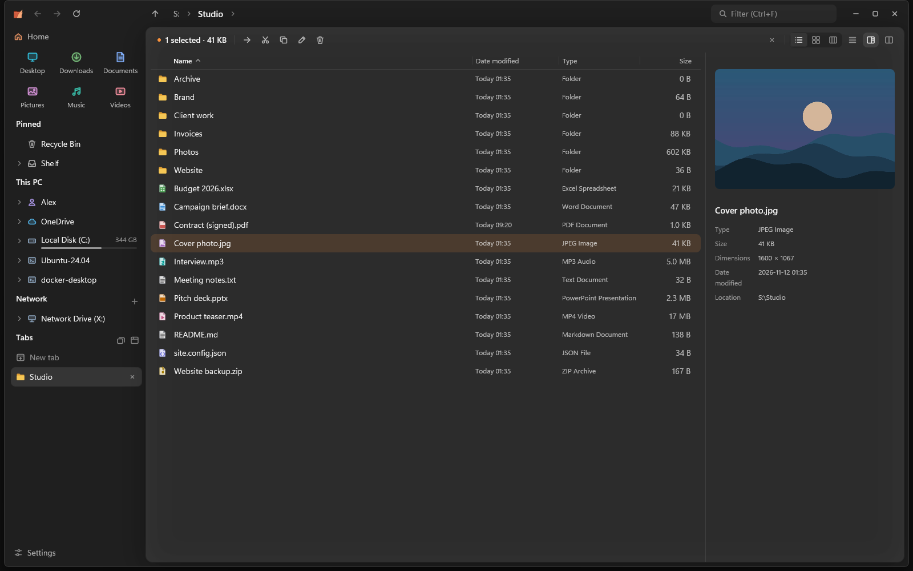
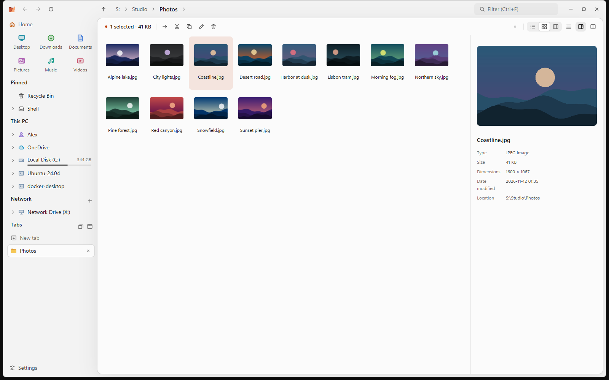
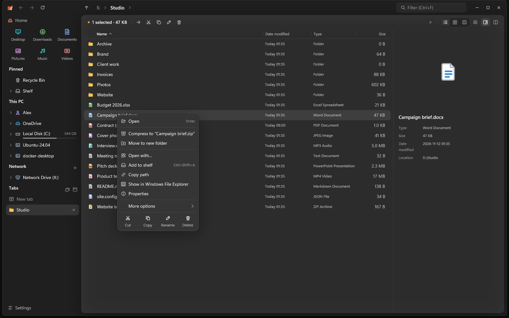
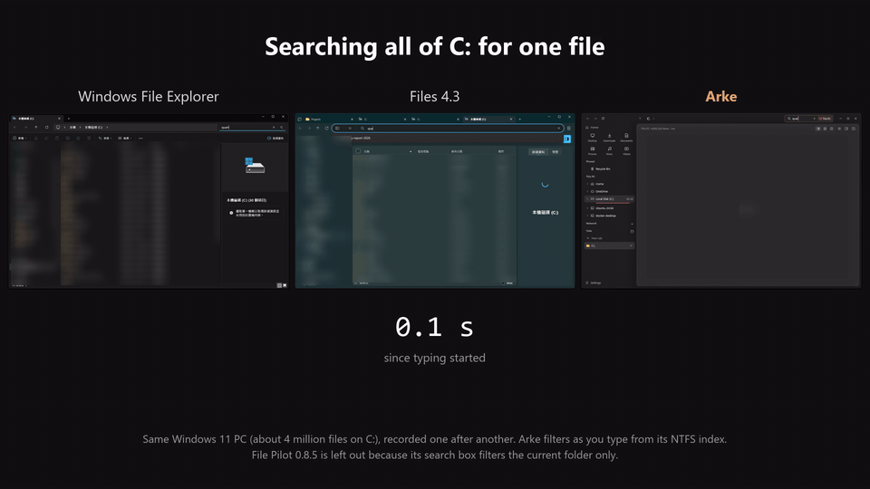

<p align="center"></p>

<h1 align="center">Arke</h1>

<p align="center"><b>A file explorer for Windows that never freezes.</b><br>
GPU-rendered, written in Rust, one small exe.</p>

<p align="center">
  <a href="https://github.com/Koimsurai/Arke/releases"></a>
  <a href="https://github.com/Koimsurai/Arke/actions/workflows/ci.yml"></a>
  
  <a href="LICENSE"></a>
</p>

<p align="center"><b>English</b> · <a href="README.zh-CN.md">简体中文</a> · <a href="README.zh-TW.md">繁體中文</a></p>

<p align="center"></p>

## Why Arke

**It stays responsive.** Listing, sorting, thumbnails, folder sizes, search and file operations
all run off the UI thread. An unreachable network share or a folder with 100,000 files doesn't
stop you from scrolling, typing or switching tabs.

**It finds anything, instantly.** Arke keeps a file name index of your local drives. With the
optional background service it reads the NTFS master file table directly, indexing millions of
files in seconds, and follows the change journal so the index is current the moment you open it.

**It's built for working in many folders at once.** Tabs live in a vertical sidebar, can be
pinned and saved as named workspaces. Any tab splits into two panes that browse in sync or compare
their contents, and dragging a file onto a tab, a pinned folder or a path segment drops it right
there.

**It's safe with your system.** Arke has no telemetry. Apart from the optional search service, which
Windows registers when you install it, Arke writes to the registry only if you turn on
"Open folders in Arke": then it registers itself as the folder handler for your Windows account
(under `HKEY_CURRENT_USER\Software\Classes` only), and turning the setting off puts everything back.
Shell extensions from other programs run in a separate process, so a buggy one can't take Arke down.

## Features

<table>
  <tr>
    <td width="50%"></td>
    <td width="50%"></td>
  </tr>
  <tr>
    <td>Details, icons and columns views, light and dark themes, accent colors and backdrops.</td>
    <td>A fast context menu of its own, with the full Windows menu one click away.</td>
  </tr>
</table>

**Browse**
- Details, icons (any size, Ctrl+mouse wheel) and columns views. In Details, folders can expand
  in place, and you can sort by several columns, reorder columns and show link targets.
- Each folder remembers its view and sort.
- Tabs you can pin or save as workspaces. Split a tab into two panes with one shared preview,
  synchronized browsing and folder compare.
- Spring-loaded folders, a shelf for collecting files from different folders, and a Home page
  with recent files, drives and network locations.

**Preview**
- A resizable preview pane and Quick Look (Space) for images, PDF, Word, Excel and PowerPoint,
  text and code with syntax highlighting, Markdown, archives and folders.

**Search**
- As you type, in this folder, its subfolders or the whole computer, with fuzzy matching and
  filters for type, size and date ([search syntax](#search-syntax)).
- Search inside files, including PDF and Office documents, in a folder and its subfolders.
- Files and folders you open often come first in whole-computer results.

**Files**
- Copy and move through the Windows shell engine with progress, undo and redo. Jobs on the same
  drive queue up and can be paused, with optional verify after copy or hand-off to TeraCopy
  (experimental).
- Batch rename, "Move to new folder", and a move/copy/shortcut menu when you drag with the right
  mouse button or drop with Alt held.

**Places**
- Network shares that fail fast when a server is offline and show the last known contents;
  `\\server` lists its shares. SFTP and WebDAV locations (experimental).
- OneDrive and other cloud folders with sync status. Previews never download online-only files.
- Archives: preview and extract zip, 7z, tar (.gz, .xz, .bz2, .zst) and RAR, compress to zip.
  RAR and the xz / bzip2 / zstd tars use the libarchive built into Windows (best on Windows 11
  23H2 and later).

**Windows**
- Big folders go to the Recycle Bin at once on local drives: 20,000 files in about a quarter of a
  second instead of 40 s, since Windows doesn't check every file first. Restore works as usual, and
  anything it can't vouch for (network drives, OneDrive, files in use, policies) is left to Windows.
  It can be turned off in settings.
- Optionally (experimental) open folders in Arke instead of File Explorer (folders opened from other
  apps included), also "Show in folder" from browsers and "Open file location" from other apps.
  It registers Arke as the folder handler for your account and is undone when you turn it off.
  File Explorer you start yourself (Win+E, the taskbar, Start) stays File Explorer unless you also
  turn on "Win+E and the File Explorer icon open Arke too".
- Screen reader support, x64 and ARM64 builds (ARM64 not yet tested on real ARM hardware),
  taskbar jump list, safe USB eject, system tray, settings backup. English, Simplified and
  Traditional Chinese.

*Experimental* features are covered by automated tests and local test servers but not yet widely
used; see the [changelog](CHANGELOG.md). Feedback in issues is welcome.

## Performance

<p align="center"></p>

| | Arke | For comparison |
| --- | --- | --- |
| Build the whole-disk index from scratch (about 4 million files) | about 10 s, about 130 MB of memory afterwards | Everything 1.4.1: 21 s, about 400 MB |
| Find one file anywhere on C: | results appear as you type | Files 4.3: about 26 s · File Explorer: no result after 30 s* |
| Open a folder with 100,000 files | about 0.7 s, 128 MB | File Pilot 0.8.5: 1.0–1.4 s, 563 MB · File Explorer: 2–3 s |

\* The file was outside the folders Windows Search indexes. Inside them, File Explorer finds files
much faster.

<details>
<summary>How this was measured</summary>

One PC: Intel i9-13900, 64 GB RAM, Samsung 990 PRO NVMe, Windows 11 (build 26200), with
real-time antivirus scanning on, which slows every program down. File system caches were warm.

- **Index**: Arke's search service reading the NTFS master file table, in a fresh profile;
  Everything 1.4.1 Lite with its service, file size and date modified indexed (the defaults), after
  deleting its database. Arke's numbers come from `arke --bench index`, Everything's from its debug
  log; memory is the working set once indexing finished.
- **Search**: each program started in `C:\` and searched for the same file name; the timer starts
  when typing starts. File Explorer and Files rely on Windows Search for indexed folders and scan
  the disk elsewhere.
- **Folder**: a folder of 100,000 generated files (`cargo run -p genfiles -- 100000`), opened from a
  cold start of each program; median of three runs after a warm-up, timed until the window stopped
  changing. File Pilot (free beta) is only in this test: it has no whole-disk search yet.

Your numbers will differ. Arke logs its own timings in `%LOCALAPPDATA%\Arke\arke.log`.

Run `arke --bench index` to measure the index on your machine.

</details>

## Install

Download `arke-<version>.exe` (or `arke-<version>-arm64.exe` for ARM64 PCs) from
[Releases](https://github.com/Koimsurai/Arke/releases) and run it. It's a single executable: no installer and no runtime. Settings are stored in
`%APPDATA%\Arke`.

Prefer an installer? `arke-<version>-setup.exe` (or `arke-<version>-arm64-setup.exe`) installs Arke
for your account without administrator approval, or for all users in Program Files, and adds it to
the Start menu and to Settings › Apps, where you can uninstall it. Arke's updates keep working the
same way.

Builds aren't code-signed yet, so SmartScreen may ask for confirmation the first time.

Arke checks GitHub for a new version at most once a day and only installs one when you say so
(Settings › About).

<details>
<summary><b>Optional background service</b></summary>

Settings › Search › Live updates installs a small Windows service, with administrator approval.
It reads only the file system's change journal and master file table, never file contents, and
never reports names inside other users' profile folders. You can remove it from the same place.

</details>

## Search syntax

Type in the search box (Ctrl+F). The panel below it picks the scope (this folder, subfolders or
the whole computer) and the filters; Tab moves into it. Words are matched fuzzily, so `rprt` finds
`report`. Filters can also be typed and combined:

| Filter | Example | Meaning |
| --- | --- | --- |
| `type:` | `type:image;video`, `type:folder` | Kind of file: folder, document, image, audio, video, archive, code, app |
| `ext:` or `*.` | `ext:pdf;docx`, `*.png` | File extension |
| `size:` | `size:>10mb`, `size:1mb..10mb`, `size:large` | File size (`empty`, `tiny`, `small`, `medium`, `large`, `huge`, `gigantic` as in Everything) |
| `dm:` | `dm:today`, `dm:7d`, `dm:2026-11`, `dm:>2026-01-01` | Date modified: a keyword, the last N hours/days/weeks, or a date range |
| `file:` / `folder:` | `folder: photos` | Only files or only folders |
| `folder\name` | `docs\report` | Name inside a folder whose name matches `docs` |
| `content:` | `content:"due date"` | Text inside files, including PDF and Office documents (this folder and subfolders) |

With filters but no name (`ext:pdf dm:7d`), results are listed newest first. Date keywords also
work in the interface language (今天, 本周, 本週…). On the whole computer, what you open often
ranks higher; turn it off or clear it in Settings › Search.

## Keyboard

<details>
<summary>Shortcuts</summary>

| Keys | Action |
| --- | --- |
| Ctrl+T | Go to a folder (recent places, open tabs and paths) |
| Ctrl+W · Ctrl+Shift+T | Close tab (in split view, the active side) · reopen closed tab |
| Ctrl+Tab · Ctrl+Shift+Tab · Ctrl+1…9 | Switch tabs |
| Ctrl+Shift+S · Ctrl+Shift+D | Dual pane: synchronized browsing · compare folders |
| Tab · Alt+C · Alt+M | Split view: switch panes · copy · move the selection to the other pane |
| Ctrl+F · Ctrl+Shift+F · Ctrl+K | Search this folder · this folder and subfolders · the whole computer; Tab moves into the scope and filters |
| Ctrl+L · Alt+D | Edit the path |
| Alt+← · Alt+→ · Alt+↑ | Back · forward · up |
| F5 · Ctrl+R | Refresh |
| Space | Quick look |
| F2 | Rename (several selected: rename them all) |
| Shift+F10 | Context menu |
| Ctrl+Shift+N | New folder |
| Ctrl+C · Ctrl+X · Ctrl+V | Copy · cut · paste, shared with File Explorer |
| Ctrl+Shift+C | Copy path |
| Ctrl+Z · Ctrl+Y or Ctrl+Shift+Z | Undo · redo the last file operation |
| Ctrl+Shift+A | Add to shelf |
| Delete · Shift+Delete | Recycle · delete permanently |
| Ctrl+H | Show hidden items |
| Ctrl+Shift+1…4 · Ctrl+Shift+6 | Icons, extra large to small · details view |
| Ctrl+, | Settings |

</details>

## FAQ

<details>
<summary><b>Does AGPL affect me if I just use it, at home or at work?</b></summary>

No. The license only adds obligations when you distribute a modified Arke (or offer it over a
network); using it, including inside a company, carries none.

</details>

<details>
<summary><b>What does it change on my system?</b></summary>

Nothing unless you ask. Installing the optional search service (with your approval) registers it
with Windows, which keeps services under
`HKEY_LOCAL_MACHINE\SYSTEM\CurrentControlSet\Services\ArkeIndex`. Besides that, the only registry
change is the optional "Open folders in Arke" setting, which registers Arke as the folder handler for your Windows account, only under
`HKEY_CURRENT_USER\Software\Classes`: the `open` and `explore` verbs of `Folder` (so every folder
the shell opens, "Show in folder" of browsers and editors included, starts Arke instead of File
Explorer; whatever Arke can't show, such as Control Panel, is handed straight to Explorer) and, only
with "Win+E and the File Explorer icon open Arke too", the Win+E handler. Whatever was there before
is saved to `%APPDATA%\Arke\folder-handler-backup.json` and put back exactly when you turn the
setting off or run `arke --restore-explorer`. Arke also keeps watching for new Explorer windows for
the cases the registration can't reach, such as `explorer.exe /select,...`. On PCs where Windows
sends Win+E straight to File Explorer without asking the registration (a change Windows has been
rolling out since late 2026), Arke takes Win+E with a keyboard hook while it runs in the background:
it only reacts to E while a Windows key is held and records nothing. Settings live in `%APPDATA%\Arke`, the search index, log and
downloaded updates in `%LOCALAPPDATA%\Arke`. "Start when I sign in to Windows" is a shortcut in your Startup
folder, and "Show Arke in the Start menu" one in your Start menu folder. Passwords for SFTP and WebDAV locations go to Windows Credential Manager, and only when
you tick "Remember". The optional search service is the only part that needs administrator
approval. The installer, if you use it, adds the uninstall entry Windows lists in Settings › Apps
(for your account, or for all users when you install it there) and asks for approval only for an
all-users install.

</details>

<details>
<summary><b>How do I remove it completely?</b></summary>

Settings › About › **Remove Arke from this PC**. It removes the search service if you installed it
(Windows asks for administrator approval for that part), the Start menu and "Start when I sign in to
Windows" shortcuts, saved SFTP and WebDAV passwords, the jump list, `%LOCALAPPDATA%\Arke`, `%APPDATA%\Arke`
(unless you tick "Keep my settings") and finally the exe itself, then shows what it removed.

From a terminal or a script: `arke --uninstall`, with `--keep-settings`, `--quiet` (no dialogs,
only the administrator prompt for the service) or `--dry-run` (only lists what it would remove).
Installed with Scoop or winget (once Arke is available there)? `arke --uninstall` leaves the exe to the package manager; remove it
with `scoop uninstall arke` or `winget uninstall Koimsurai.Arke`.

It also turns off "Open folders in Arke" and puts the previous folder handler back. Removing Arke by hand instead? Turn that setting off (or run `arke --restore-explorer`) **before** deleting the exe, so folders keep opening in File Explorer.

</details>

<details>
<summary><b>Why does SmartScreen or my antivirus warn about it?</b></summary>

The builds aren't code-signed yet, and a new unsigned exe has no reputation with SmartScreen.
Each release comes with a SHA-256 checksum and a VirusTotal scan of the exes in its notes, and you
can always build it from source yourself. For releases after 0.1.0,
`gh attestation verify arke-<version>.exe -R Koimsurai/Arke` confirms that an exe was built by this repository's release workflow.

</details>

<details>
<summary><b>Will there be a Linux or macOS version?</b></summary>

Not yet. `crates/core` is mostly platform-independent, but the parts that make Arke fast on
Windows (the MFT index, shell integration) are Windows-specific. Tell us in an issue what you'd
need.

</details>

## Building from source

You need Windows 10 or 11, the MSVC build tools and rustup; the toolchain version is pinned in
`rust-toolchain.toml` and installed automatically.

```bash
cargo arke                     # run
cargo arke -- "C:\Windows"     # open a folder
cargo nextest run --workspace  # tests
cargo lint                     # clippy, as strict as CI
```

| Path | |
| --- | --- |
| `crates/core` | Platform-independent model: listing, sorting, filtering, search, index |
| `crates/app` | The GPUI app and Windows integration |
| `crates/indexd` | The optional background service (MFT and USN journal) |
| `tools/xtask` | Release tooling: changesets, versioning, packaging, publishing |

Arke doesn't accept pull requests for now, but bug reports and ideas are very welcome as
[issues](https://github.com/Koimsurai/Arke/issues). See [CONTRIBUTING.md](CONTRIBUTING.md) for
conventions and the release process.

## Acknowledgements

Arke is built on [GPUI](https://github.com/zed-industries/zed/tree/main/crates/gpui), the UI
framework of the Zed editor, and on the open-source crates listed in
[THIRD_PARTY_LICENSES.md](THIRD_PARTY_LICENSES.md). The search syntax follows
[Everything](https://www.voidtools.com/), the look owes a lot to the
[Files](https://files.community/) app, and the tab sidebar is a nod to the Arc browser.

The name comes from Greek myth: Arke is the twin sister of Iris, both winged messengers.

## Privacy

Arke doesn't collect or send any data about you or your files. It goes online only to
check GitHub for a new version (at most once a day, can be turned off in Settings › About), to
download one when you choose to install it, and to reach the network shares, SFTP and WebDAV
locations you open yourself.

## License

[AGPL-3.0](LICENSE). Third-party notices are in [THIRD_PARTY_NOTICES.md](THIRD_PARTY_NOTICES.md), and
the full license texts of the dependencies in the exe in
[THIRD_PARTY_LICENSES.md](THIRD_PARTY_LICENSES.md) (also under Settings › About › Licenses).
