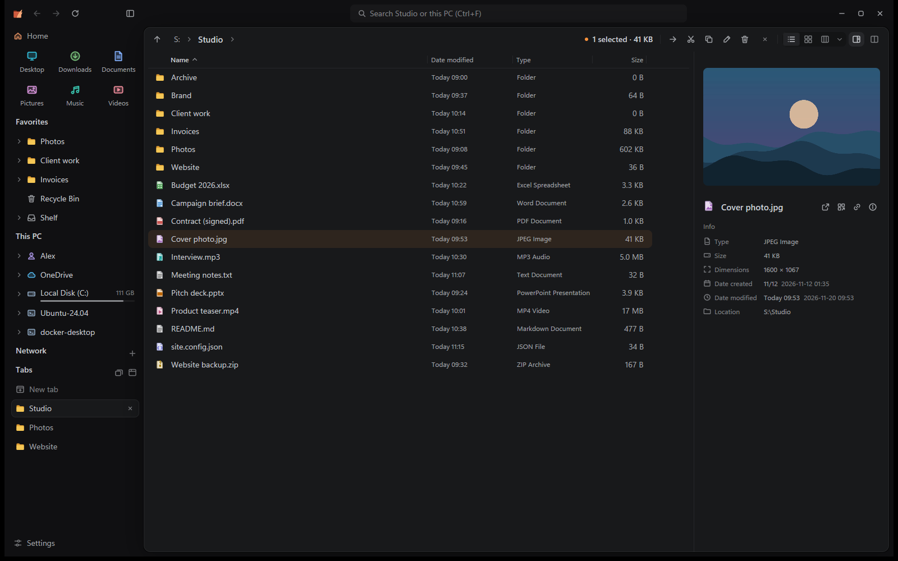
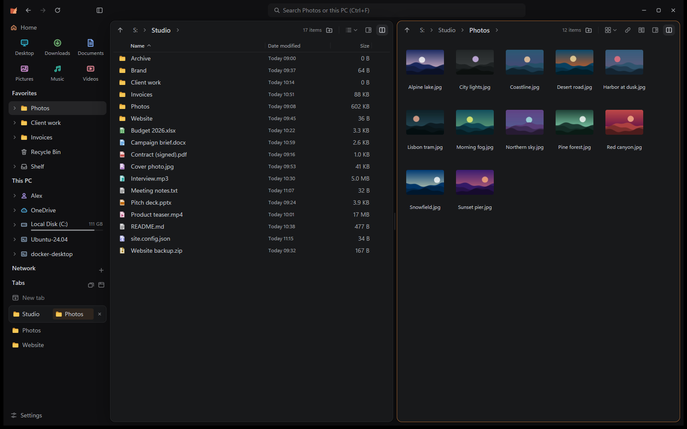
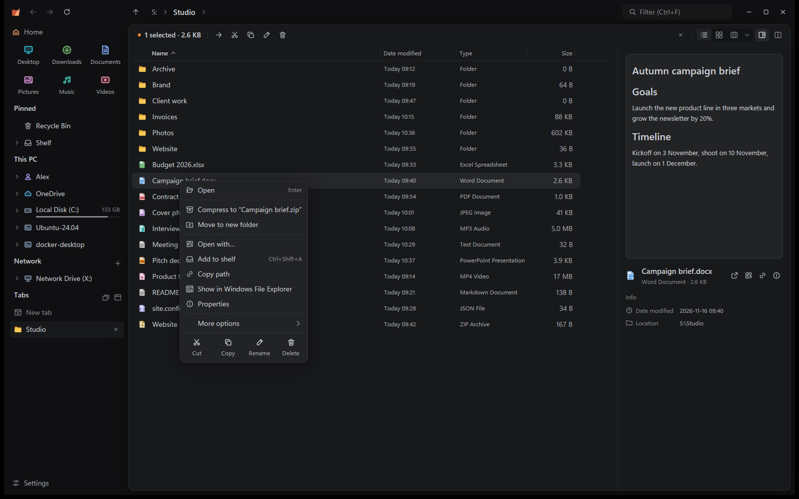
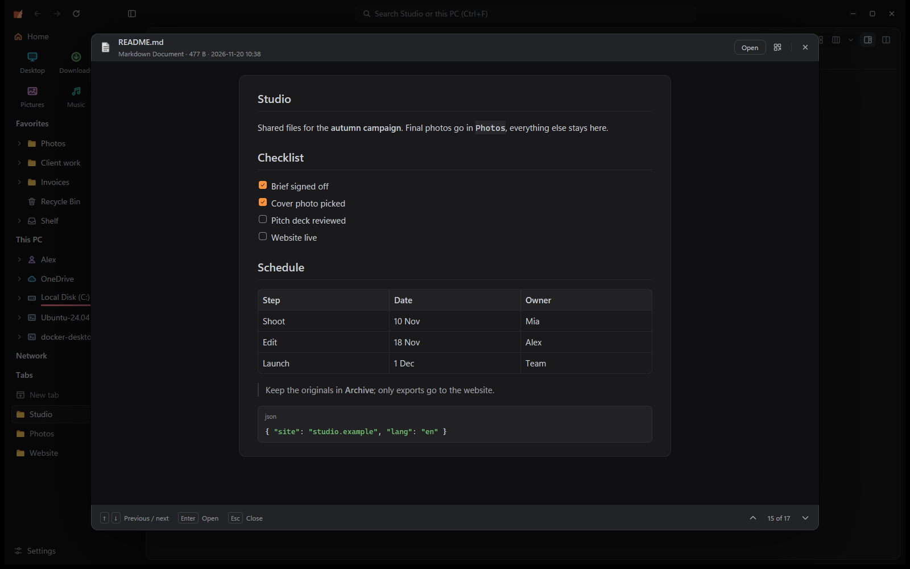
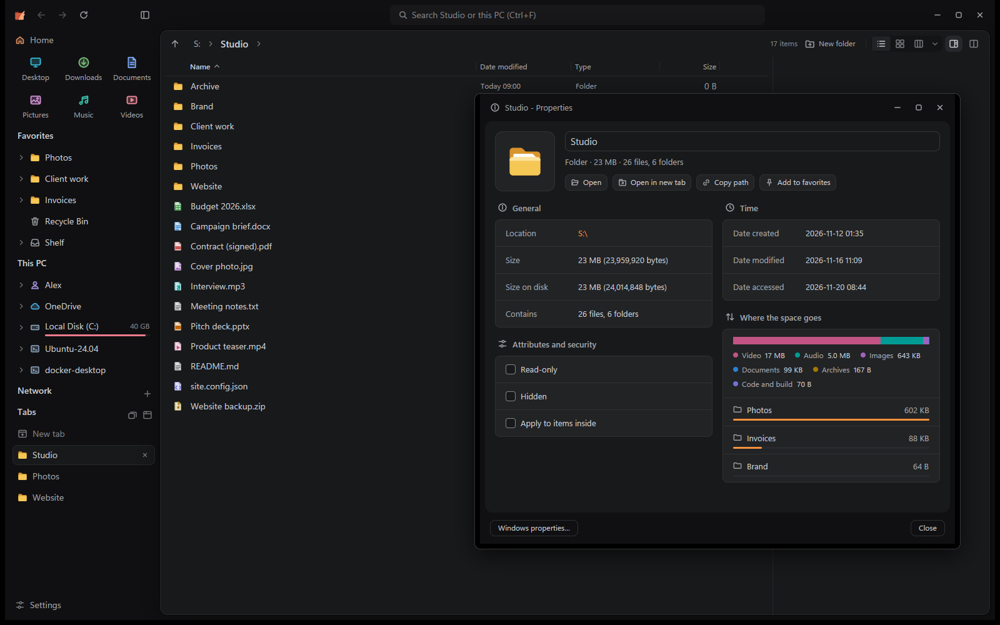
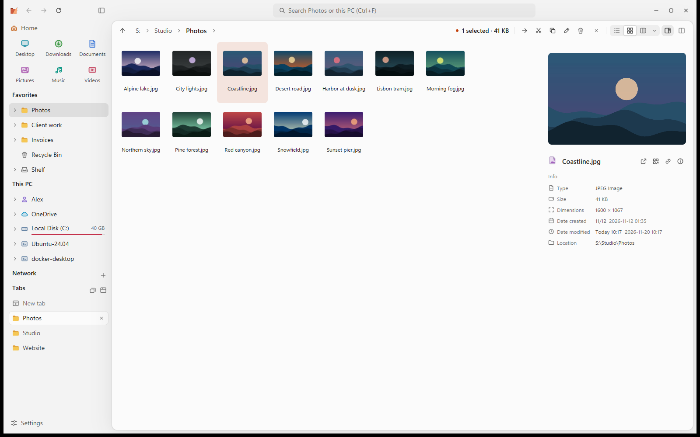
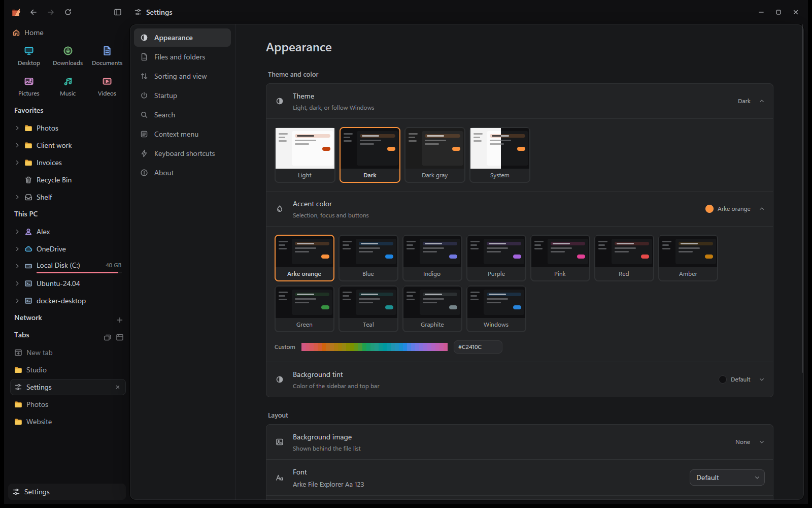
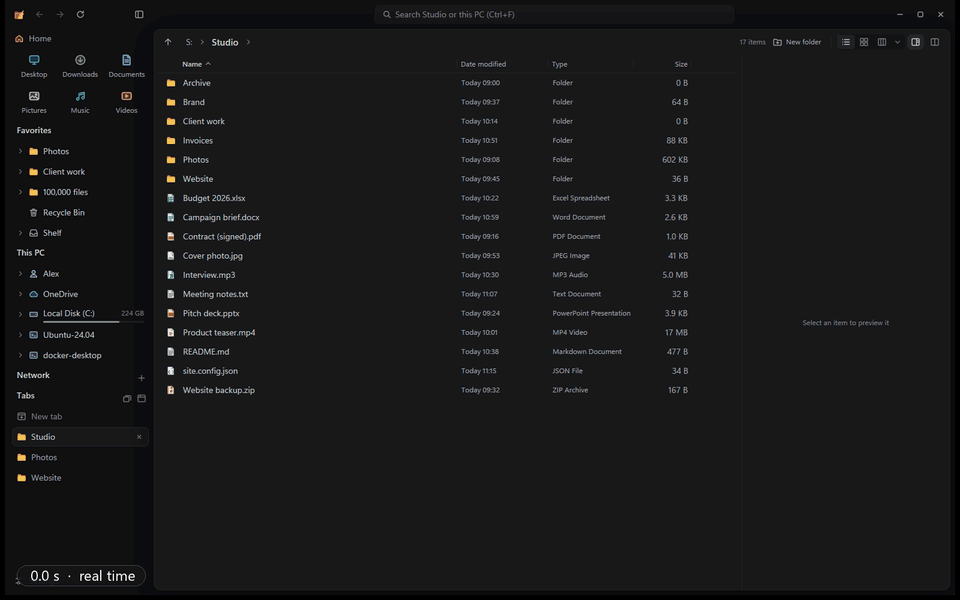
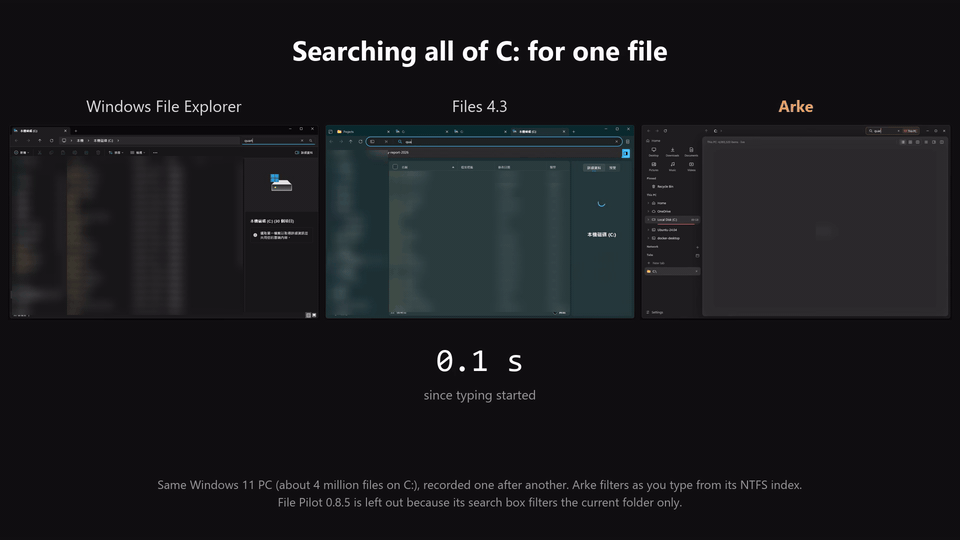
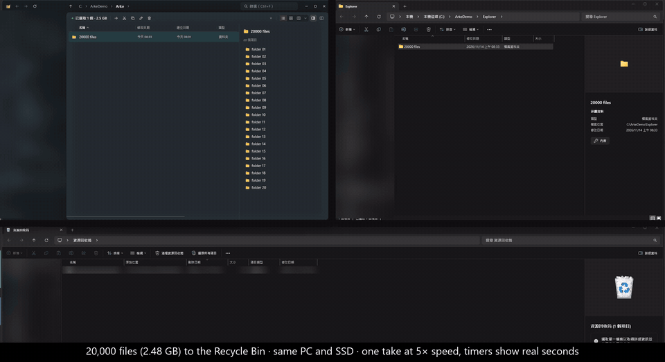

<p align="center"></p>

<h1 align="center">Arke</h1>

<p align="center"><b>A file explorer for Windows that never freezes.</b><br>
GPU-rendered, written in Rust, one small exe.</p>

<p align="center">
  <a href="https://github.com/Koimsurai/Arke/releases"></a>
  <a href="https://github.com/Koimsurai/Arke/actions/workflows/ci.yml"></a>
  
  <a href="LICENSE"></a>
</p>

<p align="center"><b>English</b> · <a href="README.zh-CN.md">简体中文</a> · <a href="README.zh-TW.md">繁體中文</a> · <a href="README.ja.md">日本語</a> · <a href="README.de.md">Deutsch</a> · <a href="README.es.md">Español</a> · <a href="README.pt-BR.md">Português (Brasil)</a></p>

<p align="center"></p>

## Why Arke

**It stays responsive.** Listing, sorting, thumbnails, folder sizes, search and file operations
all run off the UI thread. An unreachable network share or a folder with 100,000 files doesn't
stop you from scrolling, typing or switching tabs.

**It finds anything, instantly.** Arke keeps a file name index of your local drives. With the
optional background service it reads the NTFS master file table directly, indexing millions of
files in seconds, and follows the change journal so the index is current the moment you open it.

**File operations don't keep you waiting.** A folder of 20,000 files goes to the Recycle Bin in
0.2 s instead of 47 s in File Explorer, and restores as usual. Copies and moves show their progress,
queue up on the same drive, can be paused, and can be undone.

**It's built for working in many folders at once.** Tabs live in a vertical sidebar, can be
pinned and saved as named workspaces. Any tab splits into two panes that browse in sync or compare
their contents, and dragging a file onto a tab, a favorite or a path segment drops it right
there.

**It's safe with your system.** Arke has no telemetry. Apart from the optional search service, which
Windows registers when you install it, Arke writes to the registry only if you turn on
"Open folders in Arke": then it registers itself as the folder handler for your Windows account
(under `HKEY_CURRENT_USER\Software\Classes` only), and turning the setting off puts everything back.
Shell extensions from other programs run in a separate process, so a buggy one can't take Arke down.

If Arke is useful to you, a ⭐ on GitHub helps other people find it.

Arke was featured in [Ruan Yifeng's tech weekly #420](https://www.ruanyifeng.com/blog/2026/11/weekly-issue-420.html) and is listed in [awesome-rust](https://github.com/rust-unofficial/awesome-rust), [awesome-gpui](https://github.com/zed-industries/awesome-gpui) and on AlternativeTo.

<p><a href="https://alternativeto.net/software/arke/about/?utm_source=badge&utm_medium=referral"></a></p>

## Features

<table>
  <tr>
    <td width="50%"></td>
    <td width="50%"></td>
  </tr>
  <tr>
    <td>Split any tab into two panes that browse in sync or compare their contents.</td>
    <td>A fast context menu of its own, with the full Windows menu one click away.</td>
  </tr>
  <tr>
    <td width="50%"></td>
    <td width="50%"></td>
  </tr>
  <tr>
    <td>Quick Look (Space) shows Markdown the way GitHub does, and images, PDF, Office files and code.</td>
    <td>A Properties window of its own (Alt+Enter) that shows where a folder's space goes.</td>
  </tr>
  <tr>
    <td width="50%"></td>
    <td width="50%"></td>
  </tr>
  <tr>
    <td>Details, icons and columns views, with a preview pane for most kinds of files.</td>
    <td>Light, dark and dark gray themes, accent colors, and a background tint or image.</td>
  </tr>
</table>

**Browse**
- Details, icons (any size up to 256 px, Ctrl+mouse wheel) and columns views. In Details, folders
  can expand in place, and you can sort by several columns, reorder columns and show link targets.
  Items can be grouped, and a click on a group's header collapses it.
- Each folder remembers its view and sort.
- Tabs you can pin or save as workspaces. Split a tab into two panes with one shared preview,
  synchronized browsing and folder compare. Middle-click or Ctrl+click a folder in the sidebar, on
  Home or in the address bar to open it in a new tab (Ctrl+double-click in the file list).
- The search box sits in the middle of the title bar and searches the active pane. Each pane has
  its own row with Up, its path and its view buttons, so in split view each side keeps its own
  filter.
- Drag a tab out to give it a window of its own, or drop files on a tab to copy or move them into
  its folder.
- Favorites at the top of the sidebar and on Home, as tiles and a list: add a folder or a tab from
  its menu, or drag it there. Drag them to reorder (the others make room, like app icons on a
  phone) or out to remove them, and rename them without renaming the folder. Folders pinned to
  Quick Access in File Explorer show up too.
- One window by default (since 0.7): folders from other apps, Win+E and starting Arke again add a
  tab to the window you used last. Turn off "Single window" in settings for a window each.
- With "New windows open to: Last tabs", the windows open when you quit Arke (or Windows shuts
  down) come back with their tabs. A window you close while others stay open isn't kept.
- Spring-loaded folders, a shelf for collecting files from different folders, and a Home page
  with your favorites, recent files, drives and network locations, each with its own right-click
  menu (drives get eject, Format, Disk Cleanup and Properties).
- Swipe with two fingers on a touchpad to go back and forward, like in a browser.
- The sidebar can be made wider by dragging its edge and collapses to a column of icons (Ctrl+B),
  which can be set to open over the content when you rest the pointer on it (off by default).
  Favorites, This PC and Network each collapse with a click on their heading, Home, Favorites and
  This PC can be hidden, and the folder tree follows the folder you're in. The › before the drive
  in the path bar jumps to Home, Documents, any drive or a network share you opened. Columns in the columns view can be resized.
- Interface scale from 80% to 150%, on top of Windows' own scale.
- Command palette (Ctrl+Shift+P) for every command, and shortcuts you can change.

**Preview**
- A resizable preview pane and Quick Look (Space) for images (SVG too), PDF, Word, Excel and
  PowerPoint, text and code with syntax highlighting, Markdown, archives, `.gz` files and folders.
- Videos show a frame and PDFs their first page as their thumbnail. Quick Look zooms text, documents and PDF pages
  (Ctrl+wheel), and with QuickLook installed, Space can open that instead.

**Search**
- As you type, in this folder, its subfolders or the whole computer, with fuzzy matching and
  filters for type, size and date ([search syntax](#search-syntax)).
- Search inside files, including PDF and Office documents, in a folder and its subfolders.
- Files and folders you open often come first in whole-computer results.

**Files**
- Copy and move through the Windows shell engine with progress, undo and redo. Jobs on the same
  drive queue up and can be paused, with optional verify after copy or hand-off to TeraCopy
  (experimental). Many small files between local SSDs are copied several at a time, much faster
  than one by one.
- Batch rename, "Move to new folder", and a move/copy/shortcut menu when you drag with the right
  mouse button or drop with Alt held.
- A Properties window of its own (Alt+Enter): sizes, where a folder's space goes, attributes, the
  app a file opens with, SHA-256 and unblocking downloaded files. Windows' own is one click away.
  A whole drive is counted in seconds, from the search index or, with the search service, from
  the drive's file table the way WizTree does.

**Places**
- Network shares that fail fast when a server is offline and show the last known contents;
  `\\server` lists its shares. SFTP and WebDAV locations (experimental; plain http only after you
  allow it for that location). Mapped drives and network places can get names of their own, kept
  in Arke only.
- OneDrive and other cloud folders with sync status. Previews never download online-only files.
- Phones and other devices connected by USB show under This PC: browse them, open files
  and copy them to the PC (read-only for now, so nothing on the device changes).
- Archives: preview and extract zip and 7z (password-protected ones too), tar (.gz, .xz, .bz2, .zst) and RAR, compress to zip.
  RAR and the xz / bzip2 / zstd tars use the libarchive built into Windows (best on Windows 11
  23H2 and later).

**Windows**
- Big folders go to the Recycle Bin at once on local drives: 20,000 files in about a quarter of a
  second instead of 40 s, since Windows doesn't check every file first. Restore works as usual, and
  anything it can't vouch for (network drives, OneDrive, files in use, policies) is left to Windows.
  It can be turned off in settings. Loose files take a few milliseconds each, still two to six times
  faster than Windows. When the Recycle Bin is full, the oldest items make room, as in File
  Explorer, without slowing the delete down.
- Updates download quietly in the background and install the next time Arke restarts, never while
  files are being copied and never over a metered connection.
- Menus open in windows of their own, like Windows menus, so near the edge they reach past Arke's
  window instead of being squeezed. Windows commands you pin from "More options" (Git Bash,
  Windows Terminal, VS Code, 7-Zip, NanaZip...) show as soon as the menu opens, and Shift+right-click
  adds the extended ones, as in File Explorer.
- Launchers and scripts (Listary, ALTRun, AutoHotkey, PowerShell) can read Arke's windows, tabs and
  selection and open folders through one JSON interface ([docs/integration.md](docs/integration.md)).
- Quiet when idle: nothing on screen changing means nothing redrawn, minimized included. Folder
  sizes, indexing and the search service run at low priority in Windows' efficiency mode, and with
  only the tray icon left Arke frees its caches.
- Optionally (experimental) open folders in Arke instead of File Explorer (folders opened from other
  apps included), also "Show in folder" from browsers and "Open file location" from other apps.
  It registers Arke as the folder handler for your account and is undone when you turn it off.
  File Explorer you start yourself (Win+E, the taskbar, Start) stays File Explorer unless you also
  turn on "Win+E and the File Explorer icon open Arke too".
- Screen reader support, x64 and ARM64 builds (both tested on real hardware),
  taskbar jump list, safe USB eject, system tray, settings backup. English, Simplified and
  Traditional Chinese, Japanese, German, Spanish and Brazilian Portuguese (corrections to the
  wording are welcome in issues).

*Experimental* features are covered by automated tests and local test servers but not yet widely
used; see the [changelog](CHANGELOG.md). Feedback in issues is welcome.

## Performance

<p align="center"></p>

<p align="center"></p>

<p align="center"></p>

| | Arke | For comparison |
| --- | --- | --- |
| Build the whole-disk index from scratch (about 4 million files) | about 10 s, about 130 MB of memory afterwards | Everything 1.4.1: 21 s, about 400 MB |
| Find one file anywhere on C: | results appear as you type | Files 4.3: about 26 s · File Explorer: no result after 30 s* |
| Open a folder with 100,000 files | about 0.7 s, 128 MB | File Pilot 0.8.5: 1.0–1.4 s, 563 MB · File Explorer: 2–3 s |
| Send 20,000 files (2.48 GB) to the Recycle Bin | 0.2 s | File Explorer: 47.3 s |

\* The file was outside the folders Windows Search indexes. Inside them, File Explorer finds files
much faster.

<details>
<summary>How this was measured</summary>

One PC: Intel i9-13900, 64 GB RAM, Samsung 990 PRO NVMe, Windows 11 (build 26200), with
real-time antivirus scanning on, which slows every program down. File system caches were warm.

- **Index**: Arke's search service reading the NTFS master file table, in a fresh profile;
  Everything 1.4.1 Lite with its service, file size and date modified indexed (the defaults), after
  deleting its database. Arke's numbers come from `arke --bench index`, Everything's from its debug
  log; memory is the working set once indexing finished.
- **Search**: each program started in `C:\` and searched for the same file name; the timer starts
  when typing starts. File Explorer and Files rely on Windows Search for indexed folders and scan
  the disk elsewhere.
- **Folder**: a folder of 100,000 generated files (`cargo run -p genfiles -- 100000`), opened from a
  cold start of each program; median of three runs after a warm-up, timed until the window stopped
  changing. File Pilot (free beta) is only in this test: it has no whole-disk search yet.
- **Recycle Bin**: the same folder (20,000 files in 20 folders, 2.48 GB) sent to the Recycle Bin
  from each program in one take, timed from Delete until the folder left the list. Arke uses its
  fast Recycle Bin (on by default for local drives); both restore from the Windows Recycle Bin as
  usual.

Your numbers will differ. Arke logs its own timings in `%LOCALAPPDATA%\Arke\arke.log`.

Run `arke --bench index` to measure the index on your machine.

</details>

## Install

Download from [Releases](https://github.com/Koimsurai/Arke/releases). Both downloads are the same
Arke, with the same features and updates, and both keep settings in `%APPDATA%\Arke`:

- **Portable**, `arke-<version>.exe`: a single exe with no runtime that runs from any folder. Nothing
  is installed, so it isn't in the Start menu or in Settings › Apps; Settings › About › **Remove Arke
  from this PC** removes it.
- **Installer**, `arke-<version>-setup.exe`: installs Arke for your account without administrator
  approval, or for all users in Program Files, and adds it to the Start menu and to Settings › Apps,
  where you can uninstall it.

On ARM64 PCs, use the `-arm64` files (`arke-<version>-arm64.exe`,
`arke-<version>-arm64-setup.exe`).

With [Scoop](https://scoop.sh):

```bash
scoop bucket add arke https://github.com/Koimsurai/scoop-bucket
scoop install arke/arke
```

Scoop then keeps it up to date (`scoop update arke`), and Arke leaves updating to it.

Builds aren't code-signed yet, so SmartScreen may ask for confirmation the first time. Signing
through SignPath Foundation is on the way, see [Code signing policy](#code-signing-policy).

Arke checks GitHub for a new version at most once a day and only installs one when you say so
(Settings › About). Updates are signed: Arke installs only files signed with its own key. Where
GitHub is slow, you can set a download route there (see [Privacy](#privacy)).

<details>
<summary><b>Optional background service</b></summary>

Settings › Search › Live updates installs a small Windows service, with administrator approval.
It reads only the file system's change journal and master file table, never file contents, and
never reports names inside other users' profile folders. You can remove it from the same place.

</details>

## Search syntax

Type in the search box (Ctrl+F). The panel below it picks the scope (this folder, subfolders or
the whole computer) and the filters; Tab moves into it. This folder is filtered fuzzily, so `rprt`
finds `report`. Subfolders and the whole computer list the names that contain the words as typed;
names that only have their letters in order wait under "Similar results" until it is opened, and
show right away when nothing matches as typed. Start with `'` (`'report`) for exact matches only.
Filters can also be typed and combined:

| Filter | Example | Meaning |
| --- | --- | --- |
| `type:` | `type:image;video`, `type:folder` | Kind of file: folder, document, image, audio, video, archive, code, app |
| `ext:` or `*.` | `ext:pdf;docx`, `*.png` | File extension |
| `size:` | `size:>10mb`, `size:1mb..10mb`, `size:large` | File size (`empty`, `tiny`, `small`, `medium`, `large`, `huge`, `gigantic` as in Everything) |
| `dm:` | `dm:today`, `dm:7d`, `dm:2026-11`, `dm:>2026-01-01` | Date modified: a keyword, the last N hours/days/weeks, or a date range |
| `file:` / `folder:` | `folder: photos` | Only files or only folders |
| `folder\name` | `docs\report` | Name inside a folder whose name matches `docs` |
| `content:` | `content:"due date"` | Text inside files, including PDF and Office documents (this folder and subfolders) |

With filters but no name (`ext:pdf dm:7d`), results are listed newest first. Date keywords also
work in the interface language (今天, 本周, 本週…). On the whole computer, what you open often
ranks higher; turn it off or clear it in Settings › Search.

## Keyboard

<details>
<summary>Shortcuts</summary>

| Keys | Action |
| --- | --- |
| Ctrl+T | Go to a folder (recent places, open tabs and paths) |
| Ctrl+Shift+P | Command palette: search any command and run it; every shortcut can be changed in Settings › Keyboard shortcuts |
| Ctrl+N | New window on the current folder |
| Ctrl+W · Ctrl+Shift+T | Close tab (in split view, the active side) · reopen closed tab |
| Ctrl+Tab · Ctrl+Shift+Tab · Ctrl+1…9 | Switch tabs |
| Ctrl+Shift+S · Ctrl+Shift+D | Dual pane: synchronized browsing · compare folders |
| Tab · Alt+C · Alt+M | Split view: switch panes · copy · move the selection to the other pane |
| Ctrl+F · Ctrl+Shift+F · Ctrl+K | Search this folder · this folder and subfolders · the whole computer; Tab moves into the scope and filters |
| Ctrl+L · Alt+D | Edit the path |
| F6 · Shift+F6 | Next · previous area: file list, sidebar, path bar, toolbar, search box |
| Alt+← · Alt+→ · Alt+↑ | Back · forward · up |
| F5 · Ctrl+R | Refresh |
| Space | Quick look |
| F2 | Rename (several selected: rename them all) |
| Shift+F10 | Context menu |
| Ctrl+Shift+N | New folder |
| Ctrl+C · Ctrl+X · Ctrl+V | Copy · cut · paste, shared with File Explorer |
| Ctrl+Shift+C | Copy path |
| Ctrl+Z · Ctrl+Y or Ctrl+Shift+Z | Undo · redo the last file operation |
| Ctrl+Shift+A | Add to shelf |
| Delete · Shift+Delete | Recycle · delete permanently |
| Ctrl+H | Show hidden items |
| Ctrl+Shift+1…4 · Ctrl+Shift+6 | Icons, extra large to small · details view |
| Ctrl+, | Settings |

</details>

## Accessibility

Arke works with Windows screen readers through UI Automation, the interface Narrator and NVDA use;
JAWS should work too. It has been checked with NVDA and with UI Automation tools. Feedback from
people who use a screen reader every day is very welcome, other screen readers included.

What works, from the keyboard and with a screen reader: the file list, the sidebar, tabs, the path
bar, the toolbar, search, Settings, menus and the Properties window. F6 and Shift+F6 move between
the areas. Some dialogs haven't been checked yet.

The [keyboard guide](docs/keyboard.md) lists every shortcut by area. If something can't be reached
or isn't announced, please [open an issue](https://github.com/Koimsurai/Arke/issues) and mention
your screen reader and its version.

## FAQ

<details>
<summary><b>Does AGPL affect me if I just use it, at home or at work?</b></summary>

No. The license only adds obligations when you distribute a modified Arke (or offer it over a
network); using it, including inside a company, carries none.

</details>

<details>
<summary><b>What does it change on my system?</b></summary>

Nothing unless you ask. Installing the optional search service (with your approval) registers it
with Windows, which keeps services under
`HKEY_LOCAL_MACHINE\SYSTEM\CurrentControlSet\Services\ArkeIndex`. Besides that, the only registry
change is the optional "Open folders in Arke" setting, which registers Arke as the folder handler for your Windows account, only under
`HKEY_CURRENT_USER\Software\Classes`: the `open` and `explore` verbs of `Folder` (so every folder
the shell opens, "Show in folder" of browsers and editors included, starts Arke instead of File
Explorer; whatever Arke can't show, such as Control Panel, is handed straight to Explorer) and, only
with "Win+E and the File Explorer icon open Arke too", the Win+E handler. Whatever was there before
is saved to `%APPDATA%\Arke\folder-handler-backup.json` and put back exactly when you turn the
setting off or run `arke --restore-explorer`. Arke also keeps watching for new Explorer windows for
the cases the registration can't reach, such as `explorer.exe /select,...`. On PCs where Windows
sends Win+E straight to File Explorer without asking the registration (a change Windows has been
rolling out since late 2026), Arke takes Win+E with a keyboard hook while it runs in the background:
it only reacts to E while a Windows key is held and records nothing. Settings live in `%APPDATA%\Arke`, the search index, log and
downloaded updates in `%LOCALAPPDATA%\Arke`. "Start when I sign in to Windows" is a shortcut in your Startup
folder, and "Show Arke in the Start menu" one in your Start menu folder. Passwords for SFTP and WebDAV locations go to Windows Credential Manager, and only when
you tick "Remember". The optional search service is the only part that needs administrator
approval. The installer, if you use it, adds the uninstall entry Windows lists in Settings › Apps
(for your account, or for all users when you install it there) and asks for approval only for an
all-users install.

</details>

<details>
<summary><b>How do I remove it completely?</b></summary>

Settings › About › **Remove Arke from this PC**. It removes the search service if you installed it
(Windows asks for administrator approval for that part), the Start menu and "Start when I sign in to
Windows" shortcuts, saved SFTP and WebDAV passwords, the jump list, `%LOCALAPPDATA%\Arke`, `%APPDATA%\Arke`
(unless you tick "Keep my settings") and finally the exe itself, then shows what it removed.

From a terminal or a script: `arke --uninstall`, with `--keep-settings`, `--quiet` (no dialogs,
only the administrator prompt for the service) or `--dry-run` (only lists what it would remove).
Installed with Scoop or winget (once Arke is available on winget)? `arke --uninstall` leaves the exe to the package manager; remove it
with `scoop uninstall arke` or `winget uninstall Koimsurai.Arke`.

It also turns off "Open folders in Arke" and puts the previous folder handler back. Removing Arke by hand instead? Turn that setting off (or run `arke --restore-explorer`) **before** deleting the exe, so folders keep opening in File Explorer.

</details>

<details>
<summary><b>Why does SmartScreen or my antivirus warn about it?</b></summary>

The builds aren't code-signed yet, and a new unsigned exe has no reputation with SmartScreen.
Each release comes with a SHA-256 checksum and a VirusTotal scan of the exes in its notes, and you
can always build it from source yourself. For releases after 0.1.0,
`gh attestation verify arke-<version>.exe -R Koimsurai/Arke` confirms that an exe was built by this repository's release workflow.

Some antivirus software blocks each new version until you allow it. If it stops the new version
when Arke restarts after an update, Arke puts the version you had back and says so; allow
`arke.exe` in your antivirus and update again.

</details>

<details>
<summary><b>Will there be a Linux or macOS version?</b></summary>

Not yet. `crates/core` is mostly platform-independent, but the parts that make Arke fast on
Windows (the MFT index, shell integration) are Windows-specific. Tell me in an issue what you'd
need.

</details>

## Reporting a problem

The easiest way is from Arke: **Settings › About › Report a problem › Open an issue on GitHub**.
It fills in your Arke and Windows versions, the main settings and the latest log lines, with your
account, computer, server and file names taken out. You can also copy the report or save it as a
file and send it another way, and **Show log file** opens the log itself.

If Arke won't start, the log is `%LOCALAPPDATA%\Arke\arke.log`.

## Building from source

You need Windows 10 or 11, the MSVC build tools and rustup; the toolchain version is pinned in
`rust-toolchain.toml` and installed automatically.

```bash
cargo arke                     # run
cargo arke -- "C:\Windows"     # open a folder
cargo nextest run --workspace  # tests
cargo lint                     # clippy, as strict as CI
```

| Path | |
| --- | --- |
| `crates/core` | Platform-independent model: listing, sorting, filtering, search, index |
| `crates/app` | The GPUI app and Windows integration |
| `crates/indexd` | The optional background service (MFT and USN journal) |
| `tools/xtask` | Release tooling: changesets, versioning, packaging, publishing |

Arke doesn't accept pull requests for now, but bug reports and ideas are very welcome as
[issues](https://github.com/Koimsurai/Arke/issues). See [CONTRIBUTING.md](CONTRIBUTING.md) for
conventions and the release process.

## Acknowledgements

Arke is built on [GPUI](https://github.com/zed-industries/zed/tree/main/crates/gpui), the UI
framework of the Zed editor, and on the open-source crates listed in
[THIRD_PARTY_LICENSES.md](THIRD_PARTY_LICENSES.md). The search syntax follows
[Everything](https://www.voidtools.com/), the look owes a lot to the
[Files](https://files.community/) app, and the tab sidebar is a nod to the Arc browser.

The name comes from Greek myth: Arke is the twin sister of Iris, both winged messengers.

## Code signing policy

Free code signing provided by [SignPath.io](https://about.signpath.io/), certificate by
[SignPath Foundation](https://signpath.org/).

- Committers and reviewers: [Koimsurai](https://github.com/Koimsurai)
- Approvers: [Koimsurai](https://github.com/Koimsurai)

Only exes built by this repository's release workflow on GitHub Actions from a tagged commit are
signed, and each release is approved by hand before it is signed.

## Privacy

Arke doesn't collect or send any data about you or your files. It goes online only to
check GitHub for a new version (at most once a day, can be turned off in Settings › About), to
download one when you choose to install it, and to reach the network shares, SFTP and WebDAV
locations you open yourself.

If GitHub is slow or blocked where you are, Settings › About › Updates › Download route sends
update checks and downloads through a mirror (an `https://` address put in front of GitHub's) or
an HTTP proxy (`host:port`) you choose. Arke ships none of its own and uses one only if you type
it in. Whoever runs it sees your IP address and which Arke version you check for or download;
nothing else goes through it. When it fails, Arke asks GitHub directly and says so under the
setting. Arke installs only downloads signed with its own key, so a mirror or proxy can't slip in
a changed or older version.

## License

[AGPL-3.0](LICENSE). Third-party notices are in [THIRD_PARTY_NOTICES.md](THIRD_PARTY_NOTICES.md), and
the full license texts of the dependencies in the exe in
[THIRD_PARTY_LICENSES.md](THIRD_PARTY_LICENSES.md) (also under Settings › About › Licenses).
