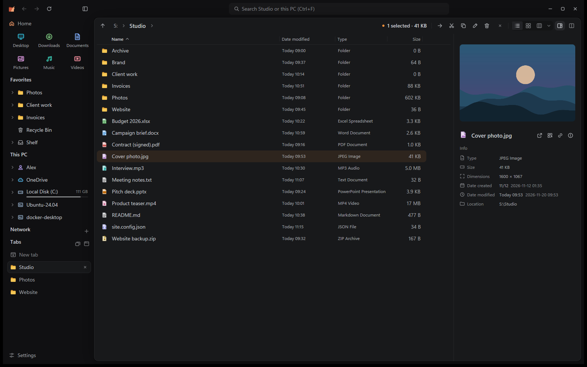
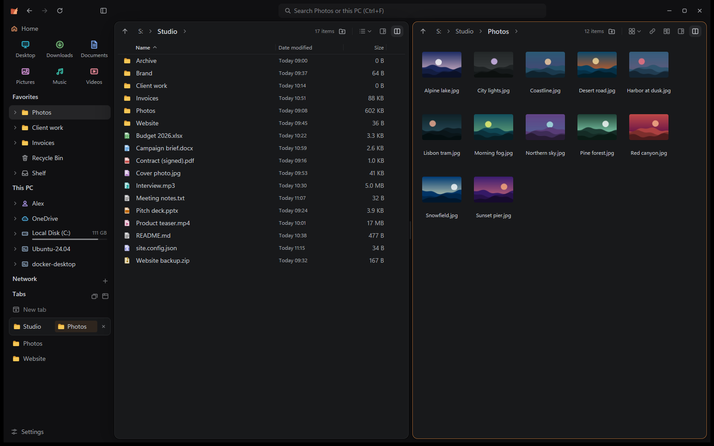
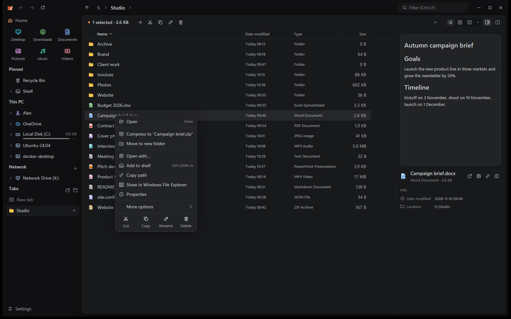
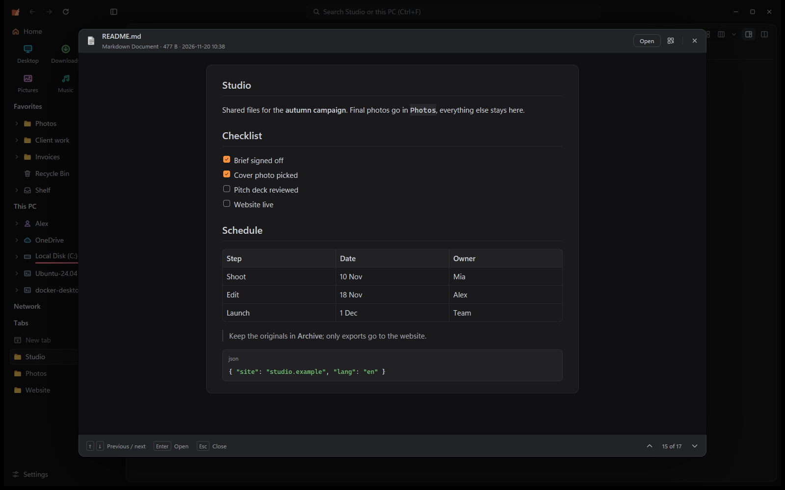
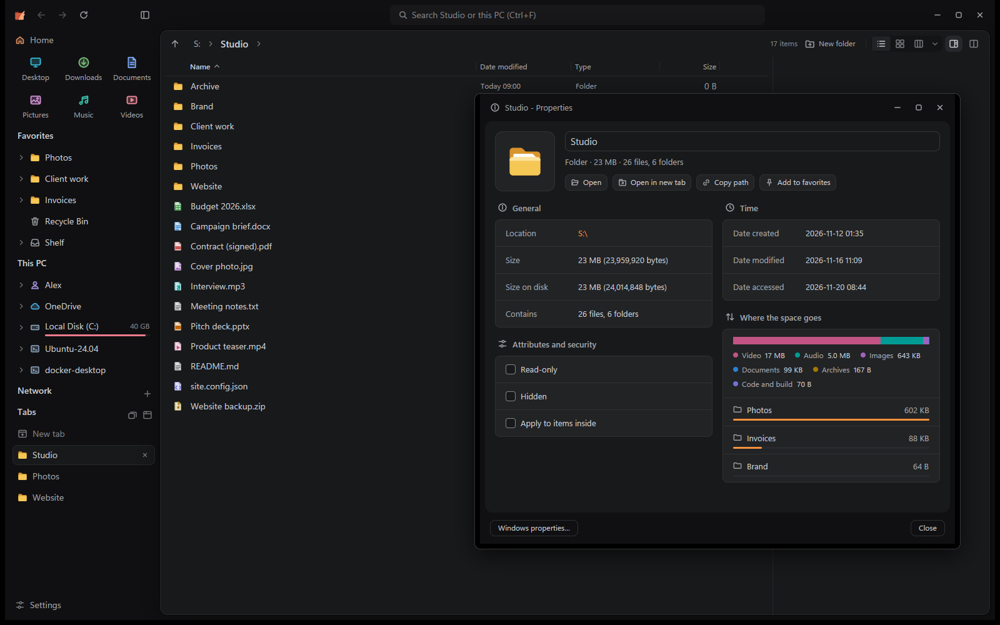
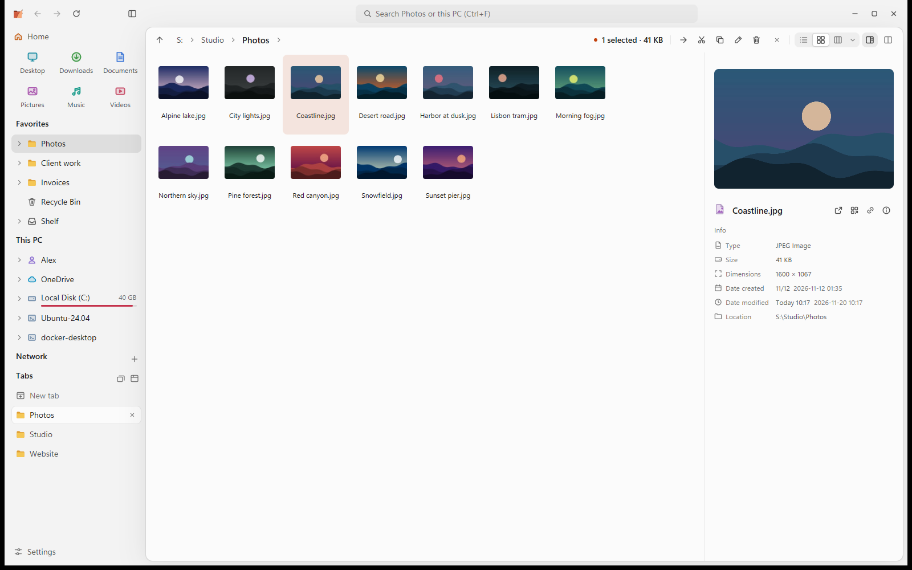
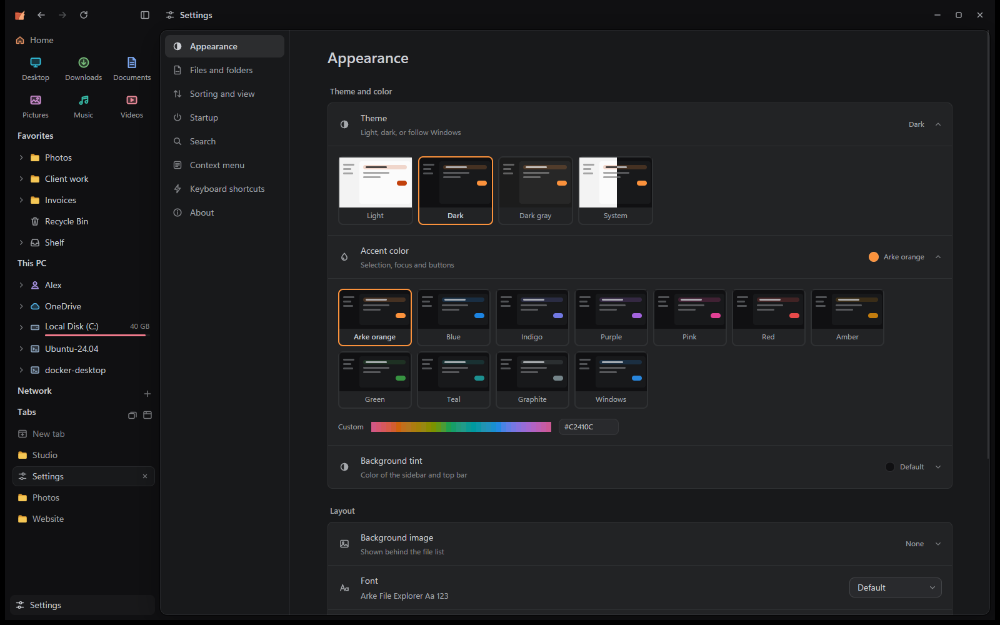
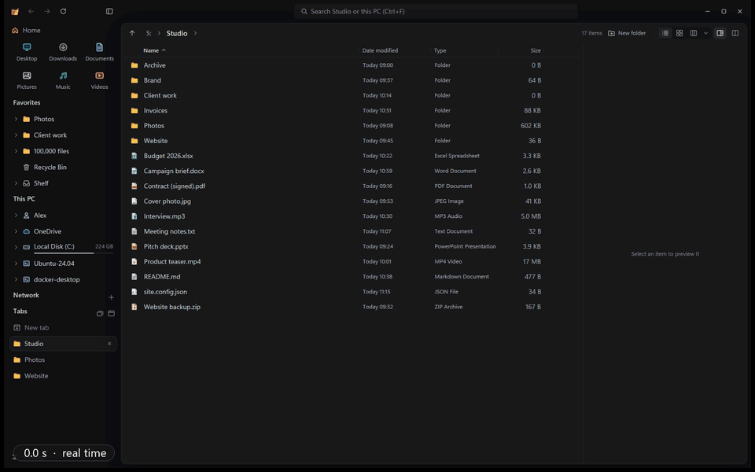
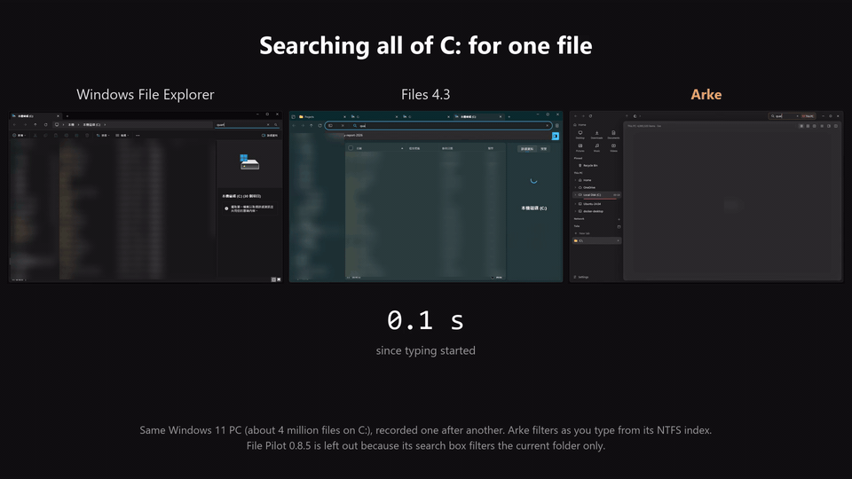
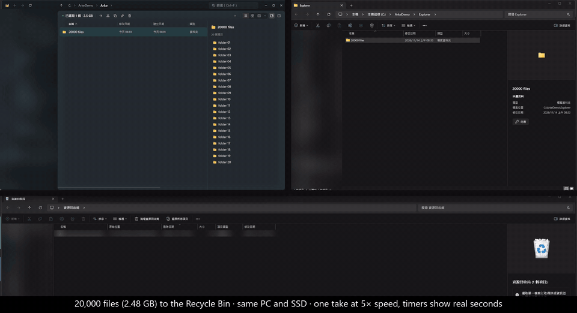

<p align="center"></p>

<h1 align="center">Arke</h1>

<p align="center"><b>Um explorador de arquivos para Windows que nunca trava.</b><br>
Renderizado pela GPU, escrito em Rust, um único exe pequeno.</p>

<p align="center">
  <a href="https://github.com/Koimsurai/Arke/releases"></a>
  <a href="https://github.com/Koimsurai/Arke/actions/workflows/ci.yml"></a>
  
  <a href="LICENSE"></a>
</p>

<p align="center"><a href="README.md">English</a> · <a href="README.zh-CN.md">简体中文</a> · <a href="README.zh-TW.md">繁體中文</a> · <a href="README.ja.md">日本語</a> · <a href="README.de.md">Deutsch</a> · <a href="README.es.md">Español</a> · <b>Português (Brasil)</b></p>

<p align="center"></p>

## Por que o Arke

**Ele continua respondendo.** Listagem, ordenação, miniaturas, tamanhos de pasta, pesquisa e
operações com arquivos rodam fora da thread da interface. Um compartilhamento de rede inacessível
ou uma pasta com 100.000 arquivos não impede você de rolar, digitar ou trocar de guia.

**Ele encontra qualquer coisa, na hora.** O Arke mantém um índice de nomes de arquivo dos seus
discos locais. Com o serviço opcional em segundo plano, ele lê diretamente a tabela mestra de
arquivos (MFT) do NTFS, indexando milhões de arquivos em segundos, e acompanha o journal de
alterações, de modo que o índice já está atualizado no instante em que você o abre.

**As operações com arquivos não fazem você esperar.** Uma pasta com 20.000 arquivos vai para a
Lixeira em 0,2 s, em vez de 47 s no Explorador de Arquivos, e é restaurada normalmente. Cópias e
movimentações mostram o progresso, entram em fila no mesmo disco, podem ser pausadas e podem ser
desfeitas.

**Foi feito para trabalhar em várias pastas ao mesmo tempo.** As guias ficam em uma barra lateral
vertical, podem ser fixadas e salvas como espaços de trabalho com nome. Qualquer guia se divide em
dois painéis que navegam em sincronia ou comparam seus conteúdos, e arrastar um arquivo para uma
guia, um favorito ou um segmento do caminho o solta ali mesmo.

**É seguro para o seu sistema.** O Arke não tem telemetria. Fora o serviço de pesquisa opcional,
que o Windows registra quando você o instala, o Arke só grava no registro se você ativar
"Abrir pastas no Arke": nesse caso, ele se registra como o manipulador de pastas da sua conta do
Windows (somente em `HKEY_CURRENT_USER\Software\Classes`), e desativar a opção devolve tudo ao
estado anterior. As extensões de shell de outros programas rodam em um processo separado, então uma
extensão com defeito não derruba o Arke.

Se o Arke é útil para você, uma ⭐ no GitHub ajuda outras pessoas a encontrá-lo.

O Arke foi destaque no [boletim semanal de tecnologia de Ruan Yifeng, edição 420](https://www.ruanyifeng.com/blog/2026/11/weekly-issue-420.html) e está listado no [awesome-rust](https://github.com/rust-unofficial/awesome-rust), no [awesome-gpui](https://github.com/zed-industries/awesome-gpui) e no AlternativeTo.

<p><a href="https://alternativeto.net/software/arke/about/?utm_source=badge&utm_medium=referral"></a></p>

## Recursos

<table>
  <tr>
    <td width="50%"></td>
    <td width="50%"></td>
  </tr>
  <tr>
    <td>Divida qualquer guia em dois painéis que navegam em sincronia ou comparam seus conteúdos.</td>
    <td>Um menu de contexto rápido próprio, com o menu completo do Windows a um clique de distância.</td>
  </tr>
  <tr>
    <td width="50%"></td>
    <td width="50%"></td>
  </tr>
  <tr>
    <td>A visualização rápida (Espaço) mostra Markdown como o GitHub faz, além de imagens, PDF, arquivos do Office e código.</td>
    <td>Uma janela de Propriedades própria (Alt+Enter) que mostra para onde vai o espaço de uma pasta.</td>
  </tr>
  <tr>
    <td width="50%"></td>
    <td width="50%"></td>
  </tr>
  <tr>
    <td>Exibições de detalhes, ícones e colunas, com um painel de visualização para a maioria dos tipos de arquivo.</td>
    <td>Temas claro, escuro e cinza escuro, cores de destaque e um matiz ou imagem de fundo.</td>
  </tr>
</table>

**Navegar**
- Exibições de detalhes, ícones (qualquer tamanho até 256 px, Ctrl+roda do mouse) e colunas. Em
  Detalhes, as pastas podem ser expandidas no próprio lugar, e você pode ordenar por várias colunas,
  reordenar colunas e mostrar os destinos de atalhos. Os itens podem ser agrupados, e um clique no
  título de um grupo o recolhe.
- Cada pasta lembra a sua exibição e a sua ordenação.
- Guias que você pode fixar ou salvar como espaços de trabalho. Divida uma guia em dois painéis com
  uma única visualização compartilhada, navegação sincronizada e comparação de pastas. Clique com o
  botão do meio ou Ctrl+clique em uma pasta na barra lateral, em Início ou na barra de endereços
  para abri-la em uma nova guia (Ctrl+clique duplo na lista de arquivos).
- A caixa de pesquisa fica no meio da barra de título e pesquisa no painel ativo. Cada painel tem
  sua própria linha com Acima, o caminho e os botões de exibição, então na exibição dividida cada
  lado mantém o seu próprio filtro.
- Arraste uma guia para fora para dar a ela uma janela própria, ou solte arquivos em uma guia para
  copiá-los ou movê-los para a pasta dela.
- Favoritos no topo da barra lateral e em Início, como blocos e como lista: adicione uma pasta ou
  uma guia pelo menu dela, ou arraste-a até lá. Arraste-os para reordenar (os outros abrem espaço,
  como os ícones de aplicativos em um celular) ou para fora para removê-los, e renomeie-os sem
  renomear a pasta. As pastas fixadas em Acesso rápido no Explorador de Arquivos também aparecem.
- Uma janela por padrão (desde a 0.7): pastas de outros aplicativos, Win+E e iniciar o Arke de novo
  adicionam uma guia à última janela usada. Desative "Janela única" nas configurações para ter uma
  janela para cada um.
- Com "Novas janelas abrem em: Últimas guias", as janelas abertas quando você encerra o Arke (ou o
  Windows é desligado) voltam com as suas guias. Uma janela que você fecha enquanto outras
  continuam abertas não é mantida.
- Pastas que se abrem ao arrastar sobre elas, uma prateleira para reunir arquivos de pastas
  diferentes e uma página Início com seus favoritos, arquivos recentes, unidades e locais de rede,
  cada um com o seu próprio menu de contexto (as unidades têm Ejetar, Formatar, Limpeza de Disco e
  Propriedades).
- Deslize com dois dedos no touchpad para voltar e avançar, como em um navegador.
- A barra lateral pode ser alargada arrastando a borda e se recolhe em uma coluna de ícones
  (Ctrl+B), que pode ser configurada para abrir sobre o conteúdo quando você pausa o ponteiro
  sobre ela (desativado por padrão). Favoritos, Este Computador e Rede se recolhem separadamente
  com um clique no título, Início, Favoritos e Este Computador podem ser ocultados, e a árvore de
  pastas acompanha a pasta em que você está. As colunas da exibição de colunas podem ser
  redimensionadas. O › antes da unidade na barra de caminho leva a Início, Documentos, qualquer
  unidade ou um compartilhamento de rede que você abriu.
- Escala da interface de 80% a 150%, somada à escala do próprio Windows.
- Paleta de comandos (Ctrl+Shift+P) para todos os comandos, e atalhos que você pode alterar.

**Visualização**
- Um painel de visualização redimensionável e a visualização rápida (Espaço) para imagens (SVG
  também), PDF, Word, Excel e PowerPoint, texto e código com realce de sintaxe, Markdown, arquivos
  compactados, arquivos `.gz` e pastas.
- Vídeos mostram um quadro e PDFs mostram a primeira página como miniatura. A visualização rápida
  amplia texto, documentos e páginas de PDF (Ctrl+roda), e o Espaço pode passar o item a outro
  programa de visualização, como o QuickLook.

**Pesquisa**
- Enquanto você digita, nesta pasta, nas subpastas ou em todo o computador, com correspondência
  aproximada e filtros de tipo, tamanho e data ([sintaxe de pesquisa](#sintaxe-de-pesquisa)).
- Pesquisa dentro de arquivos, incluindo PDF e documentos do Office, em uma pasta e suas subpastas.
- Arquivos e pastas que você abre com frequência vêm primeiro nos resultados de todo o computador.

**Arquivos**
- Copiar e mover pelo mecanismo do shell do Windows, com progresso, desfazer e refazer. Tarefas no
  mesmo disco entram em fila e podem ser pausadas, com verificação opcional após a cópia ou
  delegação a outro programa de cópia, como o TeraCopy (experimental). Muitos arquivos pequenos entre SSDs locais são copiados
  vários de uma vez, bem mais rápido que um por um.
- Renomear em lote, "Mover para nova pasta" e um menu de mover/copiar/atalho quando você arrasta com
  o botão direito do mouse ou solta com Alt pressionado.
- Uma janela de Propriedades própria (Alt+Enter): tamanhos, para onde vai o espaço de uma pasta,
  atributos, o aplicativo com que um arquivo abre, SHA-256 e desbloqueio de arquivos baixados. A do
  próprio Windows está a um clique de distância. Um disco inteiro é contabilizado em segundos, a
  partir do índice de pesquisa ou, com o serviço de pesquisa, da tabela de arquivos do disco, como
  o WizTree faz.

**Locais**
- Compartilhamentos de rede que falham rápido quando um servidor está offline e mostram o último
  conteúdo conhecido; `\\server` lista os seus compartilhamentos. Locais SFTP e WebDAV
  (experimental; http simples somente depois que você permitir para aquele local). Unidades
  mapeadas e locais de rede podem ter nomes próprios, guardados apenas no Arke.
- OneDrive e outras pastas na nuvem com status de sincronização. As visualizações nunca baixam
  arquivos que existem apenas online.
- Celulares e outros dispositivos conectados por USB aparecem em Este Computador: navegue por eles,
  abra arquivos e copie-os para o PC (por enquanto só leitura, então nada muda no dispositivo).
- Arquivos compactados: visualize e extraia zip e 7z (também com senha), tar (.gz, .xz, .bz2, .zst) e RAR, compacte em
  zip. RAR e os tars xz / bzip2 / zstd usam a libarchive incluída no Windows (melhor no Windows 11
  23H2 e posterior).

**Windows**
- Pastas grandes vão para a Lixeira de uma só vez em unidades locais: 20.000 arquivos em cerca de
  um quarto de segundo, em vez de 40 s, já que o Windows não verifica cada arquivo antes. Restaurar
  funciona normalmente, e tudo o que ele não pode garantir (unidades de rede, OneDrive, arquivos em
  uso, políticas) fica a cargo do Windows. Pode ser desativado nas configurações. Arquivos soltos
  levam alguns milissegundos cada, ainda de duas a seis vezes mais rápido que o Windows. Quando a
  Lixeira está cheia, os itens mais antigos abrem espaço, como no Explorador de Arquivos, sem deixar a
  exclusão mais lenta.
- As atualizações são baixadas em silêncio em segundo plano e instaladas na próxima vez que o Arke
  reiniciar, nunca enquanto arquivos estão sendo copiados e nunca em uma conexão limitada.
- Os menus abrem em janelas próprias, como os menus do Windows, então perto da borda eles passam
  além da janela do Arke em vez de ficarem espremidos. Os comandos do Windows que você fixa em
  "Mostrar mais opções" (Git Bash, Windows Terminal, VS Code, 7-Zip, NanaZip...) aparecem assim
  que o menu abre, e Shift+clique com o botão direito adiciona os estendidos, como no Explorador de
  Arquivos.
- Lançadores e scripts (Listary, ALTRun, AutoHotkey, PowerShell) podem ler as janelas, guias e
  seleção do Arke e abrir pastas por meio de uma única interface JSON ([docs/integration.md](docs/integration.md)).
- Silencioso quando ocioso: nada mudando na tela significa nada redesenhado, inclusive minimizado.
  Tamanhos de pasta, indexação e o serviço de pesquisa rodam com baixa prioridade no modo de
  eficiência do Windows, e com apenas o ícone da bandeja restante o Arke libera seus caches.
- Opcionalmente (experimental), abrir pastas no Arke em vez do Explorador de Arquivos (inclusive
  pastas abertas por outros aplicativos), também "Mostrar na pasta" de navegadores e "Abrir local do
  arquivo" de outros aplicativos. Ele registra o Arke como o manipulador de pastas da sua conta e é
  desfeito quando você desativa a opção. O Explorador de Arquivos que você inicia por conta própria
  (Win+E, a barra de tarefas, o menu Iniciar) continua sendo o Explorador de Arquivos, a menos que
  você também ative "Win+E e o ícone do Explorador de Arquivos também abrem o Arke".
- Suporte a leitores de tela, versões x64 e ARM64 (ambas testadas em hardware real), lista de
  atalhos da barra de tarefas, ejeção segura de USB, bandeja do sistema, backup das configurações.
  Inglês, chinês simplificado e tradicional, japonês, alemão, espanhol e português do Brasil
  (correções no texto são bem-vindas nas issues).

Os recursos *experimentais* são cobertos por testes automatizados e servidores de teste locais, mas
ainda não são amplamente usados; veja o [changelog](CHANGELOG.md). Comentários nas issues são
bem-vindos.

## Desempenho

<p align="center"></p>

<p align="center"></p>

<p align="center"></p>

| | Arke | Para comparação |
| --- | --- | --- |
| Montar do zero o índice do disco inteiro (cerca de 4 milhões de arquivos) | cerca de 10 s, cerca de 130 MB de memória depois | Everything 1.4.1: 21 s, cerca de 400 MB |
| Encontrar um arquivo em qualquer lugar do C: | os resultados aparecem enquanto você digita | Files 4.3: cerca de 26 s · Explorador de Arquivos: nenhum resultado após 30 s* |
| Abrir uma pasta com 100.000 arquivos | cerca de 0,7 s, 128 MB | File Pilot 0.8.5: 1,0–1,4 s, 563 MB · Explorador de Arquivos: 2–3 s |
| Enviar 20.000 arquivos (2,48 GB) para a Lixeira | 0,2 s | Explorador de Arquivos: 47,3 s |

\* O arquivo estava fora das pastas que o Windows Search indexa. Dentro delas, o Explorador de
Arquivos encontra arquivos muito mais rápido.

<details>
<summary>Como isso foi medido</summary>

Um PC: Intel i9-13900, 64 GB de RAM, Samsung 990 PRO NVMe, Windows 11 (build 26200), com
antivírus em tempo real ativado, o que deixa todos os programas mais lentos. Os caches do sistema
de arquivos estavam aquecidos.

- **Índice**: o serviço de pesquisa do Arke lendo a tabela mestra de arquivos do NTFS, em um perfil
  novo; Everything 1.4.1 Lite com o seu serviço, com tamanho do arquivo e data de modificação
  indexados (os padrões), depois de apagar o seu banco de dados. Os números do Arke vêm de
  `arke --bench index`, os do Everything do seu log de depuração; a memória é o working set após o
  fim da indexação.
- **Pesquisa**: cada programa iniciado em `C:\` e pesquisando o mesmo nome de arquivo; o cronômetro
  começa quando a digitação começa. O Explorador de Arquivos e o Files dependem do Windows Search
  para as pastas indexadas e varrem o disco nos demais lugares.
- **Pasta**: uma pasta com 100.000 arquivos gerados (`cargo run -p genfiles -- 100000`), aberta a
  partir de uma inicialização a frio de cada programa; mediana de três execuções após um
  aquecimento, cronometrada até a janela parar de mudar. O File Pilot (beta gratuito) só aparece
  neste teste: ele ainda não tem pesquisa em todo o disco.
- **Lixeira**: a mesma pasta (20.000 arquivos em 20 pastas, 2,48 GB) enviada para a Lixeira de cada
  programa em uma única tomada, cronometrada de Excluir até a pasta sair da lista. O Arke usa sua
  Lixeira rápida (ativada por padrão para unidades locais); ambos restauram a partir da Lixeira do
  Windows normalmente.

Os seus números serão diferentes. O Arke registra seus próprios tempos em `%LOCALAPPDATA%\Arke\arke.log`.

Execute `arke --bench index` para medir o índice no seu computador.

</details>

## Instalação

Baixe em [Releases](https://github.com/Koimsurai/Arke/releases). Os dois downloads são o mesmo
Arke, com os mesmos recursos e atualizações, e ambos guardam as configurações em `%APPDATA%\Arke`:

- **Portátil**, `arke-<version>.exe`: um único exe, sem runtime, que roda de qualquer pasta. Nada é
  instalado, então ele não aparece no menu Iniciar nem em Configurações › Aplicativos;
  Configurações › Sobre › **Remover o Arke deste computador** o remove.
- **Instalador**, `arke-<version>-setup.exe`: instala o Arke para a sua conta sem aprovação de
  administrador, ou para todos os usuários em Arquivos de Programas, e o adiciona ao menu Iniciar e
  a Configurações › Aplicativos, onde você pode desinstalá-lo.

Em PCs ARM64, use os arquivos `-arm64` (`arke-<version>-arm64.exe`,
`arke-<version>-arm64-setup.exe`).

Com o [Scoop](https://scoop.sh):

```bash
scoop bucket add arke https://github.com/Koimsurai/scoop-bucket
scoop install arke/arke
```

O Scoop passa a mantê-lo atualizado (`scoop update arke`), e o Arke deixa as atualizações com ele.

As versões ainda não têm assinatura de código, então o SmartScreen pode pedir confirmação na
primeira vez. A assinatura pela SignPath Foundation está em andamento, veja a
[política de assinatura de código](#política-de-assinatura-de-código).

O Arke consulta o GitHub por uma nova versão no máximo uma vez por dia e só instala uma quando você
mandar (Configurações › Sobre).

<details>
<summary><b>Serviço opcional em segundo plano</b></summary>

Configurações › Pesquisa › Atualizações em tempo real instala um pequeno serviço do Windows, com
aprovação de administrador. Ele lê apenas o journal de alterações e a tabela mestra de arquivos do
sistema de arquivos, nunca o conteúdo dos arquivos, e nunca informa nomes dentro das pastas de
perfil de outros usuários. Você pode removê-lo no mesmo lugar.

</details>

## Sintaxe de pesquisa

Digite na caixa de pesquisa (Ctrl+F). O painel abaixo dela escolhe o escopo (esta pasta, subpastas
ou todo o computador) e os filtros; Tab move o foco para ele. Esta pasta é filtrada de forma
aproximada, então `rprt` encontra `report`. Subpastas e todo o computador listam os nomes que contêm as
palavras como foram digitadas; os que só têm as letras na ordem ficam em "Resultados semelhantes" até
que seja aberto, e aparecem na hora quando nada corresponde exatamente. Comece com `'` (`'report`) para
ver só correspondências exatas. Os filtros também podem ser digitados e combinados:

| Filtro | Exemplo | Significado |
| --- | --- | --- |
| `type:` | `type:image;video`, `type:folder` | Tipo de arquivo: folder, document, image, audio, video, archive, code, app |
| `ext:` ou `*.` | `ext:pdf;docx`, `*.png` | Extensão do arquivo |
| `size:` | `size:>10mb`, `size:1mb..10mb`, `size:large` | Tamanho do arquivo (`empty`, `tiny`, `small`, `medium`, `large`, `huge`, `gigantic`, como no Everything) |
| `dm:` | `dm:today`, `dm:7d`, `dm:2026-11`, `dm:>2026-01-01` | Data de modificação: uma palavra-chave, as últimas N horas/dias/semanas ou um intervalo de datas |
| `file:` / `folder:` | `folder: photos` | Somente arquivos ou somente pastas |
| `folder\name` | `docs\report` | Nome dentro de uma pasta cujo nome corresponde a `docs` |
| `content:` | `content:"due date"` | Texto dentro de arquivos, incluindo PDF e documentos do Office (esta pasta e subpastas) |

Com filtros mas sem nome (`ext:pdf dm:7d`), os resultados são listados do mais novo para o mais
antigo. As palavras-chave de data também funcionam no idioma da interface (今天, 本周, 本週…). Em
todo o computador, o que você abre com frequência fica mais bem posicionado; desative isso ou
limpe em Configurações › Pesquisa.

## Teclado

<details>
<summary>Atalhos</summary>

| Teclas | Ação |
| --- | --- |
| Ctrl+T | Ir para uma pasta (locais recentes, guias abertas e caminhos) |
| Ctrl+Shift+P | Paleta de comandos: pesquise qualquer comando e execute-o; todos os atalhos podem ser alterados em Configurações › Atalhos de teclado |
| Ctrl+N | Nova janela na pasta atual |
| Ctrl+W · Ctrl+Shift+T | Fechar guia (na exibição dividida, o lado ativo) · reabrir a guia fechada |
| Ctrl+Tab · Ctrl+Shift+Tab · Ctrl+1…9 | Alternar entre guias |
| Ctrl+Shift+S · Ctrl+Shift+D | Painel duplo: navegação sincronizada · comparar pastas |
| Tab · Alt+C · Alt+M | Exibição dividida: alternar entre painéis · copiar · mover a seleção para o outro painel |
| Ctrl+F · Ctrl+Shift+F · Ctrl+K | Pesquisar nesta pasta · nesta pasta e subpastas · em todo o computador; Tab move o foco para o escopo e os filtros |
| Ctrl+L · Alt+D | Editar o caminho |
| F6 · Shift+F6 | Próxima · anterior área: lista de arquivos, barra lateral, barra de caminho, barra de ferramentas, caixa de pesquisa |
| Alt+← · Alt+→ · Alt+↑ | Voltar · avançar · acima |
| F5 · Ctrl+R | Atualizar |
| Espaço | Visualização rápida |
| F2 | Renomear (vários selecionados: renomeia todos) |
| Shift+F10 | Menu de contexto |
| Ctrl+Shift+N | Nova pasta |
| Ctrl+C · Ctrl+X · Ctrl+V | Copiar · recortar · colar, compartilhado com o Explorador de Arquivos |
| Ctrl+Shift+C | Copiar caminho |
| Ctrl+Z · Ctrl+Y ou Ctrl+Shift+Z | Desfazer · refazer a última operação com arquivos |
| Ctrl+Shift+A | Adicionar à prateleira |
| Delete · Shift+Delete | Mover para a Lixeira · excluir permanentemente |
| Ctrl+H | Mostrar itens ocultos |
| Ctrl+Shift+1…4 · Ctrl+Shift+6 | Ícones, de extragrandes a pequenos · exibição de detalhes |
| Ctrl+, | Configurações |

</details>

## Acessibilidade

O Arke funciona com os leitores de tela do Windows por meio do UI Automation, a interface usada pelo
Narrator e pelo NVDA; o JAWS também deve funcionar. Foi verificado com o NVDA e com ferramentas de UI
Automation. Retornos de pessoas que usam leitor de tela no dia a dia são muito bem-vindos, também
sobre outros leitores de tela.

Funciona pelo teclado e com leitor de tela: a lista de arquivos, a barra lateral, as guias, a barra
de caminho, a barra de ferramentas, a pesquisa, as Configurações, os menus e a janela de
Propriedades. F6 e Shift+F6 passam de uma área para outra. Alguns diálogos ainda não foram verificados.

O [guia de teclado](docs/keyboard.md) (em inglês) lista todos os atalhos por área. Se algo não puder
ser alcançado ou não for anunciado, [abra uma issue](https://github.com/Koimsurai/Arke/issues) e
informe seu leitor de tela e a versão.

## Perguntas frequentes

<details>
<summary><b>A AGPL me afeta se eu apenas usar o Arke, em casa ou no trabalho?</b></summary>

Não. A licença só acrescenta obrigações quando você distribui um Arke modificado (ou o oferece por
uma rede); usá-lo, inclusive dentro de uma empresa, não traz nenhuma.

</details>

<details>
<summary><b>O que ele altera no meu sistema?</b></summary>

Nada, a menos que você peça. Instalar o serviço de pesquisa opcional (com a sua aprovação) o
registra no Windows, que mantém os serviços em
`HKEY_LOCAL_MACHINE\SYSTEM\CurrentControlSet\Services\ArkeIndex`. Fora isso, a única alteração no
registro é a configuração opcional "Abrir pastas no Arke", que registra o Arke como o manipulador de pastas da sua conta do Windows, somente em
`HKEY_CURRENT_USER\Software\Classes`: os verbos `open` e `explore` de `Folder` (de modo que toda
pasta que o shell abre, inclusive "Mostrar na pasta" de navegadores e editores, inicia o Arke em
vez do Explorador de Arquivos; o que o Arke não consegue mostrar, como o Painel de Controle, é
repassado direto ao Explorer) e, somente com "Win+E e o ícone do Explorador de Arquivos também
abrem o Arke", o manipulador de Win+E. O que existia antes é salvo em
`%APPDATA%\Arke\folder-handler-backup.json` e restaurado exatamente quando você desativa a
configuração ou executa `arke --restore-explorer`. O Arke também continua observando novas janelas
do Explorer para os casos que o registro não alcança, como `explorer.exe /select,...`. Em PCs em
que o Windows envia Win+E direto ao Explorador de Arquivos sem consultar o registro (uma mudança
que o Windows vem implantando desde o fim de 2026), o Arke assume o Win+E com um hook de teclado
enquanto roda em segundo plano: ele só reage ao E enquanto uma tecla Windows está pressionada e não
grava nada. As configurações ficam em `%APPDATA%\Arke`, o índice de pesquisa, o log e as
atualizações baixadas em `%LOCALAPPDATA%\Arke`. "Iniciar quando eu entrar no Windows" é um atalho na
sua pasta Inicializar, e "Mostrar o Arke no menu Iniciar" um na sua pasta do menu Iniciar. As senhas
de locais SFTP e WebDAV vão para o Gerenciador de Credenciais do Windows, e somente quando você
marca "Lembrar". O serviço de pesquisa opcional é a única parte que precisa de aprovação de
administrador. O instalador, se você o usar, adiciona a entrada de desinstalação que o Windows lista
em Configurações › Aplicativos (para a sua conta, ou para todos os usuários quando instalado ali) e
pede aprovação apenas para uma instalação para todos os usuários.

</details>

<details>
<summary><b>Como removo tudo completamente?</b></summary>

Configurações › Sobre › **Remover o Arke deste computador**. Ele remove o serviço de pesquisa se
você o instalou (o Windows pede aprovação de administrador para essa parte), os atalhos do menu
Iniciar e de "Iniciar quando eu entrar no Windows", as senhas SFTP e WebDAV salvas, a lista de
atalhos, `%LOCALAPPDATA%\Arke`, `%APPDATA%\Arke` (a menos que você marque "Manter minhas
configurações") e, por fim, o próprio exe, e então mostra o que removeu.

Em um terminal ou script: `arke --uninstall`, com `--keep-settings`, `--quiet` (sem diálogos,
apenas o pedido de administrador para o serviço) ou `--dry-run` (apenas lista o que removeria).
Instalou com Scoop ou winget (quando o Arke estiver disponível no winget)? `arke --uninstall` deixa o exe para o gerenciador de pacotes; remova-o
com `scoop uninstall arke` ou `winget uninstall Koimsurai.Arke`.

Ele também desativa "Abrir pastas no Arke" e restaura o manipulador de pastas anterior. Vai remover o Arke manualmente? Desative essa configuração (ou execute `arke --restore-explorer`) **antes** de apagar o exe, para que as pastas continuem abrindo no Explorador de Arquivos.

</details>

<details>
<summary><b>Por que o SmartScreen ou meu antivírus emite um aviso?</b></summary>

As versões ainda não têm assinatura de código, e um exe novo sem assinatura não tem reputação no
SmartScreen. Cada versão traz nas suas notas uma soma de verificação SHA-256 e uma análise do
VirusTotal dos exes, e você sempre pode compilá-lo a partir do código-fonte por conta própria. Para
versões posteriores à 0.1.0,
`gh attestation verify arke-<version>.exe -R Koimsurai/Arke` confirma que um exe foi compilado pelo fluxo de trabalho de versões deste repositório.

Alguns antivírus bloqueiam cada nova versão até que você a permita. Se ele impedir a nova versão
quando o Arke reiniciar após uma atualização, o Arke restaura a versão que você tinha e avisa;
permita o `arke.exe` no seu antivírus e atualize de novo.

</details>

<details>
<summary><b>Haverá uma versão para Linux ou macOS?</b></summary>

Ainda não. O `crates/core` é em grande parte independente de plataforma, mas as partes que tornam o
Arke rápido no Windows (o índice MFT, a integração com o shell) são específicas do Windows. Conte
em uma issue o que você precisaria.

</details>

## Relatar um problema

O jeito mais fácil é pelo Arke: **Configurações › Sobre › Relatar um problema › Abrir uma issue no GitHub**.
Ele preenche as versões do Arke e do Windows, as principais configurações e as últimas linhas do
log, com os nomes de conta, computador, servidor e arquivos removidos. Você também pode copiar o
relatório ou salvá-lo como arquivo e enviá-lo de outra forma, e **Mostrar arquivo de log** abre o
próprio log.

Se o Arke não iniciar, o log está em `%LOCALAPPDATA%\Arke\arke.log`.

## Compilar a partir do código-fonte

Você precisa do Windows 10 ou 11, das ferramentas de build do MSVC e do rustup; a versão da
toolchain é fixada em `rust-toolchain.toml` e instalada automaticamente.

```bash
cargo arke                     # run
cargo arke -- "C:\Windows"     # open a folder
cargo nextest run --workspace  # tests
cargo lint                     # clippy, as strict as CI
```

| Caminho | |
| --- | --- |
| `crates/core` | Modelo independente de plataforma: listagem, ordenação, filtragem, pesquisa, índice |
| `crates/app` | O aplicativo GPUI e a integração com o Windows |
| `crates/indexd` | O serviço opcional em segundo plano (MFT e journal USN) |
| `tools/xtask` | Ferramentas de lançamento: changesets, versionamento, empacotamento, publicação |

Por enquanto, o Arke não aceita pull requests, mas relatos de bugs e ideias são muito bem-vindos
como [issues](https://github.com/Koimsurai/Arke/issues). Veja [CONTRIBUTING.md](CONTRIBUTING.md)
para as convenções e o processo de lançamento.

## Agradecimentos

O Arke é construído sobre o [GPUI](https://github.com/zed-industries/zed/tree/main/crates/gpui), o
framework de interface do editor Zed, e sobre os crates de código aberto listados em
[THIRD_PARTY_LICENSES.md](THIRD_PARTY_LICENSES.md). A sintaxe de pesquisa segue o
[Everything](https://www.voidtools.com/), o visual deve muito ao aplicativo
[Files](https://files.community/), e a barra lateral de guias é uma homenagem ao navegador Arc.

Obrigado à comunidade [LINUX DO](https://linux.do).

O nome vem da mitologia grega: Arke é a irmã gêmea de Íris, ambas mensageiras aladas.

## Política de assinatura de código

Free code signing provided by [SignPath.io](https://about.signpath.io/), certificate by
[SignPath Foundation](https://signpath.org/) (assinatura de código gratuita da SignPath.io, certificado
emitido pela SignPath Foundation).

- Commits e revisão: [Koimsurai](https://github.com/Koimsurai)
- Aprovação: [Koimsurai](https://github.com/Koimsurai)

Só são assinados os exe que o fluxo de publicação deste repositório no GitHub Actions compila a
partir de um commit com tag, e cada versão é aprovada manualmente antes de ser assinada.

## Privacidade

O Arke não coleta nem envia nenhum dado sobre você ou seus arquivos. Ele só se conecta à internet
para consultar o GitHub por uma nova versão (no máximo uma vez por dia, pode ser desativado em
Configurações › Sobre), para baixar uma quando você escolhe instalá-la e para acessar os
compartilhamentos de rede e os locais SFTP e WebDAV que você mesmo abre.

Se o GitHub estiver lento ou bloqueado onde você está, Configurações › Sobre › Atualizações › Rota de
download envia a busca e o download de atualizações por um espelho (um endereço `https://` colocado antes
do endereço do GitHub) ou um proxy HTTP (`host:porta`) que você escolher. O Arke não inclui nenhum e só
usa um se você digitar. Quem o opera vê seu endereço IP e qual versão do Arke você consulta ou baixa;
nada mais passa por ele. Se falhar, o Arke consulta o GitHub diretamente e mostra isso abaixo da
configuração. O Arke só instala downloads assinados com a própria chave, então um espelho ou proxy não
consegue empurrar uma versão alterada ou mais antiga.

## Licença

[AGPL-3.0](LICENSE). Os avisos de terceiros estão em [THIRD_PARTY_NOTICES.md](THIRD_PARTY_NOTICES.md), e
os textos completos das licenças das dependências incluídas no exe em
[THIRD_PARTY_LICENSES.md](THIRD_PARTY_LICENSES.md) (também em Configurações › Sobre › Licenças).
