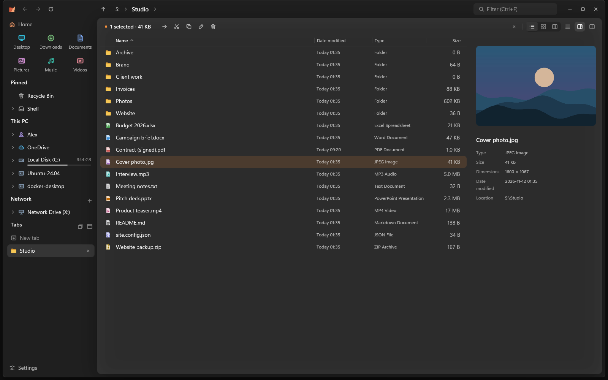
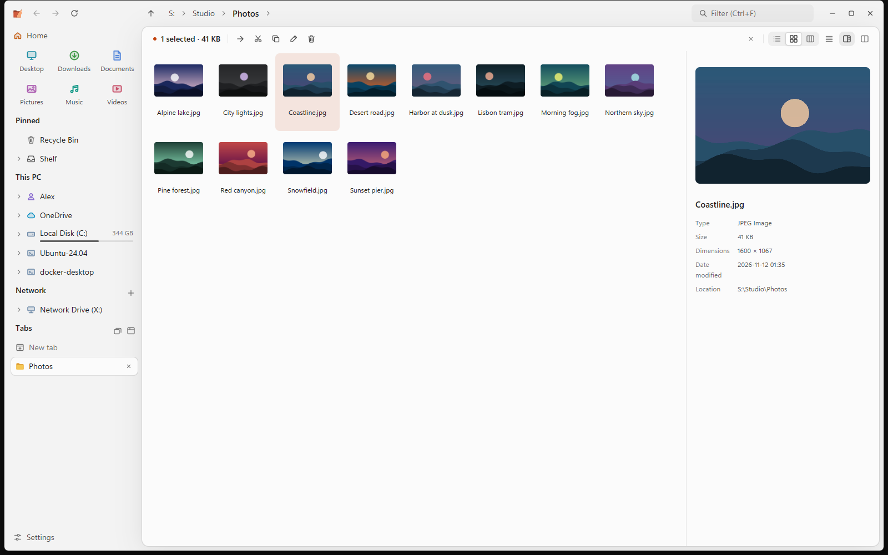
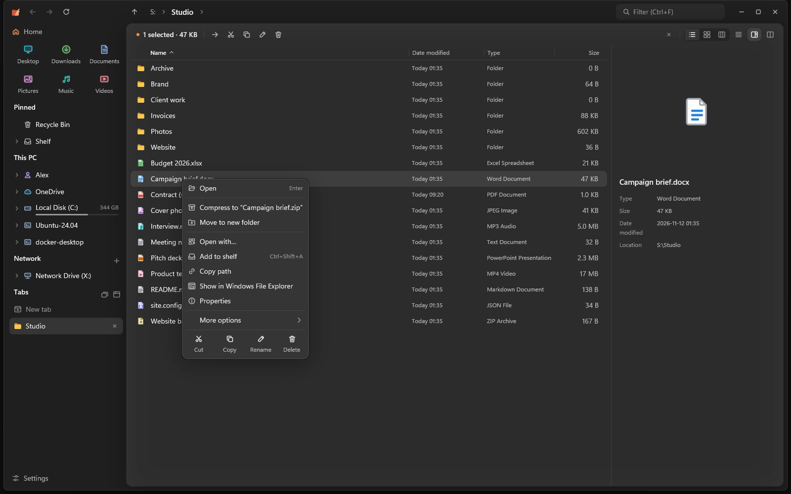
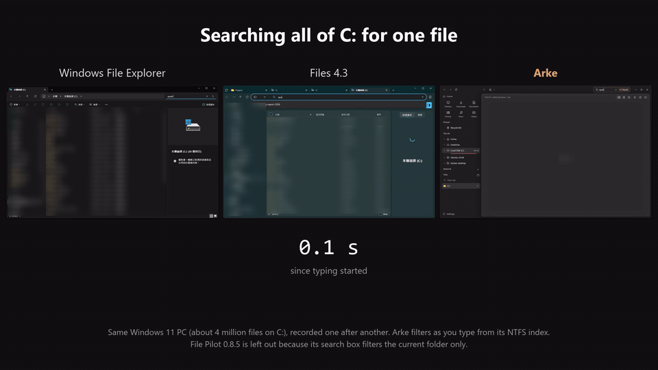

<p align="center"></p>

<h1 align="center">Arke</h1>

<p align="center"><b>永远不卡的 Windows 文件管理器。</b><br>
GPU 渲染，用 Rust 写成，只有一个小小的 exe。</p>

<p align="center">
  <a href="https://github.com/Koimsurai/Arke/releases"></a>
  <a href="https://github.com/Koimsurai/Arke/actions/workflows/ci.yml"></a>
  
  <a href="LICENSE"></a>
</p>

<p align="center"><a href="README.md">English</a> · <b>简体中文</b> · <a href="README.zh-TW.md">繁體中文</a></p>

<p align="center"></p>

## 为什么用 Arke

**不会卡。** 列目录、排序、缩略图、文件夹大小、搜索、文件操作全都在后台进行。连不上的网络位置、
十万个文件的文件夹，都不会让你滚动、打字或切换标签页时停住。

**什么都找得到，而且马上。** Arke 为本地磁盘维护一份文件名索引。装上可选的后台服务后，它直接读取
NTFS 的主文件表，几秒就能为几百万个文件建好索引，并持续跟随更改日志，打开时索引就是最新的。

**同时开很多文件夹也顺手。** 标签页放在竖排侧边栏里，可以固定，也能整组存成工作区。任何标签页都能
分成左右两个窗格，同步浏览或比较两边的内容；把文件拖到标签页、固定的文件夹或路径栏的某一层，就直接放进那里。

**不乱动你的系统。** Arke 没有遥测。除了安装可选的搜索服务时由 Windows 注册这个服务，只有在你开启
“用 Arke 打开文件夹”时才会写注册表：它会把自己注册为你这个 Windows 账户的文件夹打开程序（只改 `HKEY_CURRENT_USER\Software\Classes`），关掉设置就全部还原。
其他程序加进右键菜单的扩展在独立进程里运行，出问题的扩展不会让 Arke 崩溃。

## 功能

<table>
  <tr>
    <td width="50%"></td>
    <td width="50%"></td>
  </tr>
  <tr>
    <td>详细信息、图标、分栏三种视图，浅色和深色主题，可以换强调色和背景。</td>
    <td>Arke 自己的右键菜单，弹出很快；完整的 Windows 菜单也只差一步。</td>
  </tr>
</table>

**浏览**
- 详细信息、图标（大小可以自由调整，Ctrl+滚轮）、分栏三种视图。详细信息里可以就地展开文件夹、
  按多列排序、调整列的顺序、显示链接目标。
- 每个文件夹记得自己的视图和排序。
- 标签页可以固定、存成工作区。标签页分成左右两个窗格时共用一个预览，可以同步浏览、比较文件夹。
- 拖动时自动打开文件夹，用“暂存架”收集不同文件夹里的文件，主页有最近的文件、磁盘和网络位置。

**预览**
- 可调宽度的预览窗格和快速预览（空格键）：图片、PDF、Word、Excel、PowerPoint、带语法高亮的
  文本和代码、Markdown、压缩包、文件夹。

**搜索**
- 边打边搜索，范围可以是当前文件夹、包含子文件夹或整台电脑，支持模糊匹配和类型、大小、日期筛选
  （见[搜索语法](#搜索语法)）。
- 搜索文件内容，连 PDF 和 Office 文档里的文字都能找到（当前文件夹和子文件夹）。
- 整台电脑的结果会把你常打开的文件和文件夹排在前面。

**文件操作**
- 交给 Windows 的引擎，有进度、撤销和重做。同一块磁盘上的任务会排队、可以暂停，也可以选择复制后校验，
  或交给 TeraCopy（实验性）。
- 一次重命名多个文件、“移到新文件夹”；用右键拖动或按住 Alt 放下时，可以选择移动、复制或创建快捷方式。

**位置**
- 网络位置：服务器离线时马上告诉你、显示上次看到的内容；`\\服务器` 会列出它的共享文件夹。
  也能连接 SFTP 和 WebDAV（实验性）。
- OneDrive 和其他云文件夹显示同步状态，预览不会下载只在云端的文件。
- 压缩包：预览和解压 zip、7z、tar（.gz、.xz、.bz2、.zst）和 RAR，压缩成 zip。RAR 和
  xz／bzip2／zstd 的 tar 使用 Windows 内置的 libarchive（Windows 11 23H2 及以上最完整）。

**Windows 集成**
- 在本机磁盘上，大文件夹直接进回收站：两万个文件约 0.25 秒，不必等 Windows 先逐一检查每个文件（原来约
  40 秒）。还原方式不变；没把握的情况（网络磁盘、OneDrive、被占用的文件、组策略）照样交给 Windows。
  可以在设置关闭。
- 可以选择（实验性）让文件夹改用 Arke 打开，代替文件资源管理器（其他程序打开的文件夹也算），连浏览器的
  “在文件夹中显示”、其他程序的“打开文件所在的位置”都会接过来。它会把 Arke 注册为你账户的文件夹打开
  程序，关掉设置就还原。自己打开的文件资源管理器（Win+E、任务栏、开始菜单）仍是文件资源管理器，除非另外
  打开“Win+E 和文件资源管理器图标也打开 Arke”。
- 支持屏幕阅读器，提供 x64 和 ARM64 版本（ARM64 还没在真正的 ARM 电脑上测试过）；任务栏的跳转列表、
  安全弹出 U 盘、通知区域图标、设置备份。界面有英文、简体中文和繁体中文。

标为“实验性”的功能已有自动化测试和本地测试服务器验证，但还没有很多人实际使用，详见
[更新日志](CHANGELOG.md)。欢迎在 issue 里反馈。

## 性能

<p align="center"></p>

| | Arke | 对照 |
| --- | --- | --- |
| 从零建好全盘索引（约 400 万个文件） | 约 10 秒，建完后约占 130 MB 内存 | Everything 1.4.1：21 秒，约 400 MB |
| 在整个 C 盘找一个文件 | 边打字边出结果 | Files 4.3：约 26 秒 · 文件资源管理器：30 秒后仍没有结果* |
| 打开一个有 10 万个文件的文件夹 | 约 0.7 秒，128 MB | File Pilot 0.8.5：1.0–1.4 秒，563 MB · 文件资源管理器：2–3 秒 |

\* 那个文件放在 Windows Search 没有建立索引的位置。如果在有索引的文件夹里，文件资源管理器会快很多。

<details>
<summary>测量方式</summary>

同一台电脑：Intel i9-13900、64 GB 内存、Samsung 990 PRO NVMe、Windows 11（build 26200），
开着实时扫描的杀毒软件，所有程序都会被拖慢。文件系统缓存是热的。

- **索引**：Arke 的搜索服务读取 NTFS 主文件表，使用全新的配置；Everything 1.4.1 Lite 搭配它的服务，
  索引文件大小和修改日期（默认值），先删掉它的数据库再重建。Arke 的数字来自 `arke --bench index`，
  Everything 的来自它的调试日志；内存是建完索引后的工作集。
- **搜索**：每个程序都从 `C:\` 开始搜索同一个文件名，计时从开始打字算起。文件资源管理器和 Files
  在有索引的文件夹里用 Windows Search，其他地方则要扫描磁盘。
- **文件夹**：用 `cargo run -p genfiles -- 100000` 生成 10 万个文件，每个程序都从冷启动打开；预热一次
  后测三次取中位数，计到窗口画面不再变化为止。File Pilot（免费测试版）只参加这一项，因为它还没有全盘搜索。

你的数字会不一样。Arke 会把自己的计时写在 `%LOCALAPPDATA%\Arke\arke.log`。

运行 `arke --bench index` 可以在你的电脑上测索引。

</details>

## 安装

到 [Releases](https://github.com/Koimsurai/Arke/releases) 下载 `arke-<版本>.exe`（ARM64 电脑用 `arke-<版本>-arm64.exe`）直接运行。
只有一个 exe，不需要安装程序，也不需要装运行库。设置保存在 `%APPDATA%\Arke`。

目前还没有代码签名，第一次运行时 SmartScreen 可能会让你确认。通过 SignPath Foundation 的签名
正在申请中，见[代码签名政策](#代码签名政策)。

Arke 一天最多向 GitHub 检查一次新版本，你同意后才会安装（设置 › 关于）。

<details>
<summary><b>可选的后台服务</b></summary>

设置 › 搜索 › 实时更新 可以安装一个小的 Windows 服务（需要管理员同意）。它只读取文件系统的更改日志
和主文件表，不读文件内容，也不会报告其他用户个人文件夹里的名称。在同一个地方可以卸载。

</details>

## 搜索语法

在搜索框（Ctrl+F）里输入。下方的面板可以选范围（当前文件夹、包含子文件夹、整台电脑）和筛选，按 Tab
就能进入面板。名称是模糊匹配，`rprt` 也能找到 `report`。筛选也可以直接输入，并且可以组合使用：

| 筛选 | 例子 | 含义 |
| --- | --- | --- |
| `type:` | `type:image;video`、`type:folder` | 种类：文件夹、文档、图片、音频、视频、压缩包、代码、应用程序 |
| `ext:` 或 `*.` | `ext:pdf;docx`、`*.png` | 扩展名 |
| `size:` | `size:>10mb`、`size:1mb..10mb`、`size:large` | 文件大小（`empty`、`tiny`、`small`、`medium`、`large`、`huge`、`gigantic` 和 Everything 一样） |
| `dm:` | `dm:今天`、`dm:7d`、`dm:2026-11`、`dm:>2026-01-01` | 修改日期：关键词、最近几小时／天／周，或日期范围 |
| `file:` / `folder:` | `folder: 照片` | 只找文件或只找文件夹 |
| `文件夹\名称` | `docs\report` | 在名称匹配 `docs` 的文件夹里找 |
| `content:` | `content:"截止日期"` | 文件里的文字，包括 PDF 和 Office 文档（当前文件夹和子文件夹） |

只有筛选、没有名称时（`ext:pdf dm:7d`），结果按时间从新到旧排列。日期关键词英文和界面语言都能用
（`today`、`今天`、`本周`…）。搜索整台电脑时，常打开的项目会排得更靠前；可以在 设置 › 搜索 关闭或清除记录。

## 键盘

<details>
<summary>快捷键</summary>

| 按键 | 功能 |
| --- | --- |
| Ctrl+T | 转到文件夹（最近去过的位置、打开的标签页和路径） |
| Ctrl+W · Ctrl+Shift+T | 关闭标签页（拆分视图时只关当前这一侧）· 重新打开关闭的标签页 |
| Ctrl+Tab · Ctrl+Shift+Tab · Ctrl+1…9 | 切换标签页 |
| Ctrl+Shift+S · Ctrl+Shift+D | 双窗格：同步浏览 · 比较文件夹 |
| Tab · Alt+C · Alt+M | 拆分视图：切换窗格 · 把选中的项目复制 · 移动到另一侧 |
| Ctrl+F · Ctrl+Shift+F · Ctrl+K | 搜索当前文件夹 · 当前文件夹和子文件夹 · 整台电脑；Tab 进入范围和筛选面板 |
| Ctrl+L · Alt+D | 编辑路径 |
| Alt+← · Alt+→ · Alt+↑ | 后退 · 前进 · 上一级 |
| F5 · Ctrl+R | 刷新 |
| 空格 | 快速预览 |
| F2 | 重命名（多选时一起改） |
| Shift+F10 | 右键菜单 |
| Ctrl+Shift+N | 新建文件夹 |
| Ctrl+C · Ctrl+X · Ctrl+V | 复制 · 剪切 · 粘贴（和文件资源管理器共用） |
| Ctrl+Shift+C | 复制路径 |
| Ctrl+Z · Ctrl+Y 或 Ctrl+Shift+Z | 撤销 · 重做上一个文件操作 |
| Ctrl+Shift+A | 添加到暂存架 |
| Delete · Shift+Delete | 移到回收站 · 永久删除 |
| Ctrl+H | 显示隐藏的项目 |
| Ctrl+Shift+1…4 · Ctrl+Shift+6 | 图标，从超大到小 · 详细信息视图 |
| Ctrl+, | 设置 |

</details>

## 常见问题

<details>
<summary><b>AGPL 对我有影响吗？我只是在家里或公司里用。</b></summary>

没有。许可证只在你分发修改过的 Arke（或通过网络提供它）时才有义务；单纯使用，包括在公司内部使用，
都没有任何义务。

</details>

<details>
<summary><b>它会改动我的系统吗？</b></summary>

你不要求就不会。安装可选的搜索服务时（需要你同意），Windows 会把它注册在
`HKEY_LOCAL_MACHINE\SYSTEM\CurrentControlSet\Services\ArkeIndex`。除此之外，唯一会改注册表的是可选的
“用 Arke 打开文件夹”：它把 Arke 注册为你这个 Windows 账户的文件夹打开程序，只写 `HKEY_CURRENT_USER\Software\Classes` 下面：`Folder` 的 `open` 和 `explore` 操作
（shell 打开任何文件夹都会启动 Arke，包括浏览器、编辑器的“在文件夹中显示”；Arke 不能显示的，例如控制面板，
会直接交给文件资源管理器），以及打开“Win+E 和文件资源管理器图标也打开 Arke”时的 Win+E 处理程序。原来的内容会备份到
`%APPDATA%\Arke\folder-handler-backup.json`，你关掉设置或运行 `arke --restore-explorer` 时原样放回去。
对注册表覆盖不到的情况（例如 `explorer.exe /select,...`），Arke 仍会在运行时留意新打开的资源管理器窗口。
设置保存在 `%APPDATA%\Arke`，搜索索引、日志和下载的
更新在 `%LOCALAPPDATA%\Arke`。“登录 Windows 时启动”是在“启动”文件夹里放一个快捷方式，“在开始菜单显示 Arke”则是在开始菜单文件夹里放一个快捷方式。SFTP 和 WebDAV 位置的密码只有
在你勾选“记住”时才会存进 Windows 凭据管理器。只有可选的搜索服务需要管理员同意。

</details>

<details>
<summary><b>怎么完整卸载？</b></summary>

到 设置 › 关于 › **从这台电脑卸载 Arke**。装过搜索服务的话会一并卸载（这部分 Windows 会请求管理员批准），
还会删除开始菜单和“登录 Windows 时启动”的快捷方式、记住的 SFTP 和 WebDAV 密码、任务栏的跳转列表、`%LOCALAPPDATA%\Arke`、
`%APPDATA%\Arke`（勾选“保留我的设置”则保留），最后删除 exe 本身，并列出删除了哪些内容。

在终端或脚本里：`arke --uninstall`，可加 `--keep-settings`、`--quiet`（不弹对话框，只剩搜索服务的管理员
提示）或 `--dry-run`（只列出会删除什么）。用 Scoop 或 winget 安装的话（等 Arke 上架之后），`arke --uninstall` 会把 exe 留给包
管理器，再用 `scoop uninstall arke` 或 `winget uninstall Koimsurai.Arke` 卸载。

它也会关闭“用 Arke 打开文件夹”，把原来的文件夹打开程序还原。要自己手动卸载的话，删除可执行文件**之前**先关闭这个设置（或运行 `arke --restore-explorer`），文件夹才会继续用文件资源管理器打开。

</details>

<details>
<summary><b>为什么 SmartScreen 或杀毒软件会警告？</b></summary>

目前还没有代码签名，新的未签名 exe 在 SmartScreen 那里没有信誉。每个版本都附 SHA-256 校验值，
发布说明里也有 exe 的 VirusTotal 扫描结果，你也随时可以从源代码自己编译。0.1.0 之后的版本可以用
`gh attestation verify arke-<版本>.exe -R Koimsurai/Arke` 确认 exe 是由这个仓库的发布流程构建的。

</details>

<details>
<summary><b>会有 Linux 或 macOS 版吗？</b></summary>

暂时没有。`crates/core` 大部分和平台无关，但让 Arke 在 Windows 上这么快的部分（主文件表索引、
Shell 集成）都是 Windows 专用的。有需要的话欢迎开 issue 说说你想要什么。

</details>

## 从源代码编译

需要 Windows 10 或 11、MSVC 生成工具和 rustup；Rust 版本写在 `rust-toolchain.toml` 里，会自动安装。

```bash
cargo arke                     # 运行
cargo arke -- "C:\Windows"     # 打开指定文件夹
cargo nextest run --workspace  # 测试
cargo lint                     # clippy，和 CI 一样严格
```

| 路径 | |
| --- | --- |
| `crates/core` | 和平台无关的部分：列目录、排序、筛选、搜索、索引 |
| `crates/app` | GPUI 界面和 Windows 集成 |
| `crates/indexd` | 可选的后台服务（主文件表和 USN 更改日志） |
| `tools/xtask` | 发版工具：changeset、升版、打包、发布 |

Arke 暂时不接受 PR，但非常欢迎用 [issue](https://github.com/Koimsurai/Arke/issues) 报告问题或提建议。
开发约定和发版流程见 [CONTRIBUTING.md](CONTRIBUTING.md)。

## 致谢

Arke 基于 Zed 编辑器的界面框架 [GPUI](https://github.com/zed-industries/zed/tree/main/crates/gpui)
和 [THIRD_PARTY_LICENSES.md](THIRD_PARTY_LICENSES.md) 列出的开源软件包。搜索语法参考了
[Everything](https://www.voidtools.com/)，外观深受 [Files](https://files.community/) 影响，
侧边栏标签页则致敬了 Arc 浏览器。

名字来自希腊神话：Arke 是 Iris 的双胞胎姐妹，两人都是长着翅膀的信使。

## 代码签名政策

Free code signing provided by [SignPath.io](https://about.signpath.io/), certificate by
[SignPath Foundation](https://signpath.org/)（由 SignPath.io 免费提供代码签名，证书由
SignPath Foundation 颁发）。

- 提交与审查：[Koimsurai](https://github.com/Koimsurai)
- 批准：[Koimsurai](https://github.com/Koimsurai)

只有本仓库的 GitHub Actions 发版流程从 tag 构建出的 exe 会被签名，并且每个版本签名前都经过人工批准。

**隐私。** Arke 不会收集或发送任何关于你或你的文件的数据。它只会在这些时候联网：到 GitHub 检查新版本
（一天最多一次，可在 设置 › 关于 关闭）、在你选择安装时下载新版，以及连接到你自己打开的网络共享、
SFTP 和 WebDAV 位置。

## 许可证

[AGPL-3.0](LICENSE)。第三方许可声明见 [THIRD_PARTY_NOTICES.md](THIRD_PARTY_NOTICES.md)，exe 里所有依赖的
完整许可证文本见 [THIRD_PARTY_LICENSES.md](THIRD_PARTY_LICENSES.md)（也可以在 设置 › 关于 › 许可证 查看）。
