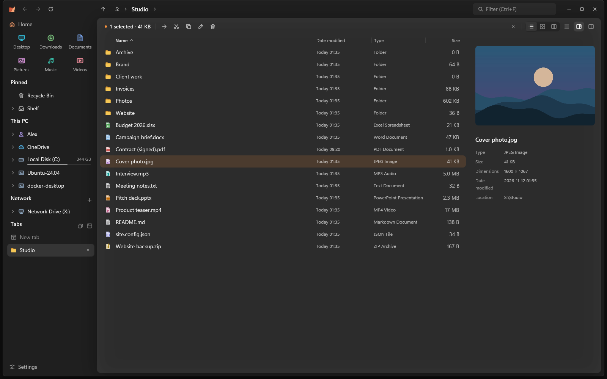
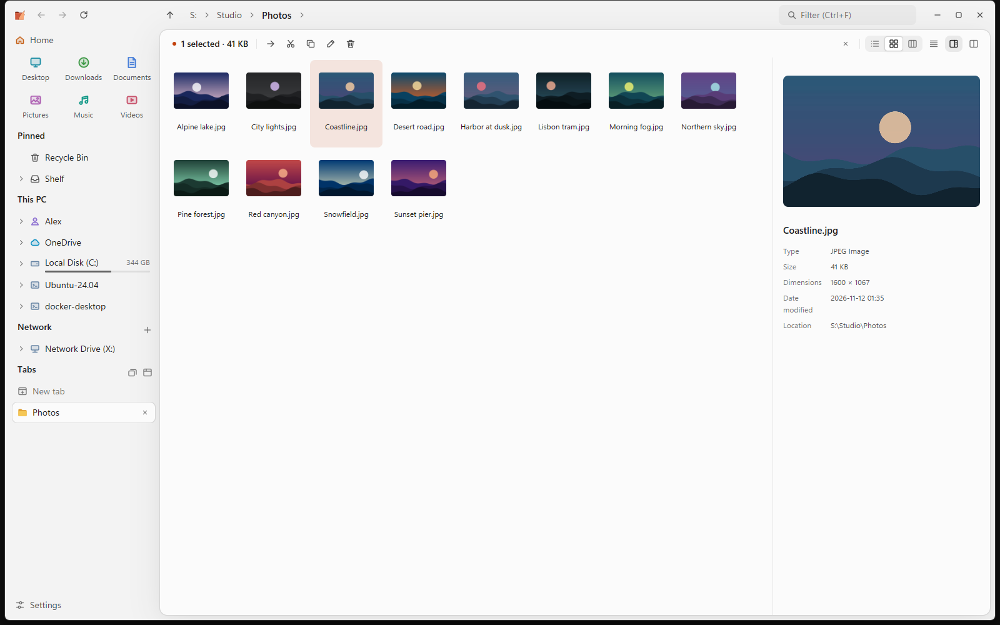
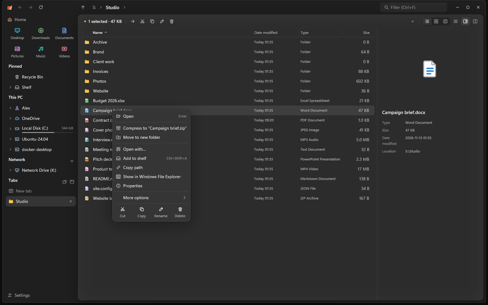
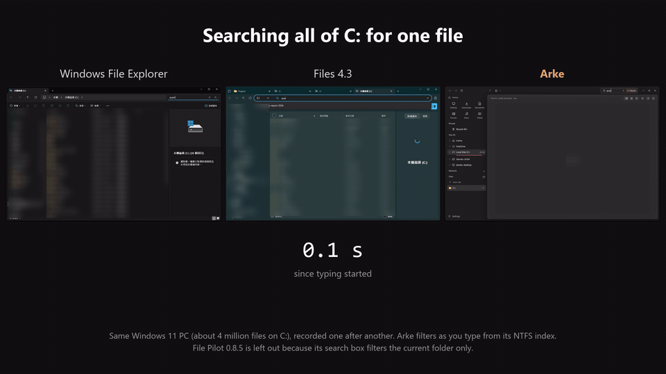

<p align="center"></p>

<h1 align="center">Arke</h1>

<p align="center"><b>永遠不卡的 Windows 檔案總管。</b><br>
GPU 繪製，用 Rust 寫成，只有一個小小的執行檔。</p>

<p align="center">
  <a href="https://github.com/Koimsurai/Arke/releases"></a>
  <a href="https://github.com/Koimsurai/Arke/actions/workflows/ci.yml"></a>
  
  <a href="LICENSE"></a>
</p>

<p align="center"><a href="README.md">English</a> · <a href="README.zh-CN.md">简体中文</a> · <b>繁體中文</b></p>

<p align="center"></p>

## 為什麼用 Arke

**不會卡住。** 列目錄、排序、縮圖、資料夾大小、搜尋、檔案操作全都在背景執行。連不上的網路位置、
十萬個檔案的資料夾，都不會讓你捲動、打字或切分頁時停住。

**什麼都找得到，而且馬上。** Arke 替本機磁碟維護一份檔名索引。裝了選用的背景服務後，它直接讀 NTFS
主檔案表，幾秒就能建好幾百萬個檔案的索引，並持續跟著變更記錄，打開時索引就是最新的。

**同時開很多資料夾也順手。** 分頁放在直式側邊欄，可以固定，也能整組存成工作區。任何分頁都能分成
左右兩個窗格，同步瀏覽或比對兩邊的內容；把檔案拖到分頁、釘選的資料夾或路徑欄的某一層，就直接放進那裡。

**不亂動你的系統。** Arke 沒有遙測。除了安裝選用的搜尋服務時由 Windows 登錄這個服務，只有在你開啟
「用 Arke 開啟資料夾」時才會寫登錄檔：它會把自己登錄為你這個 Windows 帳戶的資料夾開啟程式（只動 `HKEY_CURRENT_USER\Software\Classes`），關掉設定就全部還原。
其他程式加進右鍵選單的擴充在另一個行程執行，有問題的擴充不會讓 Arke 當掉。

## 功能

<table>
  <tr>
    <td width="50%"></td>
    <td width="50%"></td>
  </tr>
  <tr>
    <td>詳細資料、圖示、欄位三種檢視，淺色與深色主題，可換強調色與背景。</td>
    <td>Arke 自己的右鍵選單，速度快；完整的 Windows 選單也只差一下。</td>
  </tr>
</table>

**瀏覽**
- 詳細資料、圖示（大小可自由調整，Ctrl+滾輪）、欄位三種檢視。詳細資料裡可以就地展開資料夾、
  依多個欄位排序、調整欄位順序、顯示連結目標。
- 每個資料夾記得自己的檢視和排序。
- 分頁可以固定、存成工作區。分頁分成左右兩個窗格時共用一個預覽，可以同步瀏覽、比對資料夾。
- 拖曳時自動打開資料夾、用「暫存架」收集不同資料夾的檔案，首頁有最近的檔案、磁碟和網路位置。

**預覽**
- 可調寬度的預覽窗格與快速預覽（空白鍵）：圖片、PDF、Word、Excel、PowerPoint、有語法上色的
  文字與程式碼、Markdown、壓縮檔、資料夾。

**搜尋**
- 邊打邊搜尋，範圍可以是目前資料夾、含子資料夾或整台電腦，支援模糊比對和類型、大小、日期篩選
  （見[搜尋語法](#搜尋語法)）。
- 搜尋檔案內容，連 PDF 和 Office 文件裡的文字都找得到（目前資料夾與子資料夾）。
- 整台電腦的結果會把你常開的檔案和資料夾排在前面。

**檔案操作**
- 交給 Windows 的引擎，有進度、復原與重做。同一顆磁碟的工作會排隊、可以暫停，也能選擇複製後驗證，
  或交給 TeraCopy（實驗性）。
- 一次重新命名多個檔案、「移到新資料夾」；用右鍵拖曳或按住 Alt 放下時，可以選擇移動、複製或建立捷徑。

**位置**
- 網路位置：伺服器離線時馬上告訴你、顯示上次看到的內容；`\\伺服器` 會列出它的共用資料夾。
  也能連 SFTP 和 WebDAV（實驗性）。
- OneDrive 與其他雲端資料夾顯示同步狀態，預覽不會下載只在雲端的檔案。
- 壓縮檔：預覽與解開 zip、7z、tar（.gz、.xz、.bz2、.zst）與 RAR，壓縮成 zip。RAR 與
  xz／bzip2／zstd 的 tar 使用 Windows 內建的 libarchive（Windows 11 23H2 以上最完整）。

**Windows 整合**
- 在本機磁碟上，大資料夾直接進回收筒：兩萬個檔案約 0.25 秒，不必等 Windows 先逐一檢查每個檔案（原本約
  40 秒）。還原方式不變；沒把握的情況（網路磁碟、OneDrive、被佔用的檔案、群組原則）照樣交給 Windows。
  可以在設定關閉。
- 可選擇（實驗性）讓資料夾改用 Arke 開啟，取代檔案總管（其他程式開的資料夾也算），連瀏覽器的
  「在資料夾中顯示」、其他程式的「開啟檔案位置」都會接過來。它會把 Arke 登錄為你帳戶的資料夾開啟
  程式，關掉設定就還原。自己開的檔案總管（Win+E、工作列、開始功能表）仍是檔案總管，除非另外打開
  「Win+E 和檔案總管圖示也開 Arke」。
- 支援螢幕閱讀器，提供 x64 與 ARM64 版本（ARM64 還沒在真正的 ARM 電腦上測試過）；工作列的捷徑清單、
  安全退出 USB 磁碟、通知區域圖示、設定備份。介面有英文、簡體中文與繁體中文。

標示「實驗性」的功能已有自動化測試和本機測試伺服器驗證，但還沒有很多人實際使用，詳見
[更新記錄](CHANGELOG.md)。歡迎在 issue 回饋。

## 效能

<p align="center"></p>

| | Arke | 對照 |
| --- | --- | --- |
| 從零建好全碟索引（約 400 萬個檔案） | 約 10 秒，建完後約佔 130 MB 記憶體 | Everything 1.4.1：21 秒，約 400 MB |
| 在整個 C 槽找一個檔案 | 邊打字邊出結果 | Files 4.3：約 26 秒 · 檔案總管：30 秒後仍沒有結果* |
| 開一個有 10 萬個檔案的資料夾 | 約 0.7 秒，128 MB | File Pilot 0.8.5：1.0–1.4 秒，563 MB · 檔案總管：2–3 秒 |

\* 那個檔案放在 Windows Search 沒有建立索引的位置。如果在有索引的資料夾裡，檔案總管會快很多。

<details>
<summary>量測方式</summary>

同一台電腦：Intel i9-13900、64 GB 記憶體、Samsung 990 PRO NVMe、Windows 11（build 26200），
開著即時掃描的防毒軟體，所有程式都會被拖慢。檔案系統快取是熱的。

- **索引**：Arke 的搜尋服務讀 NTFS 主檔案表，用全新的設定檔；Everything 1.4.1 Lite 搭配它的服務，
  索引檔案大小與修改日期（預設值），先刪掉它的資料庫再重建。Arke 的數字來自 `arke --bench index`，
  Everything 的來自它的除錯記錄；記憶體是建完索引後的工作集。
- **搜尋**：每個程式都從 `C:\` 開始搜尋同一個檔名，計時從開始打字算起。檔案總管和 Files 在有索引
  的資料夾用 Windows Search，其他地方則要掃描磁碟。
- **資料夾**：用 `cargo run -p genfiles -- 100000` 產生 10 萬個檔案，每個程式都從冷啟動開啟；暖身一次
  後量三次取中位數，計到視窗畫面不再變化為止。File Pilot（免費測試版）只參加這一項，因為它還沒有全碟搜尋。

你的數字會不一樣。Arke 會把自己的計時寫在 `%LOCALAPPDATA%\Arke\arke.log`。

執行 `arke --bench index` 可以在你的電腦上量索引。

</details>

## 安裝

到 [Releases](https://github.com/Koimsurai/Arke/releases) 下載 `arke-<版本>.exe`（ARM64 電腦用 `arke-<版本>-arm64.exe`）直接執行。
只有一個執行檔，不用安裝程式也不用裝執行環境。設定存在 `%APPDATA%\Arke`。

想用安裝程式的話，`arke-<版本>-setup.exe`（ARM64 用 `arke-<版本>-arm64-setup.exe`）會幫你的帳號安裝，
不需要系統管理員權限；也可以選擇裝給所有使用者（Program Files）。它會加到開始功能表，並出現在
「設定 › 應用程式」，從那裡就能解除安裝。Arke 的更新方式不變。

用 [Scoop](https://scoop.sh) 安裝：

```bash
scoop bucket add arke https://github.com/Koimsurai/scoop-bucket
scoop install arke/arke
```

之後由 Scoop 負責更新（`scoop update arke`），Arke 不會自己更新。

目前還沒有程式碼簽章，第一次執行時 SmartScreen 可能會要你確認。

Arke 一天最多向 GitHub 檢查一次新版本，要你同意才會安裝（設定 › 關於）。

<details>
<summary><b>選用的背景服務</b></summary>

設定 › 搜尋 › 即時更新 可以安裝一個小的 Windows 服務（需要系統管理員同意）。它只讀檔案系統的
變更記錄與主檔案表，不讀檔案內容，也不回報其他使用者個人資料夾裡的名稱。在同一個地方可以移除。

</details>

## 搜尋語法

在搜尋框（Ctrl+F）輸入。下方的面板可以選範圍（目前資料夾、含子資料夾、整台電腦）和篩選，按 Tab
就能進到面板裡。名稱是模糊比對，`rprt` 也找得到 `report`。篩選也可以直接打，而且可以一起用：

| 篩選 | 例子 | 意思 |
| --- | --- | --- |
| `type:` | `type:image;video`、`type:folder` | 種類：資料夾、文件、圖片、音訊、影片、壓縮檔、程式碼、應用程式 |
| `ext:` 或 `*.` | `ext:pdf;docx`、`*.png` | 副檔名 |
| `size:` | `size:>10mb`、`size:1mb..10mb`、`size:large` | 檔案大小（`empty`、`tiny`、`small`、`medium`、`large`、`huge`、`gigantic` 和 Everything 相同） |
| `dm:` | `dm:今天`、`dm:7d`、`dm:2026-11`、`dm:>2026-01-01` | 修改日期：關鍵字、最近幾小時／天／週，或日期範圍 |
| `file:` / `folder:` | `folder: 照片` | 只找檔案或只找資料夾 |
| `資料夾\名稱` | `docs\report` | 在名稱符合 `docs` 的資料夾裡找 |
| `content:` | `content:"截止日期"` | 檔案裡的文字，包括 PDF 和 Office 文件（目前資料夾與子資料夾） |

只有篩選、沒有名稱時（`ext:pdf dm:7d`），結果依時間由新到舊排。日期關鍵字英文和介面語言都能用
（`today`、`今天`、`本週`…）。搜尋整台電腦時，常開的項目會排得比較前面；可以在 設定 › 搜尋 關掉或清除記錄。

## 鍵盤

<details>
<summary>快速鍵</summary>

| 按鍵 | 功能 |
| --- | --- |
| Ctrl+T | 前往資料夾（最近去過的位置、開著的分頁與路徑） |
| Ctrl+W · Ctrl+Shift+T | 關閉分頁（分割檢視時只關目前這一側）· 重新開啟關閉的分頁 |
| Ctrl+Tab · Ctrl+Shift+Tab · Ctrl+1…9 | 切換分頁 |
| Ctrl+Shift+S · Ctrl+Shift+D | 雙窗格：同步瀏覽 · 比較資料夾 |
| Tab · Alt+C · Alt+M | 分割檢視：切換窗格 · 把選取的項目複製 · 移動到另一側 |
| Ctrl+F · Ctrl+Shift+F · Ctrl+K | 搜尋目前資料夾 · 目前資料夾與子資料夾 · 整台電腦；Tab 進到範圍與篩選面板 |
| Ctrl+L · Alt+D | 編輯路徑 |
| Alt+← · Alt+→ · Alt+↑ | 上一頁 · 下一頁 · 上一層 |
| F5 · Ctrl+R | 重新整理 |
| 空白鍵 | 快速預覽 |
| F2 | 重新命名（多選時全部一起改） |
| Shift+F10 | 右鍵選單 |
| Ctrl+Shift+N | 新增資料夾 |
| Ctrl+C · Ctrl+X · Ctrl+V | 複製 · 剪下 · 貼上（和檔案總管共用） |
| Ctrl+Shift+C | 複製路徑 |
| Ctrl+Z · Ctrl+Y 或 Ctrl+Shift+Z | 復原 · 重做上一個檔案操作 |
| Ctrl+Shift+A | 加到暫存架 |
| Delete · Shift+Delete | 移到資源回收筒 · 永久刪除 |
| Ctrl+H | 顯示隱藏的項目 |
| Ctrl+Shift+1…4 · Ctrl+Shift+6 | 圖示，從超大到小 · 詳細資料檢視 |
| Ctrl+, | 設定 |

</details>

## 常見問題

<details>
<summary><b>AGPL 對我有影響嗎？我只是在家裡或公司用。</b></summary>

沒有。授權只在你散布修改過的 Arke（或透過網路提供它）時才有義務；單純使用，包括在公司內使用，
都沒有任何義務。

</details>

<details>
<summary><b>它會改動我的系統嗎？</b></summary>

你沒要求就不會。安裝選用的搜尋服務時（需要你同意），Windows 會把它登錄在
`HKEY_LOCAL_MACHINE\SYSTEM\CurrentControlSet\Services\ArkeIndex`。除此之外，唯一會動到登錄檔的是選用的
「用 Arke 開啟資料夾」：它把 Arke 登錄為你這個 Windows 帳戶的資料夾開啟程式，只寫 `HKEY_CURRENT_USER\Software\Classes` 底下：`Folder` 的 `open` 與 `explore` 動作
（shell 開任何資料夾都會啟動 Arke，包括瀏覽器、編輯器的「在資料夾中顯示」；Arke 不能顯示的，例如控制台，
會直接交給檔案總管），以及打開「Win+E 和檔案總管圖示也開 Arke」時的 Win+E 處理程式。原本的內容會備份到
`%APPDATA%\Arke\folder-handler-backup.json`，你關掉設定或執行 `arke --restore-explorer` 時原封不動放回去。
對登錄無法涵蓋的情況（例如 `explorer.exe /select,...`），Arke 還是會在執行時留意新開的檔案總管視窗。
有些電腦的 Windows 會把 Win+E 直接交給檔案總管、不經過登錄（Windows 從 2026 年底開始陸續推送這項改動），
在這些電腦上，Arke 於背景執行時會用鍵盤 hook 接手 Win+E：只在按住 Windows 鍵時看 E 這一個鍵，不記錄任何東西。設定存在 `%APPDATA%\Arke`，搜尋索引、記錄檔和下載的更新在
`%LOCALAPPDATA%\Arke`。「登入 Windows 時啟動」是在「啟動」資料夾放一個捷徑，「在開始功能表顯示 Arke」則是在開始功能表資料夾放一個捷徑。SFTP 和 WebDAV 位置的密碼只有在你
勾選「記住」時才會存進 Windows 認證管理員。只有選用的搜尋服務需要系統管理員同意。
如果你用安裝程式安裝，它會新增 Windows 在「設定 › 應用程式」列出的解除安裝項目（寫在你的帳號下，
裝給所有使用者時則寫在全機），只有裝給所有使用者時才需要系統管理員同意。

</details>

<details>
<summary><b>怎麼完整移除？</b></summary>

到 設定 › 關於 › **從這台電腦移除 Arke**。有裝搜尋服務的話會一併移除（這部分 Windows 會要求系統管理員
同意），也會移除開始功能表和「登入 Windows 時啟動」的捷徑、記住的 SFTP 與 WebDAV 密碼、工作列的捷徑清單、
`%LOCALAPPDATA%\Arke`、`%APPDATA%\Arke`（勾選「保留我的設定」就會留著），最後刪掉執行檔本身，並列出移除了
哪些項目。

在終端機或指令碼裡：`arke --uninstall`，可加 `--keep-settings`、`--quiet`（不跳對話框，只剩搜尋服務的系統
管理員提示）或 `--dry-run`（只列出會移除什麼）。用 Scoop 或 winget 安裝的話（winget 等 Arke 上架之後），`arke --uninstall` 會把執行檔
留給套件管理員，再用 `scoop uninstall arke` 或 `winget uninstall Koimsurai.Arke` 移除。

它也會關掉「用 Arke 開啟資料夾」，把原本的資料夾開啟程式還原。要自己手動移除的話，刪執行檔**之前**先關掉這個設定（或執行 `arke --restore-explorer`），資料夾才會繼續用檔案總管開。

</details>

<details>
<summary><b>為什麼 SmartScreen 或防毒軟體會警告？</b></summary>

目前還沒有程式碼簽章，新的未簽章執行檔在 SmartScreen 那裡沒有信譽。每個版本都附 SHA-256
校驗碼，發行說明裡也有執行檔的 VirusTotal 掃描結果，你也隨時可以從原始碼自己建置。0.1.0 之後的版本可以用
`gh attestation verify arke-<版本>.exe -R Koimsurai/Arke` 確認執行檔是由這個 repo 的發行流程建置的。

</details>

<details>
<summary><b>會有 Linux 或 macOS 版嗎？</b></summary>

目前還沒有。`crates/core` 大部分和平台無關，但讓 Arke 在 Windows 上這麼快的部分（主檔案表索引、
Shell 整合）都是 Windows 專用的。需要的話歡迎開 issue 說說你想要什麼。

</details>

## 從原始碼建置

需要 Windows 10 或 11、MSVC 建置工具與 rustup；Rust 版本寫在 `rust-toolchain.toml`，會自動安裝。

```bash
cargo arke                     # 執行
cargo arke -- "C:\Windows"     # 開啟指定資料夾
cargo nextest run --workspace  # 測試
cargo lint                     # clippy，和 CI 一樣嚴格
```

| 路徑 | |
| --- | --- |
| `crates/core` | 和平台無關的部分：列目錄、排序、篩選、搜尋、索引 |
| `crates/app` | GPUI 介面與 Windows 整合 |
| `crates/indexd` | 選用的背景服務（主檔案表與 USN 變更記錄） |
| `tools/xtask` | 發版工具：changeset、升版、打包、發佈 |

Arke 暫時不接受 PR，但非常歡迎用 [issue](https://github.com/Koimsurai/Arke/issues) 回報問題或提建議。
開發慣例與發版流程見 [CONTRIBUTING.md](CONTRIBUTING.md)。

## 致謝

Arke 建立在 Zed 編輯器的介面框架 [GPUI](https://github.com/zed-industries/zed/tree/main/crates/gpui)
和 [THIRD_PARTY_LICENSES.md](THIRD_PARTY_LICENSES.md) 列出的開源套件上。搜尋語法參考
[Everything](https://www.voidtools.com/)，外觀深受 [Files](https://files.community/) 影響，
側邊欄分頁則向 Arc 瀏覽器致敬。

名字來自希臘神話：Arke 是 Iris 的雙胞胎姊妹，兩人都是有翅膀的信使。

## 隱私

Arke 不會收集或傳送任何關於你或你的檔案的資料。它只會在這些時候連網：到 GitHub 檢查新版本
（一天最多一次，可在 設定 › 關於 關閉）、在你選擇安裝時下載新版，以及連到你自己開啟的網路共用、
SFTP 和 WebDAV 位置。

## 授權

[AGPL-3.0](LICENSE)。第三方授權聲明見 [THIRD_PARTY_NOTICES.md](THIRD_PARTY_NOTICES.md)，執行檔內所有相依套件的
完整授權條款見 [THIRD_PARTY_LICENSES.md](THIRD_PARTY_LICENSES.md)（也可以在 設定 › 關於 › 授權 查看）。
